# Kinetiqo

<!-- Badges: SonarCloud, Docker Hub pulls, Python version, Release, Dependabot, Snyk -->
[](https://sonarcloud.io/project/overview?id=lhotakj_kinetiqo)
[](https://hub.docker.com/r/kinetiqo/web)
[](https://www.python.org/)
</img>

</img>

**Kinetiqo** is a self-hosted personal fitness data warehouse that synchronizes workout activities and high-resolution sensor streams from the **Strava API** into a relational database (**PostgreSQL**, **MySQL/MariaDB**, or **Firebird**). It provides complete data ownership, deep athletic telemetry analysis, visual infographics, and an evidence-based **Model Context Protocol (MCP)** server connecting AI assistants directly to your athletic history.

> Full project documentation is available at [kinetiqo.org](https://kinetiqo.org)

---

## Visual Showcase

| [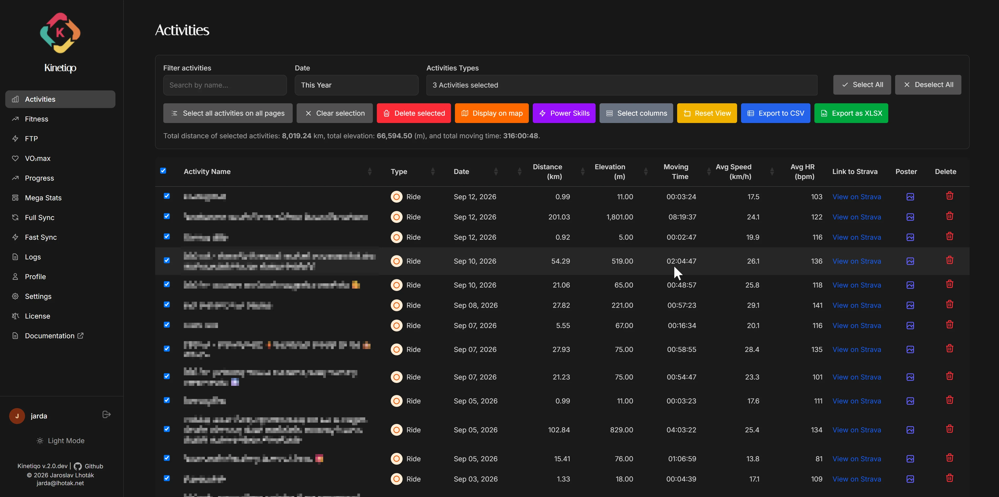](docs/activities.md)<br/>**[Activity Sync & Data Grid](docs/activities.md)**<br/>Searchable DataTables 2.x grid with bulk actions, CSV/XLSX export, and local storage state persistence | [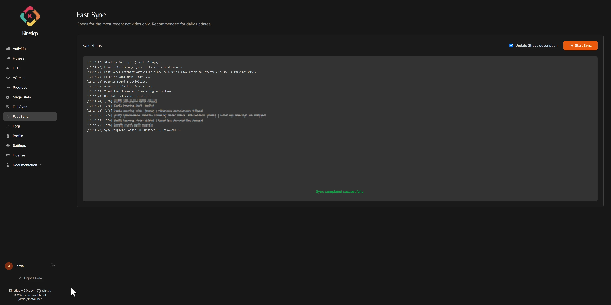](docs/sync.md)<br/>**[Real-Time Sync Engine](docs/sync.md)**<br/>Live Server-Sent Events (SSE) progress bar streaming incremental sync and full history audit status | [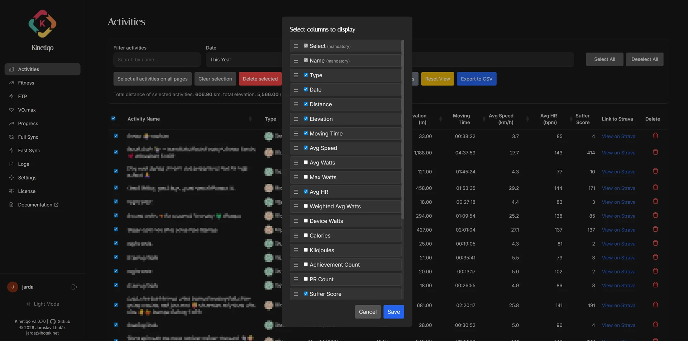](docs/activities.md)<br/>**[Column Visibility & Reorder](docs/activities.md)**<br/>Drag-and-drop column reordering with persistent visibility toggles across sessions |
|---|---|---|
| [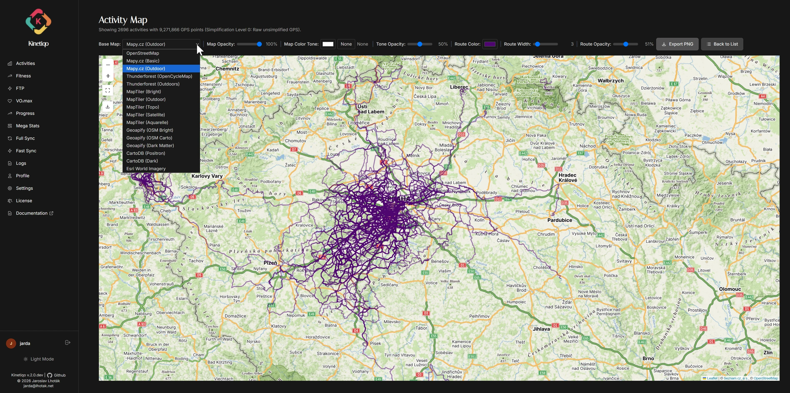](docs/maps.md)<br/>**[Interactive Canvas Maps](docs/maps.md)**<br/>Leaflet Canvas rendering for GPS tracks with 16 basemaps across 7 tile providers and local OSM proxy | [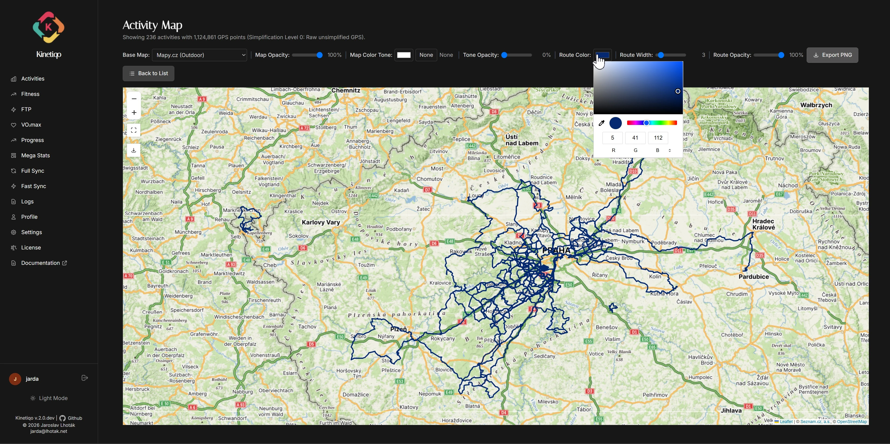](docs/maps.md)<br/>**[Route Polyline Styling](docs/maps.md)**<br/>Persistent route color, stroke weight, opacity, and tone controls for multi-stage activities | [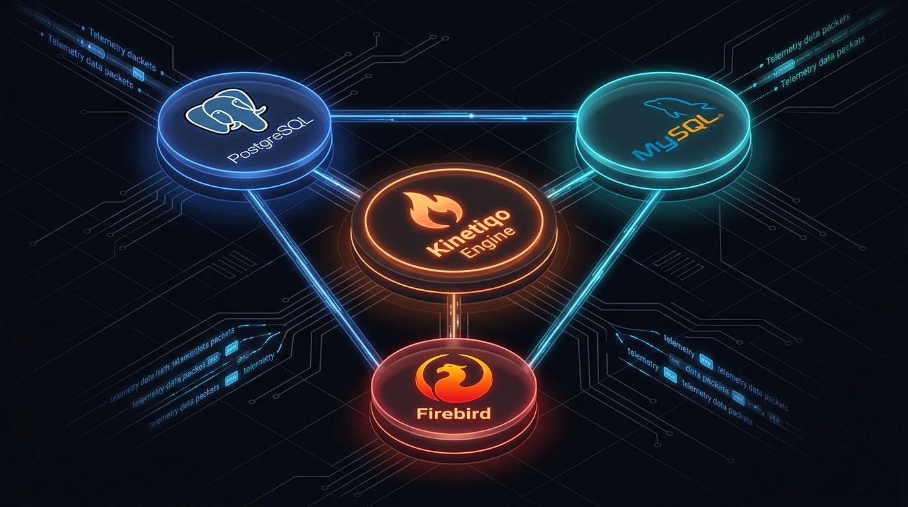](docs/DATABASE.md)<br/>**[Multi-DB Zero-ORM Warehouse](docs/DATABASE.md)**<br/>Direct parameterized SQL architecture supporting PostgreSQL 12+, MySQL 8 / MariaDB, and Firebird |
| [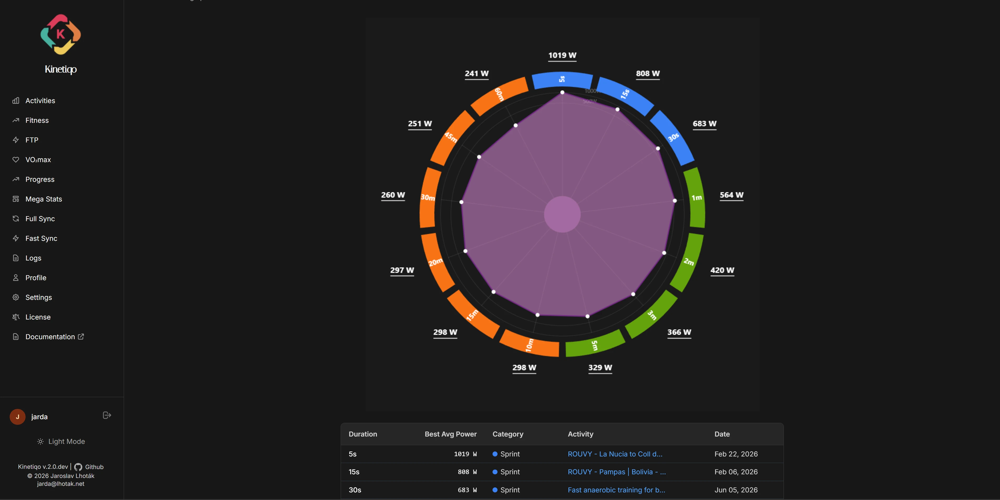](docs/power.md)<br/>**[Power Skills Analysis](docs/power.md)**<br/>Radar spider chart of peak average power efforts across intervals from 5 seconds to 1 hour | [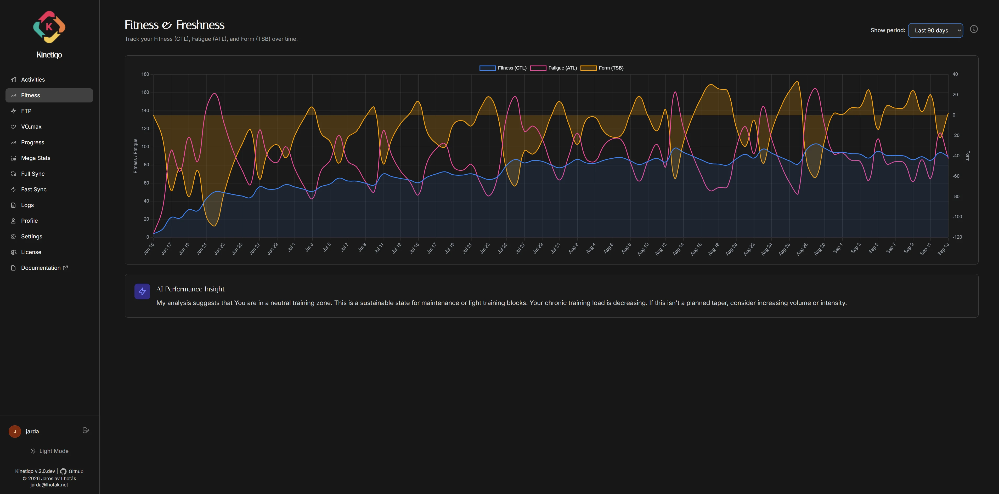](docs/fitness.md)<br/>**[Fitness & Freshness (CTL/ATL/TSB)](docs/fitness.md)**<br/>Banister impulse-response model for Chronic Load (Fitness), Fatigue, and Form curves | [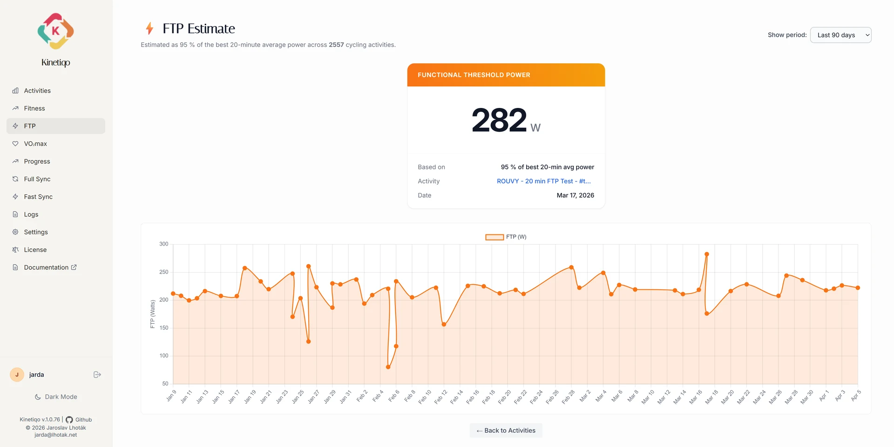](docs/ftp-vo2max.md)<br/>**[FTP Estimation Trends](docs/ftp-vo2max.md)**<br/>Automated 95% 20-min threshold power tracking with per-ride historical trend |
| [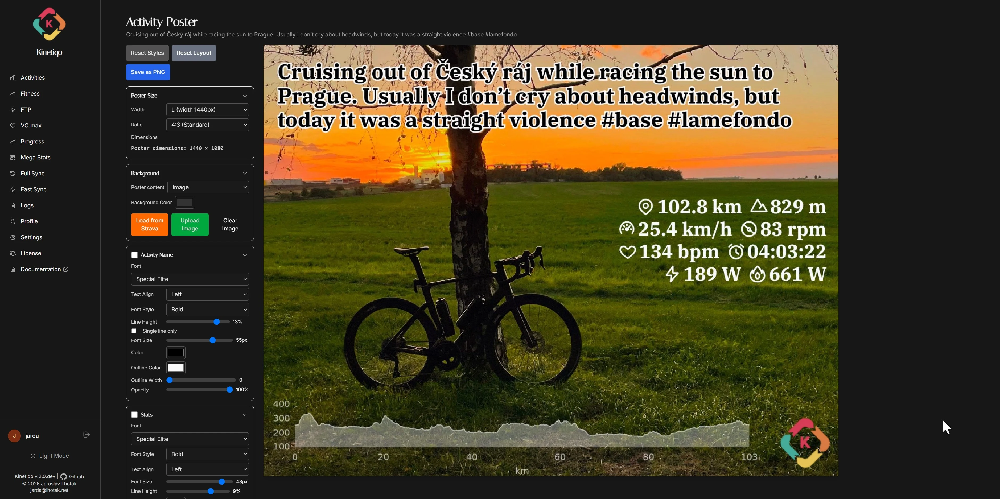](docs/poster.md)<br/>**[WYSIWYG Poster Builder](docs/poster.md)**<br/>Draggable layouts, built-in photo editor, custom typography, elevation profiles, and Playwright high-res PNG export | [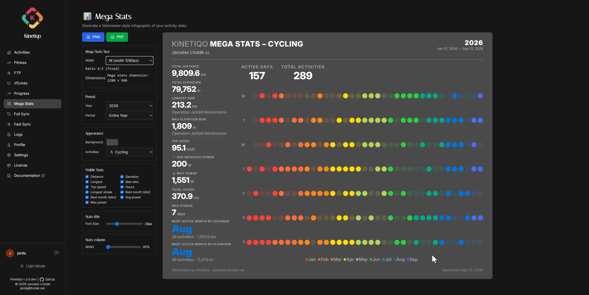](docs/mega-stats.md)<br/>**[MEGA Stats Infographic](docs/mega-stats.md)**<br/>Veloviewer-style yearly infographic with 365-day calendar heatmaps & vector PDF/PNG export | [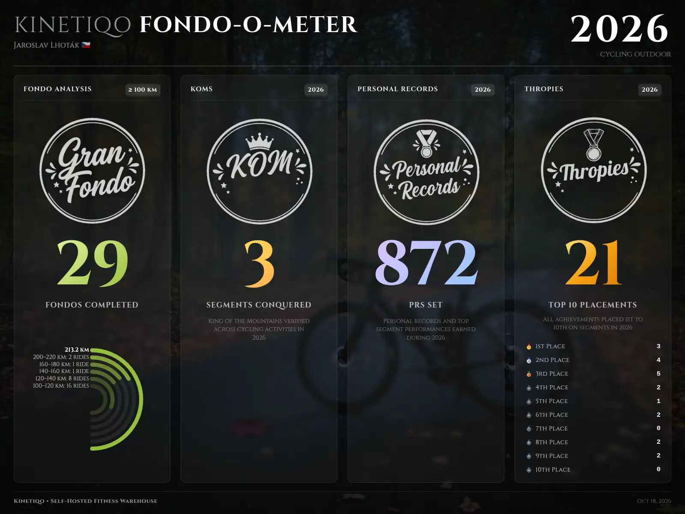](docs/FONDO_O_METER.md)<br/>**[Fondo-o-meter Infographic](docs/FONDO_O_METER.md)**<br/>Concentric radial milestone rings with sport thresholds, Gran Fondo badges, verified KOMs, and vector PDF/PNG export |
| [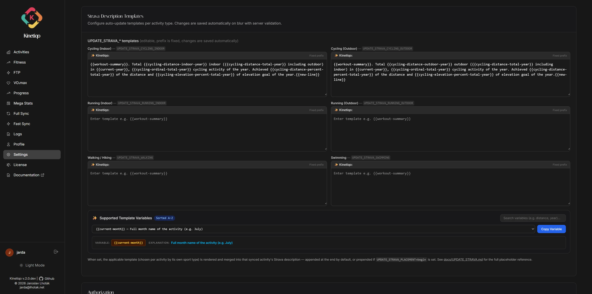](docs/UPDATE_STRAVA.md)<br/>**[Strava Auto-Descriptions](docs/UPDATE_STRAVA.md)**<br/>150+ placeholders, workout summaries, power zones, and milestone triggers (🎉) | [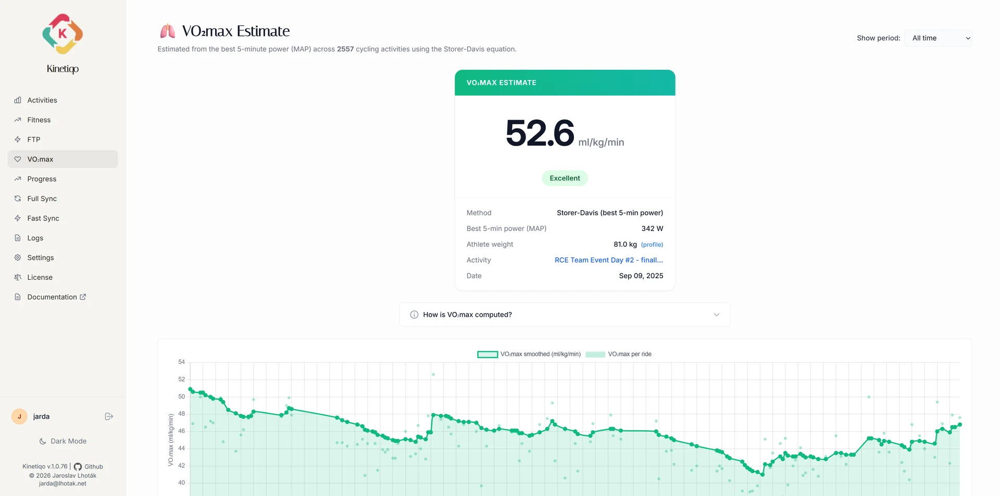](docs/ftp-vo2max.md)<br/>**[VO₂max Trends](docs/ftp-vo2max.md)**<br/>Townsend 5-min MAP and Coggan FTP-based VO₂max estimates with fitness classification bands | [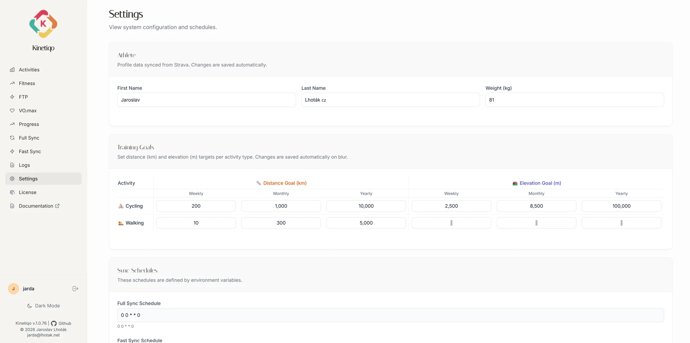](docs/goals.md)<br/>**[Athlete Goals & Settings](docs/goals.md)**<br/>Weekly, monthly, and yearly distance/elevation goals with real-time description template validation |

---

## Feature Catalog & Documentation Hub

Every capability in Kinetiqo is documented in detail in the [`docs/`](docs/) directory:

| Feature | Detailed Guide | Description |
|---|---|---|
| **Activity Grid** | [docs/activities.md](docs/activities.md) | Searchable DataTables 2.x table, column reordering, bulk actions, CSV/XLSX export, and trophies. |
| **Interactive Maps** | [docs/maps.md](docs/maps.md) | 16 basemaps across 7 providers, Canvas rendering, GPS simplification, OSM tile proxy, and route styling. |
| **Fitness & Freshness** | [docs/fitness.md](docs/fitness.md) | Banister impulse-response model for CTL (Fitness), ATL (Fatigue), and TSB (Form) curves. |
| **Power Skills** | [docs/power.md](docs/power.md) | Spider chart of peak power efforts (5s to 1h), Mean Maximal Power curves, and Normalized Power. |
| **FTP & VO₂max** | [docs/ftp-vo2max.md](docs/ftp-vo2max.md) | Automated 95% 20-min power FTP estimation and Townsend 5-min MAP VO₂max classification trends. |
| **Activity Goals** | [docs/goals.md](docs/goals.md) | Weekly, monthly, and yearly distance and elevation targets with progress and pacing tracking. |
| **Activity Posters** | [docs/poster.md](docs/poster.md) | WYSIWYG poster builder with photo editor, aspect ratios (4:3, 16:9, 1:1), elevation chart, and PNG export. |
| **Activity Detail** | [docs/activity-detail.md](docs/activity-detail.md) | Single-workout infographic with Leaflet map, multi-stream telemetry chart, AI Coach analysis, 5 analytical cards, and PNG/PDF export. |
| **MEGA Stats** | [docs/mega-stats.md](docs/mega-stats.md) | Yearly infographic with 365-day calendar heatmaps, responsive full-width layout, and vector PDF/PNG export. |
| **Fondo-o-meter** | [docs/FONDO_O_METER.md](docs/FONDO_O_METER.md) | Dynamic concentric radial milestone rings, sport thresholds, verified KOMs, PRs, and export. |
| **Weather Enrichment** | [docs/weather.md](docs/weather.md) | Historical hourly weather, temperature ranges, wind vectors, gusts, and route headwind calculations. |
| **Strava Auto-Updates** | [docs/UPDATE_STRAVA.md](docs/UPDATE_STRAVA.md) | Custom description template engine with 150+ placeholders, workout summaries, and power zones. |
| **In-App AI Chat** | [docs/AI.md](docs/AI.md) | Conversational endurance coach supporting Google Gemini and OpenRouter (multi-provider). |
| **Model Context Protocol** | [docs/MCP.md](docs/MCP.md) | FastMCP server exposing 32+ evidence-based tools to Antigravity, Claude Desktop, Cursor, and OpenClaw. |
| **Database Architecture** | [docs/DATABASE.md](docs/DATABASE.md) | Multi-DB zero-ORM repository pattern, driver benchmarks, and production tuning for PG, MySQL, and Firebird. |
| **Sync Engine** | [docs/sync.md](docs/sync.md) | 4-phase ETL pipeline, Fast vs. Full sync, normalized status tags, HTMX + SSE progress, and rate-limit safety. |
| **CLI Reference** | [docs/cli.md](docs/cli.md) | Command-line interface reference for `web`, `sync`, `mcp`, `benchmark`, `flightcheck`, and `scan-trophies`. |
| **Usage & Deployment** | [docs/usage.md](docs/usage.md) | Production deployment guide for Docker, Docker Compose, native Python, and complete `.env` configuration. |

---

## Quick Start

### 1. Docker Compose (Recommended)

Create `docker-compose.yml`:

```yaml
services:
  db:
    image: postgres:16-alpine
    restart: unless-stopped
    environment:
      POSTGRES_DB: kinetiqo
      POSTGRES_USER: kinetiqo
      POSTGRES_PASSWORD: ChangeThisDatabasePassword123!
    volumes:
      - pgdata:/var/lib/postgresql/data
    healthcheck:
      test: ["CMD-SHELL", "pg_isready -U kinetiqo -d kinetiqo"]
      interval: 10s
      timeout: 5s
      retries: 5

  web:
    image: kinetiqo/web:latest
    restart: unless-stopped
    depends_on:
      db:
        condition: service_healthy
    ports:
      - "4444:4444"
    env_file:
      - .env
    volumes:
      - app_data:/app/data

volumes:
  pgdata:
  app_data:
```

Provide your Strava credentials in `.env`:

```env
STRAVA_CLIENT_ID=your_client_id
STRAVA_CLIENT_SECRET=your_client_secret
STRAVA_REFRESH_TOKEN=your_refresh_token
STRAVA_ATHLETE_ID=your_athlete_id
SECRET_KEY=generate_a_random_32_character_secret_key
DATABASE_TYPE=postgresql
DB_HOST=db
DB_NAME=kinetiqo
DB_USER=kinetiqo
DB_PASSWORD=ChangeThisDatabasePassword123!
# Optional: Historical activity weather (1,000 free records/day from visualcrossing.com/weather-api)
VISUAL_CROSSING_API_KEY=
```

Launch the stack:
```bash
docker compose up -d
```
Access the dashboard at `http://localhost:4444`.

*For detailed configurations including MySQL, Firebird, and standalone Docker Run commands, see [docs/usage.md](docs/usage.md).*

---

### 2. Native Python Setup

```bash
# Clone and enter repository
git clone https://github.com/lhotakj/kinetiqo.git
cd kinetiqo

# Create virtual environment (Python 3.14+)
python -m venv .venv
source .venv/bin/activate  # Windows: .venv\Scripts\Activate.ps1

# Install requirements & Playwright browser
pip install -r requirements.txt
playwright install chromium-headless-shell

# Configure .env and launch web dashboard
cp .env.example .env
python src/kinetiqo.py web
```

---

## Command-Line Interface (CLI)

Kinetiqo includes a Click-powered CLI (`src/kinetiqo.py`) for management and automation:

```bash
# Start Flask web server (default port 4444)
python src/kinetiqo.py web

# Execute fast incremental synchronization
python src/kinetiqo.py sync --fast

# Execute full historical sync audit
python src/kinetiqo.py sync

# Retrigger AI description agents during sync
python src/kinetiqo.py sync --fast --retrigger-ai-agents

# Run FastMCP server over STDIO or SSE
python src/kinetiqo.py mcp --transport sse --port 8000

# Run pre-flight healthcheck (database, tokens, browser)
python src/kinetiqo.py flightcheck

# Benchmark database driver performance
python src/kinetiqo.py benchmark --scope 365
```

*For complete CLI parameter documentation, see [docs/cli.md](docs/cli.md).*

---

## Model Context Protocol (MCP) Server

Kinetiqo includes a built-in **FastMCP Server** connecting your local fitness data directly to AI assistants (**Google Antigravity IDE**, **Claude Desktop**, **Cursor**, **Windsurf**, and **OpenClaw**).

- **Privacy-First**: Sensor streams and GPS coordinates stay entirely local.
- **Evidence-Based Toolset**: Exposes 32 read-only tools (and up to 36 tools with gated mutation controls) covering activity searches, power curves, recovery turnaround, VO₂max trends, and Playwright infographic visual exports.
- **Transports**: STDIO (local process) or FastMCP SSE over HTTP (`http://0.0.0.0:8000/sse`).

*To configure your AI desktop client, see [docs/MCP.md](docs/MCP.md).*

---

## Architecture & Technology Stack

| Component | Technology | Version | Description |
|---|---|---|---|
| **Runtime** | Python | 3.14+ | Dockerized on `python:3.14-slim` |
| **Web Framework** | Flask[async] + Gunicorn | 3.1.3 / 26.2.0 | Async-enabled WSGI architecture with Server-Sent Events |
| **Frontend Styling** | Tailwind CSS | v4 (4.3.3) | Compiled standalone stylesheet (`download-tailwind.sh`) |
| **Interactive Grid** | DataTables + Buttons + ColReorder | 2.3.7 / 3.2.6 / 2.1.2 | Client-side reactive grid with localStorage state persistence |
| **Maps** | Leaflet.js | 1.9.4 | Canvas renderer with 16 basemaps and server-side tile proxy |
| **Visual Exports** | Playwright | ≥1.64.0 | Server-side headless Chromium rendering for pixel-perfect posters/PDFs |
| **AI Protocol** | FastMCP | 1.30.0 | Model Context Protocol server exposing 35+ fitness telemetry tools |
| **Database Drivers** | psycopg2, mysql-connector, firebird-driver | Latest | Direct parameterized raw SQL — **Zero ORM** overhead |

*For deep architectural design and benchmark analysis, see [docs/DATABASE.md](docs/DATABASE.md) and [docs/sync.md](docs/sync.md).*

---

## License, Map & Weather Attributions

This project is licensed under the terms of the MIT License. See `LICENSE` for details.

Map tiles and cartography are provided by:
- **OpenStreetMap**: © [OpenStreetMap contributors](https://www.openstreetmap.org/copyright) (ODbL).
- **Mapy.cz**: © [Seznam.cz, a.s.](https://mapy.cz/) and OpenStreetMap contributors.
- **Thunderforest**: Maps © [Thunderforest](https://www.thunderforest.com/), Data © OpenStreetMap contributors.
- **MapTiler**: © [MapTiler](https://www.maptiler.com/), © OpenStreetMap contributors.
- **Geoapify**: Powered by [Geoapify](https://www.geoapify.com/), © OpenStreetMap contributors.
- **CARTO**: © [CARTO](https://carto.com/), © OpenStreetMap contributors.
- **Esri**: World Imagery sources: Esri, Maxar, Earthstar Geographics, and the GIS User Community.

Historical activity weather data is provided by:
- **Visual Crossing**: Powered by [Visual Crossing](https://www.visualcrossing.com/) Timeline Weather API. The free plan provides **1,000 free records per day** (resets daily at 00:00 UTC, no credit card required). Create your free API key at [visualcrossing.com/weather-api](https://www.visualcrossing.com/weather-api) and configure via `VISUAL_CROSSING_API_KEY`. See [docs/weather.md](docs/weather.md) for complete details.
