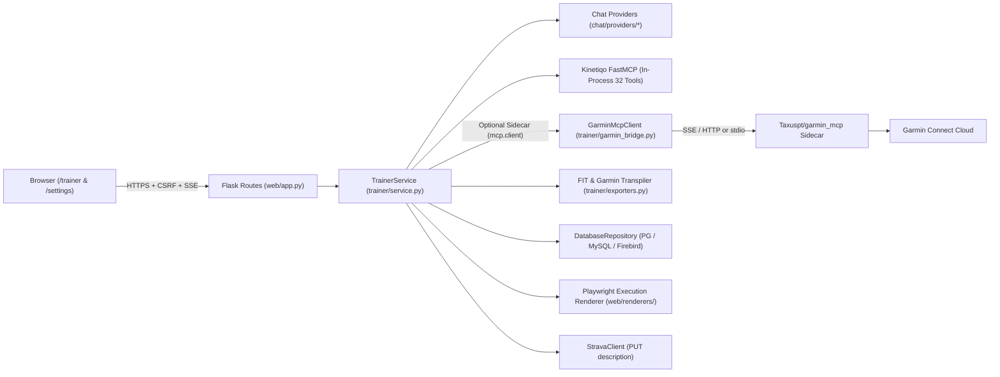
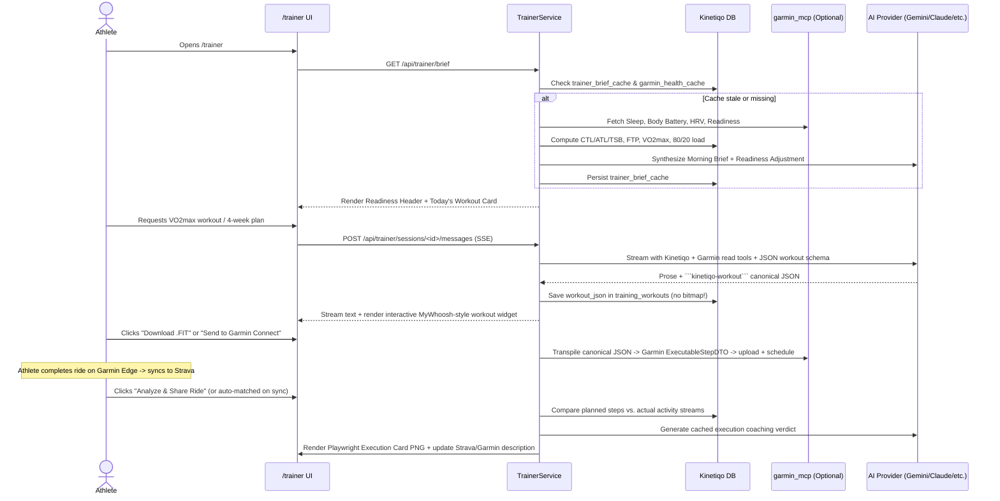
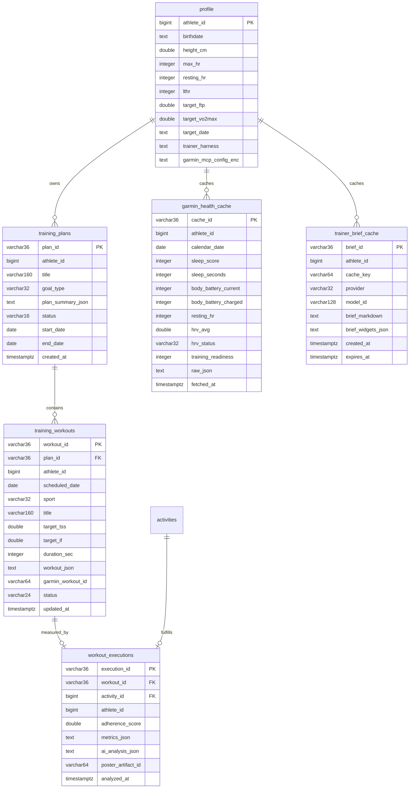

# Kinetiqo AI Trainer — Concept, Research & Technical Architecture Plan

> **Status:** Concept & Architecture Proposal (Pending Decision Sign-off)  
> **Target Feature:** `AI Trainer` (`/trainer` route + `/settings` & `/profile` integrations)  
> **Primary Goals:** Data-grounded adaptive coaching (Cycling, Running, Swimming), VO₂max & FTP progression, Garmin Connect MCP readiness ingestion (`Sleep`, `Body Battery`, `HRV`, `Training Readiness`), MyWhoosh-inspired structured workout visualization, Garmin Edge `.fit` & Garmin Connect workout export, and post-ride execution analysis & sharing.  
> **Codebase Alignment:** Designed specifically for Kinetiqo's Python 3.14, Flask, FastMCP (`mcp==1.30.0`), multi-provider Chat layer, Playwright renderers, and zero-ORM 3-backend database architecture (PostgreSQL, MySQL, Firebird).

---

## 1. Market & Platform Research

### 1.1 Leading AI Endurance Coaching Platforms (Cycling, Running, Swimming)

| Platform | Primary Sports | Adaptive Engine & Physiology | Readiness & Biometrics | Workout Execution & Outdoors | AI Conversational UX |
|---|---|---|---|---|---|
| **TrainerRoad** | Cycling (primary), basic Triathlon | **AI FTP Detection** (eliminates frequent ramp tests), **Adaptive Training** progression levels, **Red Light / Green Light** fatigue warning | Training load & post-ride RPE surveys | ERG-focused indoor workouts + outdoor equivalents via Garmin/Wahoo | No conversational LLM coach |
| **Athletica.ai** | Cycling, Running, Swimming, Triathlon | Science-led load management (CTL/ATL/TSB + HIIT Science), dynamic rescheduling when sessions are missed or commutes added | Daily recovery & HRV integration (Garmin, COROS) | Pushes structured sessions to Garmin/Wahoo | Advisory AI coach chat (guardrailed by physiology engine) |
| **Humango** | Triathlon (Swim/Bike/Run) | Generative-AI plan builder + dynamic calendar re-planning around life/work constraints | Deep **Garmin Sleep, HRV, Fatigue & Body Battery** ingestion | Syncs structured workouts to Garmin | **"Hugo"** conversational AI assistant |
| **Xert** | Cycling | **MPA (Maximal Power Available)** & **W' / HIE** modeling, **Forecast AI** goal-date peaking, **Magic Bucket** unstructured outdoor target | Strain & recovery tracking | Real-time Garmin Connect IQ data fields + structured exports | Algorithmic advisor |
| **JOIN.cc** | Cycling | Real-life flexible scheduling (shortens/shifts workouts dynamically based on availability) | Post-ride RPE & availability input | Terrain-friendly outdoor intervals + **Workout Compliance Score** | Structured UI prompts |

**Key Takeaway for Kinetiqo:** No single platform combines **full data ownership**, **transparent multi-provider LLMs** (Gemini, Claude, OpenRouter, local Ollama, etc.), **Garmin wellness readiness** (Body Battery + Sleep + HRV), **MyWhoosh-caliber visual interval clarity**, and **customizable coach system prompts ("harness")**. Kinetiqo already has ~80% of the telemetry & AI plumbing (`/chat`, 32 MCP tools, Playwright renderers, Strava sync, Banister CTL/ATL/TSB, Coggan/Storer-Davis VO₂max).

---

### 1.2 MyWhoosh Training Plans & Workout Anatomy

Research into MyWhoosh's coaching ecosystem (built with WorldTour coaches such as Kevin Poulton & Javier Sola) and inspection of MyWhoosh's workout UI (e.g., *2min Anaerobic Capacity*) reveal clear design patterns we should adopt:

1. **Macro-Periodized Plan Architecture (20-Week / 5-Phase Model):**
   - *Early Base* (aerobic foundation, Zone 2 volume) → *Late Base* (aerobic durability + tempo) → *Early Build* (Sweet Spot / Threshold) → *Late Build* (VO₂max & Anaerobic Capacity) → *Preparation* (taper & peak).
   - **Smart Workout Selector:** Filters or adapts daily sessions using *sleep quality, muscle soreness, recovery state, available time*, and *training focus* (Target FTP, Climbing, Endurance, VO₂max).
2. **7-Zone Coggan Power Color System:**
   - **Z1 Active Recovery (`< 55% FTP`):** Slate/Grey (`#9ca3af`)
   - **Z2 Endurance (`56–75% FTP`):** Cyan/Blue (`#0ea5e9`)
   - **Z3 Tempo (`76–90% FTP`):** Emerald Green (`#22c55e`)
   - **Z4 Sweet Spot / Threshold (`91–105% FTP`):** Amber/Yellow (`#eab308`)
   - **Z5 VO₂max (`106–120% FTP`):** Orange (`#f97316`)
   - **Z6 Anaerobic Capacity (`121–150% FTP`):** Red (`#dc2626`)
   - **Z7 Neuromuscular / Sprint (`> 150% FTP`):** Deep Crimson (`#991b1b`)
3. **Visual & Functional Anatomy of a Workout Card:**
   - **Left Interval Rail:** Scrollable color-coded pill list (`Ramp Up 3:30`, `156 W 30 sec`, `354 W 30 sec`, etc.) with optional cadence pill (`95–105 rpm`).
   - **Right Power-Profile Chart:** Vertical bars proportional to `% FTP` and width proportional to duration, supporting **flat blocks**, **sloped linear ramps**, and **multi-zone progressive ramps** (gradient/banded Yellow→Orange→Red bars).
   - **Header Metadata:** Workout Title, **IF** (Intensity Factor), **TSS** (Training Stress Score), Total Duration (`30:00`), Author/Coach attribution, and Coaching Brief.
   - **Interactive FTP Stepper (`FTP [-] 282 [+]`):** Adjusting FTP instantaneously recalculates all target wattages and chart Y-axis reference lines without altering the underlying `% FTP` workout template.
   - **Primary Actions:** `Schedule` (add to Kinetiqo plan calendar + optional Garmin calendar) and `Export / Push` (Download `.FIT` or Send to Garmin Connect).

---

## 2. Product Concept: "AI Trainer"

### 2.1 Navigation & Page Entry (`/trainer`)

- Add **`AI Trainer`** to the left navigation sidebar in `src/kinetiqo/web/templates/base.html` directly below `AI Chat`.
- **Two-Mode Unified Workspace** (looks and feels like `/chat`, using the same Tailwind/dark-mode design system, provider/model selector, streaming SSE, Chart.js ```chart``` blocks, and Markdown rendering):
  1. **Agentic Morning Brief & Status Header (Auto-Loaded on Page Open):**
     - Immediately answers *"How do I stand today?"* and *"What is my near-term plan?"* using **cached** analysis (no redundant LLM calls on page refresh).
     - Displays compact readiness KPI pills:
       - **Kinetiqo Physiology:** `CTL` / `ATL` / `TSB (Form)` / `ACWR`, current **FTP** vs. goal (`255 W → 290 W`), current **VO₂max** vs. goal (`49.2 → 55.0`).
       - **Garmin Readiness (when connected):** `Sleep Score & Hours`, `Body Battery (Morning / Current)`, `HRV Status`, `Resting HR`, `Garmin Training Readiness`.
     - Displays **Today's / Next Scheduled Workout** mini-card with a miniature MyWhoosh power bar preview and action buttons: *View Workout*, *Adapt to Today's Fatigue*, *Send to Garmin*, *Download .FIT*.
  2. **Interactive AI Coach Thread + Workout Canvas:**
     - Conversational coaching below/beside the brief where the AI can **generate structured workouts** (rendered inline as rich interactive MyWhoosh-style cards, not just raw Markdown tables), **build multi-week training blocks**, **re-plan around missed rides or poor sleep**, and **analyze completed rides**.

### 2.2 Editable Coach Harness (First-Time Prefill & Live Hydration)

- Provide a collapsible **"Coach Harness & Athlete Goals"** panel (or slide-over drawer) persisted in DB per athlete.
- **Important Codebase Gap Found:** Currently, the `profile` table (`src/kinetiqo/db/schema.py`) stores `athlete_id`, `first_name`, `last_name`, `weight`, `ftp`, etc., **but does not yet store `age` / `birthdate`**, even though `_format_athlete_profile()` in `src/kinetiqo/chat/service.py` already has logic to compute age from `age` or `birthdate`. Phase 1 extends `profile` cleanly with `birthdate` (or `age`), `height_cm`, `max_hr`, `resting_hr`, `lthr`, `target_ftp`, `target_vo2max`, `target_date`, and `primary_sports`.
- **First-Time Prefilled Harness Template** (resolved dynamically when fields exist, leaving clear editable prompts where user goals are set):

```text
You are a personal endurance coach for {{name}}. My age is {{age}}, my weight is {{weight}} kg, and my last measured FTP is {{ftp}} W (estimated VO2max: {{vo2max}} ml/kg/min).
My usual sport activities are mostly cycling, with occasional hiking and swimming. I want to focus primarily on my cycling performance.
My goal is to reach {{target_vo2max}} VO2max and {{target_ftp}} W FTP by {{target_date}}.
You have access to all my historical Strava activities in Kinetiqo via MCP tools, and (when configured) my Garmin Connect sleep, Body Battery, HRV, and readiness data via Garmin MCP.
Adapt my weekly plan dynamically based on fatigue (TSB/ACWR), sleep quality, Body Battery, and schedule constraints. Include cadence targets on structured cycling intervals.
```

- Users can freely customize this harness (e.g., adding injury notes, available training days/hours, indoor smart trainer vs. outdoor climb preferences, target events).

### 2.3 High-Value Features Specifically for Raising VO₂max & FTP

Beyond standard chat and plan generation, these targeted analytics & coaching features support an athlete chasing `55 VO₂max` and `290 W FTP`:

1. **VO₂max & FTP Goal-Gap Simulator ("Path to 290 W / 55 VO₂max"):**
   - Reuses `src/kinetiqo/web/vo2max.py` (`COGGAN_FACTOR = 14.73`, Storer-Davis 5m MAP `(10.8 * MAP / kg) + 7`) to show the exact W/kg bridge needed (e.g., at 75 kg, 290 W = `3.87 W/kg` → Coggan VO₂max `~57.0`; or if weight drops by 2 kg, target FTP for 55 VO₂max adjusts accordingly).
   - Tracks rolling 4-week **5-min MAP** and **20-min MMP** progression curves alongside weekly **Time-in-Zone 5 (106–120% FTP)** and **Zone 4/Sweet Spot**.
2. **80/20 Polarized Intensity Distribution Guardrail:**
   - Computes weekly **Seiler 3-Zone** (Low `<LT1/Z2`, Tempo/Threshold `Z3–Z4`, High `Z5+`) distribution from local `streams` so the AI flags "grey-zone fatigue traps" (too much Z3 junk mileage, not enough Z2 base + sharp Z5 VO₂max).
3. **Readiness-Gated Auto-Scaling ("Morning Check-In"):**
   - Deterministic readiness heuristic combining Kinetiqo TSB/ACWR + Garmin Body Battery / Sleep / HRV:
     - *Green (`Readiness ≥ 75`)*: Execute prescribed VO₂max / Threshold session at 100% target.
     - *Amber (`Readiness 50–74`)*: AI offers 1-click **"Scale Intensity (-5% to -10%)"** or swap to Sweet Spot / Tempo.
     - *Red (`Readiness < 50` or Garmin Sleep < 55 / TSB < -25)*: AI recommends swapping hard intervals for Z1/Z2 recovery spin or rest day, shifting the key session forward.
4. **W'bal & Interval Repeatability Advisor:**
   - Estimates `CP` and `W'` (anaerobic work capacity) from the athlete's power curve (`kinetiqo_calculate_power_curve`), helping the trainer choose the right VO₂max format for *that athlete* — e.g., **4×4m @ 112% FTP** vs. **30/30s micro-intervals (Billat)** vs. **Ronnestad 3×13×(30s/15s)** when longer 4-minute intervals fail due to low W' or high fatigue.
5. **Multisport Fatigue Accounting (Hiking & Swimming):**
   - Hiking and swimming rarely have power meters, so power-only TSS misses their load. Use HR-based `hrTSS` / Strava `suffer_score` + duration weighting to ensure heavy weekend hikes or swim blocks properly modulate Monday's cycling recovery.
6. **Scheduled Ramp / FTP Test & Breakthrough Detection:**
   - Automatically proposes an FTP validation test (20-min test or Ramp test) every 4–6 weeks, and flags **"Breakthrough Detected"** whenever a synced ride beats the athlete's 20-min or 5-min implied FTP.

---

## 3. Garmin Connect MCP Integration Analysis (`Taxuspt/garmin_mcp`)

### 3.1 Research Summary of `Taxuspt/garmin_mcp`

- **Repository:** `https://github.com/Taxuspt/garmin_mcp` (MIT License, Python 3.12+, built on **FastMCP** + **`python-garminconnect`**).
- **Important Library Note:** Standalone `garth` has become deprecated/broken under recent Garmin SSO changes; `python-garminconnect` now manages sessions/tokens internally (via `curl_cffi` & cached token files in `~/.garminconnect`).
- **Tool Coverage (~110–150+ tools):**
  - *Health & Wellness:* Sleep stages/scores, Body Battery (charged/drained/timeline), Stress, Resting HR, HRV status, Training Readiness, Respiration/SpO2.
  - *Activities & Performance:* Activities list, training load, VO₂max, recovery time, endurance/hill scores.
  - *Workouts & Calendar:* List/get workouts, `upload_workout`, `schedule_workout` on calendar dates, update activity description/RPE/feel.
- **Transports Supported:** `stdio` (subprocess) and **`sse` / `streamable-http`** (`GARMIN_MCP_TRANSPORT=sse`, `GARMIN_MCP_HOST`, `GARMIN_MCP_PORT`, `GARMIN_MCP_HTTP_TOKEN` bearer auth).

### 3.2 Architecture Decision: Sideload vs. Reimplement vs. Hybrid

| Option | Pros | Cons | Verdict |
|---|---|---|---|
| **A. Pure Sideload (`Taxuspt/garmin_mcp`)** | Zero maintenance of Garmin's volatile private SSO/API; instant 110+ tools; isolated Python 3.12 container avoids Python 3.14 dependency conflicts (`curl_cffi`, etc.); supports `sse` + Bearer token | Requires user to run sidecar container or `uvx` + initial `garmin-mcp-auth` interactive MFA token bootstrap; raw Garmin workout tools vary in cycling ramp/cadence ergonomics | **Strong base** |
| **B. Pure Reimplementation in Kinetiqo** | Single container; no external MCP config | High maintenance burden whenever Garmin changes Cloudflare/SSO login; bloats Kinetiqo `requirements.txt`; risks Python 3.14 wheel breakages; duplicates 110+ tools | **Not recommended** |
| **C. Hybrid: Sideload `garmin_mcp` + Thin Kinetiqo Bridge (Recommended)** | Sideloads `Taxuspt/garmin_mcp` as an **optional MCP sidecar** (Docker Compose service or local `uvx`/`stdio`) for **all Garmin health/readiness/calendar reads & workout push**, while Kinetiqo keeps **canonical Workout JSON, `.fit` generation, DB caching, and Strava/Garmin execution analysis** deterministic in-house | Small bridge module (`GarminMcpClient`) needed in Kinetiqo (using `mcp==1.30.0`, already installed in `requirements.txt`) | **Recommended** |

### 3.3 How Sideloading & Configuration Works in Kinetiqo

1. **Docker Compose Sidecar (Zero-Friction Self-Hosting):**
   Add an optional `profiles: ["garmin"]` service `garmin-mcp` in `docker-compose.yml` running `Taxuspt/garmin_mcp` with `GARMIN_MCP_TRANSPORT=sse`, `GARMIN_MCP_PORT=8001`, `GARMIN_MCP_HTTP_TOKEN`, and a persistent `/root/.garminconnect` volume.
2. **Settings UI (`/settings` → "Garmin Connect MCP (Optional)"):**
   - **Connection Mode:**
     - `Disabled` (Kinetiqo works fully with Strava-only data)
     - `Remote / Sidecar MCP (SSE / Streamable HTTP)` — fields: `MCP Endpoint URL` (e.g. `http://garmin-mcp:8001/sse`), optional `Bearer Token` (encrypted with AES-256-GCM via `src/kinetiqo/chat/encryption.py`)
     - `Local Managed Subprocess (stdio)` — launches `uvx --python 3.12 --from git+https://github.com/Taxuspt/garmin_mcp garmin-mcp` (or local binary) using cached token dir `/data/garmin_tokens` (plus optional encrypted `GARMIN_EMAIL` / `GARMIN_PASSWORD` or interactive MFA token import).
   - **"Test & Sync Wellness Now" Button:** Verifies connectivity via `mcp` client `list_tools()`, calls health tools for today + last 7 days, populates `garmin_health_cache`, and displays status badge (`Connected ✓ — Last Sleep: 82, Body Battery: 78`).
3. **Resilient Tool Bridging:**
   - Kinetiqo already executes its own 32 read-only tools in-process via `src/kinetiqo/chat/tools.py`.
   - When the user is on `/trainer` and Garmin MCP is enabled, the Trainer's tool router (`TrainerToolExecutor`) exposes **curated, bounded Garmin read tools** (e.g., `garmin_get_sleep_data`, `garmin_get_body_battery`, `garmin_get_hrv_data`, `garmin_get_training_readiness`, `garmin_get_training_status`, `garmin_get_rhr_daily`, `garmin_get_workouts`) alongside Kinetiqo's 32 Strava/telemetry tools, applying the same `_bound_tool_payload()` token guardrails.
   - **Write/Mutation Safety:** Pushing a workout to Garmin Connect (`upload_workout` / `schedule_workout`) is **never** executed silently by the LLM; the LLM emits a structured workout card, and the **athlete explicitly clicks "Send to Garmin Connect"** (or "Schedule on Date") in the UI.

---

## 4. Technical Architecture & Data Flow

### 4.1 System Component Diagram



### 4.2 End-to-End Lifecycle (Plan → Workout → Ride → Execution Poster)



---

## 5. Canonical Workout JSON, MyWhoosh Visualizer & Garmin Export

### 5.1 Canonical JSON Format (`kinetiqo.workout.v1`) — Stored in DB (Zero Bitmaps)

Instead of storing images/bitmaps, every workout is stored as compact JSON (~1–3 KB) in `training_workouts.workout_json`. Percentages (`power_pct_low` / `power_pct_high`) are canonical so the athlete can change FTP anytime without regenerating workouts:

```json
{
  "schema": "kinetiqo.workout.v1",
  "title": "VO2max Oxygen Kinetics 4x4m",
  "sport": "cycling",
  "category": "vo2max",
  "designer": "Kinetiqo AI Coach",
  "description": "4x4 min @ 112% FTP, high cadence 95-105 RPM to maximize O2 uptake.",
  "reference_ftp_w": 265,
  "estimated_if": 0.86,
  "estimated_tss": 74,
  "total_duration_sec": 3600,
  "steps": [
    {
      "id": "s1",
      "kind": "ramp",
      "step_type": "warmup",
      "label": "Progressive Ramp Up",
      "duration_sec": 600,
      "power_pct_low": 45,
      "power_pct_high": 75,
      "cadence_low": 85,
      "cadence_high": 95
    },
    {
      "id": "s2",
      "kind": "repeat",
      "repeat_count": 4,
      "steps": [
        {
          "id": "s2a",
          "kind": "steady",
          "step_type": "interval",
          "label": "VO2max Effort",
          "duration_sec": 240,
          "power_pct_low": 108,
          "power_pct_high": 115,
          "cadence_low": 95,
          "cadence_high": 105
        },
        {
          "id": "s2b",
          "kind": "steady",
          "step_type": "recovery",
          "label": "Active Recovery",
          "duration_sec": 240,
          "power_pct_low": 50,
          "power_pct_high": 55,
          "cadence_low": 80,
          "cadence_high": 90
        }
      ]
    },
    {
      "id": "s3",
      "kind": "ramp",
      "step_type": "cooldown",
      "label": "Cool Down",
      "duration_sec": 600,
      "power_pct_low": 60,
      "power_pct_high": 45,
      "cadence_low": 80,
      "cadence_high": 85
    }
  ]
}
```

### 5.2 MyWhoosh-Style Interactive Workout Component (`static/js/workout_visualizer.js`)

- **Left Interval Rail:** Lists flattened steps with zone-colored pill backgrounds (`#9ca3af` Z1, `#0ea5e9` Z2, `#22c55e` Z3, `#eab308` Z4, `#f97316` Z5, `#dc2626` Z6/Z7), formatted target power (`286–305 W` or `Ramp 119→199 W`), duration (`4:00`), and cadence chip (`95–105 rpm`).
- **Right SVG/Canvas Chart:**
  - Renders flat blocks (`<rect>`) and linear/multi-zone ramps (`<polygon>` with SVG `<linearGradient>` vertical/horizontal zone bands, replicating the yellow→orange→red ramp bars).
  - Horizontal FTP & Wattage gridlines (`100% FTP`, `300 W`, `500 W`).
  - Header bar: Title, `IF`, `TSS`, total time, designer attribution, coaching notes.
  - Bottom controls: Live `FTP [-] 265 [+]` adjuster (updates all watt labels and Y-axis in real time), `Download .FIT`, `Send to Garmin Connect`, `Schedule`, and `Save to Library`.

### 5.3 Deterministic Garmin Export Pipelines

1. **Garmin Edge `.FIT` File (`src/kinetiqo/trainer/fit_encoder.py`):**
   - Uses `fit-tool` (or Garmin's official `garmin-fit-sdk`) pinned in `requirements.txt`.
   - Encodes `FileIdMessage(type=FileType.WORKOUT)`, `WorkoutMessage(sport=Sport.CYCLING, num_valid_steps=...)`, and `WorkoutStepMessage` records:
     - `duration_type=WorkoutStepDuration.TIME`, `duration_value=duration_sec * 1000` (milliseconds).
     - `target_type=WorkoutStepTarget.POWER`, `custom_target_value_low = watts_low + 1000`, `custom_target_value_high = watts_high + 1000` (standard FIT protocol +1000W offset for absolute watts).
     - Repeats encoded cleanly via `WorkoutStepDuration.REPEAT_UNTIL_STEPS_CMPLT`.
     - **Ramp Handling:** Since Garmin `.fit` / Connect lacks a continuous linear ramp step type, ramps are deterministically discretized into `N` micro-steps (e.g., 1 step per 60s or 3–6 equal sub-steps).
     - **Cadence Guidance:** Garmin FIT `workout_step` allows one primary `target_type`; therefore, `.fit` files set Power as the primary target and embed cadence (`95-105 rpm`) in `wkt_step_name` (displayed on Edge workout screen), whereas Garmin Connect JSON (`secondaryTargetType`) supports **dual simultaneous Power + Cadence targets** natively on Garmin Edge.
2. **Garmin Connect Workout JSON (`to_garmin_workout_json()`):**
   - Produces `workoutSegments` with `ExecutableStepDTO` and `WorkoutRepeatStep` (`repeat_until_steps_cmplt`), setting `targetTypeKey: "power"` (`targetValueOne` / `targetValueTwo` in Watts) AND `secondaryTargetTypeKey: "cadence"` (`secondaryTargetValueOne` / `secondaryTargetValueTwo` in RPM).
   - Uploaded via `garmin_mcp` (`upload_workout` + `schedule_workout`), appearing wirelessly on the athlete's Garmin Edge calendar.

---

## 6. Post-Workout Execution Analysis & Social Poster Pipeline

### 6.1 Plan-vs-Actual Adherence Engine (`src/kinetiqo/trainer/execution_analyzer.py`)

When an activity syncs from Strava (or when the user selects a ride on a scheduled workout):
1. **Auto-Match Candidate:** Looks up `training_workouts` within ±1 day of `activity.start_date` with matching sport group.
2. **Telemetry Alignment:** Reads 1 Hz `watts`, `cadence`, `heartrate`, `time` streams from Kinetiqo's `streams` table.
3. **Computes Execution Metrics:**
   - **Time-in-Target Power (%)** & **Time-in-Target Cadence (%)** per interval step (excluding warm-up/cool-down or weighting work intervals 2× higher than recovery).
   - **Interval Execution Score (`0–100%`)**, **Planned vs. Actual NP / IF / TSS**, and **Aerobic Decoupling (`Pw:HR`)** (reusing `src/kinetiqo/analytics/pacing.py`).
4. **Cached AI Verdict:** Runs a single structured prompt through `ChatService` (using the athlete's selected model) and caches the result in `workout_executions.ai_analysis_json` (mirroring `activities.ai_responses` caching in Activity Detail).

### 6.2 Predefined Execution Poster & Platform Upload Reality

- **Playwright Renderer (`src/kinetiqo/web/renderers/trainer_execution_renderer.py`):**
  - Follows the exact architecture of `activity_renderer.py` and `poster_renderer.py`.
  - Uses **one clean, predefined 1200×900 (4:3) dark-slate template** (no bloated sidebar customization needed):
    - Top: Workout Title, Date, Athlete Name, **Adherence Score Badge** (e.g., `93% Execution`).
    - Center: **Planned Target Zone Bars (semi-transparent MyWhoosh bars) overlaid with Actual 1-second/5-second Power Line + Heart Rate overlay**.
    - Bottom: Planned vs. Actual summary cards (`NP`, `IF`, `TSS`, `Avg Cadence`, `VO₂max / Form delta`) + concise 2-line AI Coach Verdict + subtle Kinetiqo watermark.
- **API Constraints & Honest Sharing UX:**
  - **Strava Limitation (Verified):** Strava's public v3 API (`POST /activities`, `PUT /activities/{id}`, `POST /uploads`) **prohibits image/photo uploads** for non-partner apps; only whitelisted Strava partners (Zwift, Rouvy, etc.) have private media endpoints.
  - **Garmin Connect Limitation (Verified):** `python-garminconnect` / `garmin_mcp` does **not** expose a reliable programmatic activity photo-upload endpoint.
  - **Kinetiqo's Clean Solution:**
    1. **1-Click Strava Description Push:** Updates Strava activity description via `StravaClient.update_activity_description()` with structured execution stats (`Adherence: 93% | Planned TSS 74 → Actual 71 | AI Verdict: ...`).
    2. **1-Click Garmin Activity Update (Optional via `garmin_mcp`):** Updates Garmin Connect activity notes / RPE / feel.
    3. **1-Click PNG Download & Clipboard Copy:** Generates and caches the Execution Poster PNG so the athlete can drop it directly onto Strava/Garmin in seconds via desktop/mobile upload.

---

## 7. Database Schema Design (PostgreSQL, MySQL, Firebird)

All tables adhere strictly to `src/kinetiqo/db/schema.py` conventions (zero ORM, parameterized SQL, explicit dialect types for `type_mysql`, `type_pg`, `type_firebird`, `BLOB SUB_TYPE TEXT` for Firebird CLOBs, `SMALLINT` for booleans in Firebird).



### Key Schema & Repository Rules
- **Extend `profile` columns** (auto-migrated cleanly by `SchemaManager` in `src/kinetiqo/db/schema.py`) rather than breaking existing `repo.get_profile()` callers.
- **Reuse `chat_sessions` + `chat_messages`** by adding a nullable `session_kind` (`'chat'` vs `'trainer'`, default `'chat'`) and optional `context_json` column to `chat_sessions`. That immediately gives `/trainer` full conversation history, delete/rename, token tracking, tool provenance (`Data used`), and model switching without duplicating session tables across 3 DB backends.
- Implement every new repository contract in `DatabaseRepository` (`src/kinetiqo/db/repository.py`) AND all 3 backends: `postgresql.py`, `mysql.py`, and `firebird.py`.

---

## 8. Caching, Security & Performance Architecture

1. **Multi-Layer Caching (Fast Page Loads & Low Token Cost):**
   - `garmin_health_cache`: Stores Garmin daily sleep/Body Battery/HRV snapshots for 2 hours (configurable) + manual "Refresh Garmin" button.
   - `trainer_brief_cache`: Keyed by `sha256(athlete_id + latest_activity_id + latest_garmin_date + harness_hash + model_id)`. Opening `/trainer` hits cache in `< 20 ms` with zero LLM calls unless state changed or user clicks "Regenerate Brief".
   - `workout_executions.ai_analysis_json`: Stores per-ride analysis keyed by `model_id` (matching Activity Detail's cached/re-prompt UX).
   - Rendered execution PNGs cached via `store_chat_artifact()` / `trainer-posters-cache/`.
2. **Security & Compliance (`AGENTS.md` / SonarQube Rules):**
   - **Credential Encryption:** Garmin MCP Bearer token or optional credentials encrypted with AES-256-GCM + HKDF-SHA256 (`src/kinetiqo/chat/encryption.py`). Never returned to the browser.
   - **CSRF & Auth:** All `/api/trainer/*` mutations decorated with `@login_required` + `Flask-WTF` CSRF validation; ownership enforced via `current_user.id`.
   - **XSS & Accessibility:** All rendered AI Markdown sanitized with `DOMPurify`; workout JSON rendered via safe DOM APIs (`textContent` / SVG `createElementNS`, zero `innerHTML` concatenation, `Web:S5725`); all inputs/sliders/checkboxes paired with `<label for="...">` (`Web:S6853`); `Number.parseInt` / `Number.isNaN` (`javascript:S7773`); `secrets` for IDs (`python:S2245`); path-boundary validation (`S8707`).

---

## 9. Phased Implementation Plan

### Phase 1: Foundation — Profile Extensions, Schema & Trainer Session Plumbing
- **Files:**
  - `src/kinetiqo/db/schema.py`, `repository.py`, `postgresql.py`, `mysql.py`, `firebird.py`
  - `src/kinetiqo/web/app.py`, `src/kinetiqo/web/templates/profile.html`
- **Scope:**
  - Add athlete biometrics/goal columns to `profile` (`birthdate`, `height_cm`, `max_hr`, `resting_hr`, `lthr`, `target_ftp`, `target_vo2max`, `target_date`, `trainer_harness`, `garmin_mcp_config_enc`).
  - Add `training_plans`, `training_workouts`, `workout_executions`, `garmin_health_cache`, `trainer_brief_cache`, and `chat_sessions.session_kind`.
  - Expose biometrics & VO₂max/FTP goal fields on `/profile` with existing auto-save blur + validation UX.
- **Verification:** Mocked unit tests for schema definitions & all 3 repository backends (`PostgreSQL`, `MySQL`, `Firebird`).

### Phase 2: Garmin Connect MCP Sidecar & Bridge
- **Files:**
  - `docker-compose.yml` (optional `garmin-mcp` service under `profiles: ["garmin"]`)
  - `src/kinetiqo/trainer/garmin_bridge.py` (`GarminMcpClient` using `mcp.client.sse` / `stdio`)
  - `src/kinetiqo/web/templates/settings.html`, `src/kinetiqo/web/app.py` (`/api/settings/garmin-mcp`)
- **Scope:**
  - Implement Settings UI for configuring optional `Taxuspt/garmin_mcp` (Disabled / SSE URL + Bearer Token / Local stdio), encrypted storage, "Test Connection", and "Sync Wellness Now" populating `garmin_health_cache`.
  - Map read-only Garmin tools (`sleep`, `body_battery`, `hrv`, `training_readiness`, `rhr`) into bounded envelopes with fallback when Garmin is offline or unconfigured.
- **Verification:** Mocked MCP client unit tests (testing timeout, auth error, MFA token missing, and cache hit/miss).

### Phase 3: Canonical Workout Engine, MyWhoosh Visualizer & `.FIT` / Garmin Export
- **Files:**
  - `requirements.txt` (add pinned `fit-tool` or `garmin-fit-sdk`)
  - `src/kinetiqo/trainer/workout_schema.py` (Pydantic validation, IF/TSS calculation, FTP scaling, ramp discretization)
  - `src/kinetiqo/trainer/fit_encoder.py` (`.fit` binary workout compiler)
  - `src/kinetiqo/trainer/garmin_workout_exporter.py` (Garmin `workoutSegments` + dual Power/Cadence JSON builder + `garmin_mcp` upload/schedule)
  - `src/kinetiqo/web/static/js/workout_visualizer.js` (MyWhoosh-style interval sidebar + SVG bar/ramp chart + live FTP `[-]/[+]` control)
- **Scope:**
  - Validate AI-generated ```kinetiqo-workout``` JSON blocks, compute IF/TSS deterministically in Python, persist in `training_workouts`, render interactively, export `.fit`, and push/schedule to Garmin Connect.
- **Verification:** Unit tests verifying IF/TSS math, `.fit` binary round-trip header/step validation, Garmin JSON schema (`ExecutableStepDTO`, `WorkoutRepeatStep`, `secondaryTargetType: cadence`), and ramp discretization.

### Phase 4: AI Trainer Workspace (`/trainer`) & Agentic Morning Brief
- **Files:**
  - `src/kinetiqo/trainer/service.py`, `src/kinetiqo/trainer/context.py`, `src/kinetiqo/trainer/readiness.py`
  - `src/kinetiqo/web/templates/base.html` (add `"AI Trainer"` menu item)
  - `src/kinetiqo/web/templates/trainer.html`, `src/kinetiqo/web/static/js/trainer.js`
- **Scope:**
  - Agentic Morning Brief with `trainer_brief_cache`, readiness traffic-light badge, today's prescribed workout card, and 80/20 + VO₂max/FTP gap widgets.
  - Chat workspace reusing `/chat` provider/model selector, SSE streaming, tool provenance, and first-time prefilled Coach Harness editor.
  - Inline ```kinetiqo-workout``` card interception in `trainer.js` to save, preview, edit FTP, download `.fit`, or push to Garmin right from the chat stream.
- **Verification:** Mocked SSE route tests, prompt/harness hydration tests, cache invalidation tests, and Playwright/DOM accessibility checks.

### Phase 5: Post-Ride Execution Analyzer & Execution Poster
- **Files:**
  - `src/kinetiqo/trainer/execution_analyzer.py`
  - `src/kinetiqo/web/renderers/trainer_execution_renderer.py`, `src/kinetiqo/web/templates/trainer_execution_poster.html`
  - `src/kinetiqo/sync.py` (optional post-sync auto-matching hook)
- **Scope:**
  - Plan-vs-actual stream matching, step-by-step power & cadence compliance score, cached AI execution debrief, Playwright 1200×900 Planned-vs-Actual PNG poster, 1-click Strava description push (`StravaClient.update_activity_description`), optional Garmin activity notes push, and PNG download/copy.
- **Verification:** Mocked stream execution tests, Playwright renderer mock tests, and Strava write-scope tests.

### Phase 6: Documentation & Sync Compliance
- **Files:** `docs/concepts/ai-agent.md` (this spec), `docs/AI.md`, `docs/MCP.md`, `README.md`
- **Scope:** Synchronize documentation per `sync-ai-documentation` and `sync-documentation` skills.

---

## 10. Open Questions & Decisions Needed Before Implementation

> Resolve these decisions when continuing in a follow-up session to begin Phase 1:

1. **Garmin MCP Deployment Mode (`Taxuspt/garmin_mcp`):**
   - Should we prioritize **both** a Docker Compose `garmin-mcp` (`sse`) sidecar and local `stdio` subprocess support in `/settings`, or start with the `sse` sidecar only (simplest for Dockerized Kinetiqo and isolated Python 3.12)?
2. **`.FIT` Binary Encoder Dependency:**
   - Should we pin `fit-tool` (lightweight Python `.fit` message builder) or Garmin's official `garmin-fit-sdk` in `requirements.txt`?
3. **Post-Workout Sharing UX (Given Strava/Garmin Image Upload API Restrictions):**
   - Since Strava's public v3 API forbids third-party photo uploads and `python-garminconnect` lacks an activity photo-upload endpoint:
     - Confirm whether automatic Strava description update (`PUT /api/v3/activities/{id}`) + 1-click Execution Poster PNG Download/Clipboard Copy satisfies the post-ride workflow.
     - Confirm whether Kinetiqo should also offer an optional external/self-hosted share URL in the Strava description (disabled by default for privacy).
4. **Garmin Authentication UX (MFA):**
   - `Taxuspt/garmin_mcp` requires an initial interactive `garmin-mcp-auth` login to cache OAuth tokens in `~/.garminconnect` when MFA is enabled. Confirm whether configuring `GARMIN_MCP_URL` + `GARMIN_MCP_HTTP_TOKEN` (with documented `docker compose run --rm garmin-mcp garmin-mcp-auth` setup) is preferred over building an in-browser MFA code prompt inside `/settings`.
5. **Multisport Scope for Phase 1–5:**
   - Cycling power workouts (`% FTP` + cadence RPM) are the primary Phase 3 target; should running (pace/HR zones) and swimming (distance/CSS pace) workout JSON schemas be scaffolded in Phase 3 or deferred to a post-v1 phase?
6. **Execution Poster Template Design:**
   - Confirm layout details for the single predefined Execution Poster template (`1200×900` 4:3 vs. `1080×1350` 4:5 portrait for Strava feed): planned MyWhoosh zone bars + overlaid actual power/HR curve + adherence badge + 2-line AI coach verdict.
