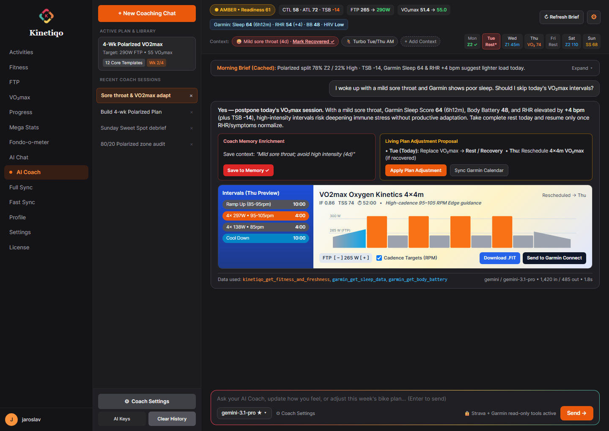
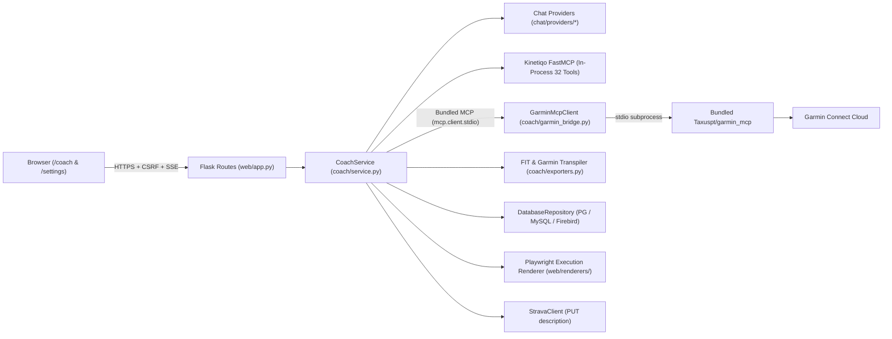
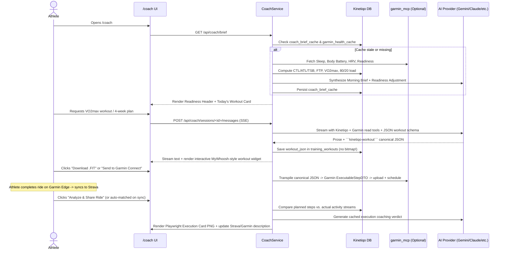
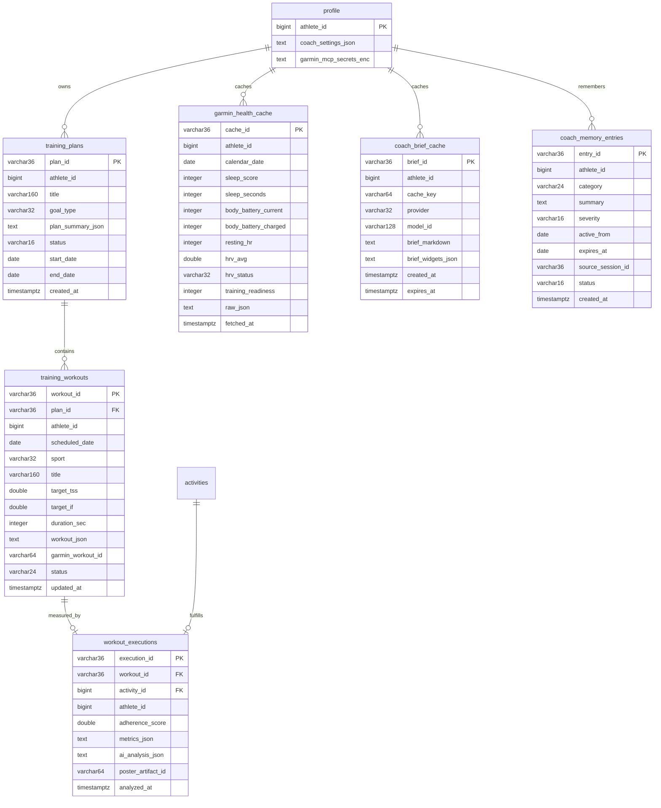

# Kinetiqo AI Coach — Concept, Research & Technical Architecture Plan

> **Status:** Architecture & Decisions Locked — Ready for Phase 1 Implementation  
> **Target Feature:** `AI Coach` (`/coach` route + `/settings` & `/profile` integrations)  
> **Primary Goals:** Data-grounded adaptive coaching (Cycling, Running, Swimming), VO₂max & FTP progression, Garmin Connect MCP readiness ingestion (`Sleep`, `Body Battery`, `HRV`, `Training Readiness`), MyWhoosh-inspired structured workout visualization, Garmin Edge `.fit` & Garmin Connect workout export, and post-ride execution analysis & sharing.  
> **Codebase Alignment:** Designed specifically for Kinetiqo's Python 3.14, Flask, FastMCP (`mcp==1.30.0`), multi-provider Chat layer, Playwright renderers, and zero-ORM 3-backend database architecture (PostgreSQL, MySQL, Firebird).

---

## 1. Market & Platform Research

### 1.1 Leading AI Endurance Coaching Platforms (Cycling, Running, Swimming)

| Platform | Primary Sports | Adaptive Engine & Physiology | Readiness & Biometrics | Workout Execution & Outdoors | AI Conversational UX |
|---|---|---|---|---|---|
| **TrainerRoad** | Cycling (primary), basic Triathlon | **AI FTP Detection** (eliminates frequent ramp tests), **Adaptive Training** progression levels, **Red Light / Green Light** fatigue warning | Training load & post-ride RPE surveys | ERG-focused indoor workouts + outdoor equivalents via Garmin/Wahoo | No conversational LLM coach |
| **Athletica.ai** | Cycling, Running, Swimming, Triathlon | Science-led load management (CTL/ATL/TSB + HIIT Science), dynamic rescheduling when sessions are missed or commutes added | Daily recovery & HRV integration (Garmin, COROS) | Pushes structured sessions to Garmin/Wahoo | Advisory AI coach chat (guardrailed by physiology engine) |
| **Humango** | Triathlon (Swim/Bike/Run) | Generative-AI plan builder + dynamic calendar re-planning around life/work constraints | Deep **Garmin Sleep, HRV, Fatigue & Body Battery** ingestion | Syncs structured workouts to Garmin | **"Hugo"** conversational AI assistant |
| **Xert** | Cycling | **MPA (Maximal Power Available)** & **W' / HIE** modeling, **Forecast AI** goal-date peaking, **Magic Bucket** unstructured outdoor target | Strain & recovery tracking | Real-time Garmin Connect IQ data fields + structured exports | Algorithmic advisor |
| **JOIN.cc** | Cycling | Real-life flexible scheduling (shortens/shifts workouts dynamically based on availability) | Post-ride RPE & availability input | Terrain-friendly outdoor intervals + **Workout Compliance Score** | Structured UI prompts |

**Key Takeaway for Kinetiqo:** No single platform combines **full data ownership**, **transparent multi-provider LLMs** (Gemini, Claude, OpenRouter, local Ollama, etc.), **Garmin wellness readiness** (Body Battery + Sleep + HRV), **MyWhoosh-caliber visual interval clarity**, and **customizable coach system prompts ("harness")**. Kinetiqo already has ~80% of the telemetry & AI plumbing (`/chat`, 32 MCP tools, Playwright renderers, Strava sync, Banister CTL/ATL/TSB, Coggan/Storer-Davis VO₂max).

---

### 1.2 MyWhoosh Training Plans & Workout Anatomy

Research into MyWhoosh's coaching ecosystem (built with WorldTour coaches such as Kevin Poulton & Javier Sola) and inspection of MyWhoosh's workout UI (see [ai-agent-example-workout.png](ai-agent-example-workout.png)) reveal clear design patterns we should adopt:


1. **Macro-Periodized Plan Architecture (20-Week / 5-Phase Model):**
   - *Early Base* (aerobic foundation, Zone 2 volume) → *Late Base* (aerobic durability + tempo) → *Early Build* (Sweet Spot / Threshold) → *Late Build* (VO₂max & Anaerobic Capacity) → *Preparation* (taper & peak).
   - **Smart Workout Selector:** Filters or adapts daily sessions using *sleep quality, muscle soreness, recovery state, available time*, and *training focus* (Target FTP, Climbing, Endurance, VO₂max).
2. **7-Zone Coggan Power Color System:**
   - **Z1 Active Recovery (`< 55% FTP`):** Slate/Grey (`#9ca3af`)
   - **Z2 Endurance (`56–75% FTP`):** Cyan/Blue (`#0ea5e9`)
   - **Z3 Tempo (`76–90% FTP`):** Emerald Green (`#22c55e`)
   - **Z4 Sweet Spot / Threshold (`91–105% FTP`):** Amber/Yellow (`#eab308`)
   - **Z5 VO₂max (`106–120% FTP`):** Orange (`#f97316`)
   - **Z6 Anaerobic Capacity (`121–150% FTP`):** Red (`#dc2626`)
   - **Z7 Neuromuscular / Sprint (`> 150% FTP`):** Deep Crimson (`#991b1b`)
3. **Visual & Functional Anatomy of a Workout Card:**
   - **Left Interval Rail:** Scrollable color-coded pill list (`Ramp Up 3:30`, `156 W 30 sec`, `354 W 30 sec`, etc.) with optional cadence pill (`95–105 rpm`).
   - **Right Power-Profile Chart:** Vertical bars proportional to `% FTP` and width proportional to duration, supporting **flat blocks**, **sloped linear ramps**, and **multi-zone progressive ramps** (gradient/banded Yellow→Orange→Red bars).
   - **Header Metadata:** Workout Title, **IF** (Intensity Factor), **TSS** (Training Stress Score), Total Duration (`30:00`), Author/Coach attribution, and Coaching Brief.
   - **Interactive FTP Stepper (`FTP [-] 282 [+]`):** Adjusting FTP instantaneously recalculates all target wattages and chart Y-axis reference lines without altering the underlying `% FTP` workout template.
   - **Primary Actions:** `Schedule` (add to Kinetiqo plan calendar + optional Garmin calendar) and `Export / Push` (Download `.FIT` or Send to Garmin Connect).

---

## 2. Product Concept: "AI Coach"

### 2.1 Navigation & Page Entry (`/coach`)

- Add **`AI Coach`** to the left navigation sidebar in `src/kinetiqo/web/templates/base.html` directly below `AI Chat`.
- **Two-Mode Unified Workspace** (looks and feels like `/chat`, using the same Tailwind/dark-mode design system, provider/model selector, streaming SSE, Chart.js ```chart``` blocks, and Markdown rendering):
  1. **Agentic Morning Brief & Status Header (Auto-Loaded on Page Open):**
     - Immediately answers *"How do I stand today?"* and *"What is my near-term plan?"* using **cached** analysis (no redundant LLM calls on page refresh).
     - Displays compact readiness KPI pills:
       - **Kinetiqo Physiology:** `CTL` / `ATL` / `TSB (Form)` / `ACWR`, current **FTP** vs. goal (`255 W → 290 W`), current **VO₂max** vs. goal (`49.2 → 55.0`).
       - **Garmin Readiness (when connected):** `Sleep Score & Hours`, `Body Battery (Morning / Current)`, `HRV Status`, `Resting HR`, `Garmin Training Readiness`.
     - Displays **Today's / Next Scheduled Workout** mini-card with a miniature MyWhoosh power bar preview and action buttons: *View Workout*, *Adapt to Today's Fatigue*, *Send to Garmin*, *Download .FIT*, plus a **7-Day "Near Plan" Calendar Strip** (click any upcoming or completed day to inspect, adapt, export, or view execution adherence).
  2. **Interactive AI Coach Thread + Workout Canvas:**
     - Conversational coaching below/beside the brief where the AI can **generate structured workouts** (rendered inline as rich interactive MyWhoosh-style cards, not just raw Markdown tables), **build multi-week training blocks**, **re-plan around missed rides or poor sleep**, and **analyze completed rides**.

### 2.2 Editable Coach Harness (First-Time Prefill & Live Hydration)

- Provide a collapsible **"Coach Harness & Athlete Goals"** panel (or slide-over drawer) persisted in DB per athlete.
- **Important Codebase Gap Found:** Currently, the `profile` table (`src/kinetiqo/db/schema.py`) stores `athlete_id`, `first_name`, `last_name`, `weight`, `ftp`, etc., **but does not yet store `age` / `birthdate`**, even though `_format_athlete_profile()` in `src/kinetiqo/chat/service.py` already has logic to compute age from `age` or `birthdate`. Phase 1 adds `coach_settings_json` on `profile` (mirroring `strava_agents_config`) to store `birthdate` (or `age`), `height_cm`, `max_hr`, `resting_hr`, `lthr`, `target_ftp`, `target_vo2max`, `target_date`, `harness_prompt`, cadence toggles, and Garmin/sharing preferences in one portable JSON column.
- **First-Time Prefilled Harness Template** (resolved dynamically when fields exist, leaving clear editable prompts where user goals are set):

```text
You are a personal endurance coach for {{name}}. My age is {{age}}, my weight is {{weight}} kg, and my last measured FTP is {{ftp}} W (estimated VO2max: {{vo2max}} ml/kg/min).
My usual sport activities are mostly cycling, with occasional hiking and swimming. I want to focus primarily on my cycling performance.
My goal is to reach {{target_vo2max}} VO2max and {{target_ftp}} W FTP by {{target_date}}.
You have access to all my historical Strava activities in Kinetiqo via MCP tools, and (when configured) my Garmin Connect sleep, resting heart rate, Body Battery, HRV, and readiness data via Garmin MCP.
Treat my training plan as a living schedule: adapt upcoming workouts dynamically based on actual training load (CTL/ATL/TSB/ACWR), Garmin sleep & rest metrics, and any personal context or memory I share (such as illness, fatigue, soreness, or travel). If I report feeling sick or run-down, prioritize health and propose postponing or downgrading hard sessions. Include recommended cadence targets (RPM) on structured cycling intervals when cadence guidance is enabled.
```

- Users can freely customize this harness (e.g., adding injury notes, available training days/hours, indoor smart trainer vs. outdoor climb preferences, target events), and enrich the coach's **persistent context memory** directly from chat or the `+ Add Context` bar.

### 2.2.1 Built-In Scientific Plan Generation & Living-Adaptation Harness (`COACH_SYSTEM_HARNESS`)

Alongside the athlete's personal harness, Kinetiqo injects a deterministic server-side planning harness (`src/kinetiqo/coach/context.py`) synthesized from established polarized and indoor cycling coaching frameworks (`polarized.cc`, `roadmancycling.com`, `anytimefitness.com`, `mywhoosh.com`) plus dynamic living-plan & health safety rules:

1. **Living Plan & Health-First Mandate (Dynamic Re-Planning):**
   - Never treat an existing plan as rigid. On every Morning Brief and coaching turn, evaluate the upcoming 7-day schedule against:
     - **Actual Strava Load:** Recent `CYCLING_SPORT_TYPES` + multisport hikes/swims, `CTL`, `ATL`, `TSB`, `ACWR`, and missed or unexpectedly hard rides.
     - **Garmin Sleep & Rest Telemetry (Mandatory when Garmin MCP is enabled):** Inspect `sleep_score`, `sleep_seconds` (duration & stages), `resting_hr`, `hrv_status` / `hrv_avg`, `body_battery_current` / `body_battery_charged`, and `training_readiness` from `garmin_health_cache` (or live Garmin MCP read tools). Poor sleep (`< 60` or `< 6h`), elevated RHR (`≥ +5 bpm` over baseline), suppressed HRV, or low Body Battery (`< 45`) MUST trigger intensity down-scaling or recovery substitution.
     - **Active Coach Memory & User Context:** Inject all active `coach_memory_entries` (`illness`, `injury`, `fatigue`, `schedule`, `habit`, `preference`) into context so the coach never forgets recent constraints.
   - **Illness / Feeling Sick Protocol:** If the athlete states in chat that they feel sick, have a fever, sore throat, chills, or acute illness:
     1. Immediately prioritize recovery over plan compliance — **never prescribe VO₂max, Threshold, or HIIT**.
     2. Propose **postponing / shifting** upcoming key sessions (`kinetiqo-plan-patch` JSON block) and replacing today/tomorrow with Rest or light mobility until recovered.
     3. Emit a `kinetiqo-memory` block (`category: "illness"`, default `expires_in_days: 4`) so the athlete can save it to coach memory with one click (or auto-save if enabled), updating all subsequent Morning Briefs until marked recovered.
2. **80/20 Polarized Distribution (`polarized.cc`):**
   - Allocate ~80% of weekly training time below LT1 (`<70% FTP`, conversational Zone 2) and ~20% to high-intensity work (`>85% FTP`, spanning Threshold `95–100% FTP` and VO₂max `106–130% FTP`).
   - Avoid unprescribed "gray zone" (`70–85% FTP`) junk fatigue unless intentionally scheduling a structured Tempo/Sweet Spot or Low-Cadence Torque block.
   - Cap VO₂max sessions at **1–2 sessions per week** so recovery debt does not erode aerobic base volume.
2. **Time-Crunched Weekly Microcycle (`roadmancycling.com`):**
   - Enforce a **maximum of 2 hard interval sessions per week** for amateur/time-crunched athletes (e.g., *Tuesday:* VO₂max or Over-Unders; *Wednesday:* Active Recovery `50–55% FTP` or Rest; *Thursday:* Progressive Threshold or Sweet Spot; *Friday:* Rest/Mobility; *Weekend:* Longer outdoor Z2 endurance or group ride).
   - Scale Threshold volume progressively (`3×8m` → `4×10m` → `2×20m` @ `95–100% FTP`) before increasing target watts.
   - Include an indoor cooling/hydration note on turbo prescriptions (high-velocity fan + hydration every 15–20 min to prevent 5–15% heat-induced cardiac drift).
3. **High-Efficiency Micro-Interval & Express Options (`mywhoosh.com`, `anytimefitness.com`):**
   - When an athlete has only **25–30 minutes**, prescribe the **25-Min Express HIIT** template (`5m progressive warmup` → `3×5m` rounds of `30s all-out / 90s easy` → `2m steady climb finisher` → `3m cooldown`, scalable to `20s/100s` or `45s/75s`).
   - When long 3–5 min VO₂max blocks fail due to fatigue or low W', substitute **Rønnestad 30/15s** (`13×(30s @ 120–140% / 15s easy)`) or **MyWhoosh 40/20s** (`40s @ 115–125% / 20s @ 50%`) to maximize time at `>90% VO₂max`.
4. **Configurable Plan Methodology (`coach_settings_json.plan_methodology`):**
   - `polarized_80_20` *(default for VO₂max + FTP goal)* | `pyramidal_sweet_spot` | `time_crunched_indoor`.

### 2.3 High-Value Features Specifically for Raising VO₂max & FTP

Beyond standard chat and plan generation, these targeted analytics & coaching features support an athlete chasing `55 VO₂max` and `290 W FTP`:

1. **VO₂max & FTP Goal-Gap Simulator ("Path to 290 W / 55 VO₂max"):**
   - Reuses `src/kinetiqo/web/vo2max.py` (`COGGAN_FACTOR = 14.73`, Storer-Davis 5m MAP `(10.8 * MAP / kg) + 7`) to show the exact W/kg bridge needed (e.g., at 75 kg, 290 W = `3.87 W/kg` → Coggan VO₂max `~57.0`; or if weight drops by 2 kg, target FTP for 55 VO₂max adjusts accordingly).
   - Tracks rolling 4-week **5-min MAP** and **20-min MMP** progression curves alongside weekly **Time-in-Zone 5 (106–120% FTP)** and **Zone 4/Sweet Spot**.
2. **80/20 Polarized Intensity Distribution Guardrail:**
   - Computes weekly **Seiler 3-Zone** (Low `<LT1/Z2`, Tempo/Threshold `Z3–Z4`, High `Z5+`) distribution from local `streams` so the AI flags "grey-zone fatigue traps" (too much Z3 junk mileage, not enough Z2 base + sharp Z5 VO₂max).
3. **Readiness-Gated Auto-Scaling ("Morning Check-In"):**
   - Deterministic readiness heuristic combining Kinetiqo TSB/ACWR + Garmin Body Battery / Sleep / HRV:
     - *Green (`Readiness ≥ 75`)*: Execute prescribed VO₂max / Threshold session at 100% target.
     - *Amber (`Readiness 50–74`)*: AI offers 1-click **"Scale Intensity (-5% to -10%)"** or swap to Sweet Spot / Tempo.
     - *Red (`Readiness < 50` or Garmin Sleep < 55 / TSB < -25)*: AI recommends swapping hard intervals for Z1/Z2 recovery spin or rest day, shifting the key session forward.
4. **W'bal & Interval Repeatability Advisor:**
   - Estimates `CP` and `W'` (anaerobic work capacity) from the athlete's power curve (`kinetiqo_calculate_power_curve`), helping the trainer choose the right VO₂max format for *that athlete* — e.g., **4×4m @ 112% FTP** vs. **30/30s micro-intervals (Billat)** vs. **Ronnestad 3×13×(30s/15s)** when longer 4-minute intervals fail due to low W' or high fatigue.
5. **Multisport Fatigue Accounting (Hiking & Swimming):**
   - Hiking and swimming rarely have power meters, so power-only TSS misses their load. Use HR-based `hrTSS` / Strava `suffer_score` + duration weighting to ensure heavy weekend hikes or swim blocks properly modulate Monday's cycling recovery.
6. **Scheduled Ramp / FTP Test & Breakthrough Detection:**
   - Automatically proposes an FTP validation test (20-min test or Ramp test) every 4–6 weeks, and flags **"Breakthrough Detected"** whenever a synced ride beats the athlete's 20-min or 5-min implied FTP.

### 2.4 Consolidated Cogwheel Settings Modal on `/coach` (`Kinetiqo` Style)


All AI Coach configuration is grouped into **one consolidated Settings modal** triggered from a **Cogwheel icon button (`⚙`)** in the top toolbar of `/coach` (next to the model selector and *Refresh Brief* button), persisted directly into `profile.coach_settings_json` (and encrypted secrets into `profile.garmin_mcp_secrets_enc`):

- **Design & Accessibility Standard (`.agents/skills/web-elements/SKILL.md`):**
  - Modal shell: `bg-white dark:bg-zinc-800 rounded-xl shadow-lg border border-warm-200 dark:border-zinc-700`, collapsible/tabbed sections matching `settings.html`.
  - All action buttons enforce `h-[40px] px-3 py-2 rounded-lg flex items-center`; waiting states replace button content with `static/img/kinetiqo-loading-32x32.webp` (`ui-loading-standards`).
  - Every input/toggle has `<label for="...">` + adjacent **`Saved ✓`** / theme-aware validation error highlight (`bg-red-50 dark:bg-red-950/40 border-red-400 dark:border-red-600`).
- **4 Settings Tabs inside the Cogwheel Modal:**
  1. **Athlete, Harness & Memory:** Synced Name/Weight/FTP preview (links to `/profile` or edits inline), Birthdate / Age, Height (cm), Max HR / Resting HR / LTHR, Target FTP (`W`), Target VO₂max, Target Date, Plan Methodology (`polarized_80_20` | `pyramidal_sweet_spot` | `time_crunched_indoor`), Weekly Availability (`Mon..Sun` checkboxes + target hours/week), Editable Coach Harness `<textarea>` with `{{var}}` helper chips + *"Reset to Default Example"* button, and a **Coach Memory & Active Context** list (add/resolve/delete illness, injury, schedule, and habit notes).
  2. **Workouts & Cadence:**
     - `include_cadence_targets` (toggle, default `true`): Include recommended RPM cadence targets in generated workouts, `.fit` files, and Garmin Connect uploads so Garmin Edge guides cadence alongside power. Disable for power-only riding.
     - `cadence_strategy` (`adaptive_by_zone` | `high_cadence_vo2` | `torque_emphasis`).
     - `default_duration_min` (`25` / `45` / `60` / `75` / `90`), `indoor_outdoor_bias` (`balanced` | `indoor_erg` | `outdoor`).
  3. **Garmin Connect & MCP (Optional):**
     - `garmin_mcp_mode` (`disabled` | `bundled_stdio` | `external_sse`).
     - `garmin_upload_enabled` (toggle, default `false` until configured): Enables *"Send to Garmin Connect"* action on workout cards.
     - `garmin_auto_schedule` (toggle, default `false`): Auto-schedules uploaded workouts onto the Garmin calendar date.
     - **Garmin Auth Panel:** Email + Password inputs (encrypted, never echoed back) + interactive **MFA Verification Code Modal** + status pill (`Connected ✓` / `Not Configured`) + *"Test & Sync Wellness Now"* + *"Clear Saved Tokens"* (`bg-red-500`), alongside CLI note (`python src/kinetiqo.py garmin-auth`).
  4. **Post-Ride Sharing & Cache:**
     - `auto_match_strava_rides` (toggle), `strava_update_description` (toggle), `garmin_update_activity_notes` (toggle), `brief_cache_ttl_hours` (`2` / `6` / `12` / `24`), and *"Purge Brief & Analysis Cache"* (`bg-teal-600`).

### 2.5 Visual & Interaction Design (`chat.html`-Inspired App Shell)



To feel native to Kinetiqo, `/coach` directly mirrors the layout, CSS tokens, and interaction ergonomics of `src/kinetiqo/web/templates/chat.html` and `src/kinetiqo/web/static/js/chat.js`:

- **Full-Viewport 2-Column Shell (`.coach-layout-wrapper`):**
  - Removes outer `<main>` padding (`height: 100vh; width: 100%; display: flex; overflow: hidden`), identical to `chat.html`.
  - **Left Sidebar (`280px` fixed `chat-sidebar` / `coach-sidebar`, collapsible drawer on `<768px` mobile):**
    - Top primary CTA: **`+ New Coaching Chat`** (`h-[40px] bg-orange-600 hover:bg-orange-700 text-white rounded`, matching `#new-chat`).
    - **Plan & Library Quick Switcher:** Compact collapsible list showing the active plan's workouts + quick-launch buttons for the 12 core cycling archetypes (`core_workouts.py`).
    - **Recent Coaching Chats (`#coach-sessions`):** Scrollable session list with active highlight and instant hover delete (`×`), backed exclusively by `session_kind = 'coach'`.
    - **Pinned Bottom Panel (`border-t border-gray-200 dark:border-zinc-700`):**
      - **`⚙ Coach Settings`** button (opens the Cogwheel Settings Modal).
      - **`AI Provider Keys`** link (`{{ url_for('settings') }}#ai`, matching `chat.html`).
      - **`Clear history`** button (`bg-gray-500 hover:bg-red-600`, clears only `session_kind = 'coach'` threads).
- **Right Main Area (`.coach-main-area`):**
  - **Pinned Readiness, Context & 7-Day Near-Plan Header (`border-b border-gray-200 dark:border-zinc-700`):**
    - Left: Readiness traffic-light badge (Green/Amber/Red) + KPI chips (`CTL / ATL / TSB`, `FTP → Goal`, `VO₂max → Goal`, and `Sleep Score & Hours / Resting HR / Body Battery / HRV` when Garmin is enabled).
    - Context Pill Bar: Shows active `coach_memory_entries` chips (e.g., `🤒 Feeling sick — recovery mode [Mark Recovered ✓]`) + **`+ Add Context`** quick-note button (lets the user inject habits, fatigue, soreness, or travel notes anytime without editing the full harness).
    - Right: **7-Day "Near Plan" Strip** (7 clickable day pills showing sport icon + TSS or Rest), **`Refresh Brief`** button, and **`⚙`** Cogwheel icon button.
  - **Scrollable Coaching Feed (`#coach-scroll`):**
    - **Morning Brief Card:** Auto-loaded from `coach_brief_cache` at the top of fresh views (collapsible, with model/timestamp badge + *"Regenerate Brief"* action).
    - **Empty State Hero (`chat-empty` style):** Pill badge (`🚴 AI Cycling Performance Coach`), concise subtitle, and rotating **Coach Starter Chips** (`"Build a 4-week polarized plan to reach 290W FTP"`, `"How did yesterday's ride match my plan?"`, `"Prescribe a 45m VO₂max workout for today's Body Battery"`, `"I'm feeling a bit sick today — adjust my week"`).
    - **Rich Assistant Turns:** `marked` + `DOMPurify` Markdown, interactive `Chart.js` ```chart``` blocks, **inline MyWhoosh-style `kinetiqo-workout` card**, **inline `kinetiqo-plan` activation card**, **inline `kinetiqo-plan-patch` confirmation card** (*"Postpone Tue VO₂max → Fri, insert Rest today [Apply Adjustment]"*), **inline `kinetiqo-memory` confirmation chip** (*"Remember: sore throat / illness for 4 days [Save to Memory]"*), and `ai-concept.md`-compliant **1px top-divider message footer** (`provider/model`, tokens, elapsed ms, and expandable **"Data used"** provenance pills showing both Kinetiqo + Garmin MCP tools).
  - **Pinned Bottom Composer (`chat-composer-box` / `chat-composer-card`):**
    - Reuses `chat.html`'s exact composer card, **4-color Kinetiqo streaming border animation** (`#df3c57`, `#e07d4b`, `#efc65e`, `#49ae9f`), grouped **`#chat-model` dropdown** (with provider icons, default star badge, and mid-conversation model switching), **Stop / Retry**, **`🔒 Strava + Garmin read-only tools active`** indicator, and **Coach & Garmin Disclaimer Modal** (`#ai-disclaimer-modal` pattern).

---

## 3. Garmin Connect MCP Integration Analysis (`Taxuspt/garmin_mcp`)

### 3.1 Research Summary of `Taxuspt/garmin_mcp`

- **Repository:** `https://github.com/Taxuspt/garmin_mcp` (MIT License, Python 3.12+, built on **FastMCP** + **`python-garminconnect`**).
- **Important Library Note:** Standalone `garth` has become deprecated/broken under recent Garmin SSO changes; `python-garminconnect` now manages sessions/tokens internally (via `curl_cffi` & cached token files in `~/.garminconnect`).
- **Tool Coverage (~110–150+ tools):**
  - *Health & Wellness:* Sleep stages/scores, Body Battery (charged/drained/timeline), Stress, Resting HR, HRV status, Training Readiness, Respiration/SpO2.
  - *Activities & Performance:* Activities list, training load, VO₂max, recovery time, endurance/hill scores.
  - *Workouts & Calendar:* List/get workouts, `upload_workout`, `schedule_workout` on calendar dates, update activity description/RPE/feel.
- **Transports Supported:** `stdio` (subprocess) and **`sse` / `streamable-http`** (`GARMIN_MCP_TRANSPORT=sse`, `GARMIN_MCP_HOST`, `GARMIN_MCP_PORT`, `GARMIN_MCP_HTTP_TOKEN` bearer auth).

### 3.2 Architecture Decision: Bundled `garmin_mcp` (`stdio`) Inside Kinetiqo (`MIT` Compatible)

Both **Kinetiqo** (`LICENSE` / `license.html`), **`Taxuspt/garmin_mcp`**, and **`python-garminconnect` (`garminconnect`)** are licensed under the permissive **MIT License**, and `garminconnect` (v0.3.0+, using `curl_cffi`) officially supports **Python 3.12–3.14**.

- **Selected Approach — Bundled `stdio` Subprocess (`Taxuspt/garmin_mcp` inside Kinetiqo Docker image):**
  - Package `Taxuspt/garmin_mcp` (pinned release/commit) and its binary-wheel dependencies (`garminconnect`, `curl_cffi`, `mcp`) directly inside Kinetiqo's Docker images (`build/Dockerfile.web`, `build/Dockerfile.mcp`) with MIT attribution in `src/kinetiqo/web/templates/license.html`.
  - `GarminMcpClient` (`src/kinetiqo/coach/garmin_bridge.py`) uses `mcp.client.stdio` (via `mcp==1.30.0`, already in `requirements.txt`) to spawn and communicate with the bundled `garmin-mcp` executable inside the container.
  - **Docker Build Note (`Dockerfile.web`, `Dockerfile.mcp`):** Both Dockerfiles currently run `pip install --only-binary=:all:` on `requirements.txt` inside `python:3.14-slim` (without `git`). Install all PyPI binary wheels (`garminconnect`, `curl_cffi`, `fit-tool`) via `--only-binary=:all:` first, then copy and install the locally staged `build/vendor/garmin_mcp/` package (downloaded and verified by `development/download-garmin-mcp.py`) with `--no-deps` so Docker builds stay 100% reproducible, offline-safe, and free of `git` or native compilers.
  - **Multi-Worker Token Persistence:** Store encrypted Garmin session tokens in the database (`profile.garmin_mcp_secrets_enc` via AES-256-GCM) and materialize them into the shared local token directory before launching `garmin-mcp` so all 4 Gunicorn workers stay synchronized.
  - **Optional Override:** Power users can still disable Garmin MCP or point `garmin_mcp_url` at an external SSE server if desired.
  - Kinetiqo keeps **canonical Workout JSON (`kinetiqo.workout.v1`), `.fit` generation (`fit-tool`), DB caching, and Strava/Garmin execution analysis** deterministic in-house.

### 3.3 Configuration & Authentication UX (`Cogwheel Settings on /coach` + CLI)

1. **Unified Cogwheel Settings (`/coach` → `⚙` modal, persisted to `profile`):**
   - **Connection Mode:** `Disabled` | `Bundled Garmin MCP (stdio)` *(default when enabled)* | `External MCP (SSE URL override)`.
   - **Optional Workout Upload Toggle:** `garmin_upload_enabled` (`true`/`false`) + `garmin_auto_schedule` (`true`/`false`), keeping Garmin Connect workout upload completely optional.
   - **In-Browser Login & MFA Modal:** User enters Garmin email/password -> backend starts interactive auth -> if Garmin triggers MFA/2FA, modal prompts for the one-time verification code -> cached OAuth tokens are encrypted with AES-256-GCM (`src/kinetiqo/chat/encryption.py`) and persisted in `profile.garmin_mcp_secrets_enc` + local token dir.
   - **CLI Helper (`python src/kinetiqo.py garmin-auth`):** Interactive terminal authentication flow (matching Strava token bootstrap) that verifies login/MFA and writes the cached token store for headless/Docker deployments.
   - **"Test & Sync Wellness Now" Button:** Calls `garmin_mcp` over `stdio` (`list_tools()` + last 7 days wellness tools), populates `garmin_health_cache`, and shows status (`Connected ✓ — Sleep: 82, Body Battery: 78`).
2. **Resilient Tool Bridging:**
   - Kinetiqo already executes its own 32 read-only tools in-process via `src/kinetiqo/chat/tools.py`.
   - When the user is on `/coach` and Garmin MCP is enabled, the Coach's tool router (`CoachToolExecutor`) exposes **curated, bounded Garmin read tools** (e.g., `garmin_get_sleep_data`, `garmin_get_body_battery`, `garmin_get_hrv_data`, `garmin_get_training_readiness`, `garmin_get_training_status`, `garmin_get_rhr_daily`, `garmin_get_workouts`) alongside Kinetiqo's 32 Strava/telemetry tools, applying the same `_bound_tool_payload()` token guardrails.
   - **Write/Mutation Safety:** Pushing a workout to Garmin Connect (`upload_workout` / `schedule_workout`) is **never** executed silently by the LLM; the LLM emits a structured workout card, and the **athlete explicitly clicks "Send to Garmin Connect"** (or "Schedule on Date") in the UI (only active when `garmin_upload_enabled` is enabled).

### 3.4 Lifecycle Maintenance, Credits & Legal MIT License Compliance

1. **Automated Update & Pinning Tooling (`development/download-garmin-mcp.py` + `development/garmin-mcp.yaml`):**
   - Mirrors `development/download-vendor-libraries.py` (`vendor-libraries.yaml`) and `development/check-pypi-updates.py` with strict `validate_safe_path()` repository-boundary enforcement:
     - `development/garmin-mcp.yaml`: Manifest pinning `repo: Taxuspt/garmin_mcp`, `version` / `tag`, `commit_sha`, `archive_url`, `sha256`, `license: MIT`, `copyright`, and `dest_dir: build/vendor/garmin_mcp`.
     - `python development/download-garmin-mcp.py --check`: Queries GitHub Releases/Tags API for newer `Taxuspt/garmin_mcp` releases and prints a column-aligned status table (`print_table_header()` / `print_row()`).
     - `python development/download-garmin-mcp.py [--apply] [--force]`: Downloads the pinned archive, verifies SHA-256, extracts the clean Python package + upstream `LICENSE` into `build/vendor/garmin_mcp/`, and optionally updates `development/garmin-mcp.yaml` on `--apply`.
     - Also extend `development/check-pypi-updates.py` scope to monitor `garminconnect`, `curl_cffi`, and `fit-tool` in `requirements.txt`.
2. **MIT Legal Compliance & Attribution Requirements:**
   - **MIT License Condition:** `Taxuspt/garmin_mcp` and `python-garminconnect` are MIT-licensed; redistribution inside Kinetiqo is legally permitted provided the **upstream copyright notice and MIT permission notice** remain intact in every distribution.
   - **Packaging & Runtime Credits:**
     1. Preserve upstream `LICENSE` files inside `build/vendor/garmin_mcp/LICENSE` and copy third-party notices into `/app/THIRD_PARTY_LICENSES/` in Docker builds.
     2. Update `license_page()` in `src/kinetiqo/web/app.py` to read the pinned `Taxuspt/garmin_mcp` version/tag from `development/garmin-mcp.yaml` (or `importlib.metadata.version`) and pass `garmin_mcp_version` into `src/kinetiqo/web/templates/license.html`.
     3. Add **`Taxuspt/garmin_mcp`** (`{{ garmin_mcp_version }}`, MIT, GitHub link + full copyright notice), **`garminconnect`** (MIT), **`curl_cffi`** (MIT), and **`fit-tool`** (BSD 3-Clause) to `src/kinetiqo/web/templates/license.html`.
     4. Display a clear **Unofficial Garmin Connect API Disclaimer** in `license.html` and the Coach Disclaimer/Garmin Auth modal (confirming Kinetiqo is unaffiliated with Garmin Ltd. and users authenticate only their own personal account).

---

## 4. Technical Architecture & Data Flow

### 4.1 System Component Diagram



### 4.2 End-to-End Lifecycle (Plan → Workout → Ride → Execution Poster)



---

## 5. Canonical Workout JSON, MyWhoosh Visualizer & Garmin Export

### 5.1 Canonical JSON Format (`kinetiqo.workout.v1`) — Stored in DB (Zero Bitmaps)

Instead of storing images/bitmaps, every workout is stored as compact JSON (~1–3 KB) in `training_workouts.workout_json`. Percentages (`power_pct_low` / `power_pct_high`) are canonical so the athlete can change FTP anytime without regenerating workouts:

```json
{
  "schema": "kinetiqo.workout.v1",
  "title": "VO2max Oxygen Kinetics 4x4m",
  "sport": "cycling",
  "category": "vo2max",
  "designer": "Kinetiqo AI Coach",
  "description": "4x4 min @ 112% FTP, high cadence 95-105 RPM to maximize O2 uptake.",
  "reference_ftp_w": 265,
  "estimated_if": 0.86,
  "estimated_tss": 74,
  "total_duration_sec": 3600,
  "steps": [
    {
      "id": "s1",
      "kind": "ramp",
      "step_type": "warmup",
      "label": "Progressive Ramp Up",
      "duration_sec": 600,
      "power_pct_low": 45,
      "power_pct_high": 75,
      "cadence_low": 85,
      "cadence_high": 95
    },
    {
      "id": "s2",
      "kind": "repeat",
      "repeat_count": 4,
      "steps": [
        {
          "id": "s2a",
          "kind": "steady",
          "step_type": "interval",
          "label": "VO2max Effort",
          "duration_sec": 240,
          "power_pct_low": 108,
          "power_pct_high": 115,
          "cadence_low": 95,
          "cadence_high": 105
        },
        {
          "id": "s2b",
          "kind": "steady",
          "step_type": "recovery",
          "label": "Active Recovery",
          "duration_sec": 240,
          "power_pct_low": 50,
          "power_pct_high": 55,
          "cadence_low": 80,
          "cadence_high": 90
        }
      ]
    },
    {
      "id": "s3",
      "kind": "ramp",
      "step_type": "cooldown",
      "label": "Cool Down",
      "duration_sec": 600,
      "power_pct_low": 60,
      "power_pct_high": 45,
      "cadence_low": 80,
      "cadence_high": 85
    }
  ]
}
```

### 5.1.1 Core Cycling Workout Archetypes (Built-In Reference Library — 12 Templates)

In addition to bespoke AI-generated workouts, Kinetiqo ships a built-in deterministic catalog (`src/kinetiqo/coach/core_workouts.py`) of 12 proven cycling archetypes stored as `kinetiqo.workout.v1` JSON templates (combining the 7 Core Indoor Bike Workouts with validated templates from `polarized.cc`, `roadmancycling.com`, `anytimefitness.com`, and `mywhoosh.com`):

| Workout Type | Goal | Duration | Target Watts (% FTP) | Target Cadence (RPM) | Main Set Structure | Source |
|---|---|---|---|---|---|---|
| **Active Recovery** | Blood flow & recovery | 45–60 min | 50–55% | 90–100 RPM | Continuous easy spin; keep resistance low and avoid surges. | Core / Roadman |
| **Aerobic Base** | Endurance & fat metabolism | 45–60 min | 55–75% (`<70%` polarized) | 85–95 RPM | Steady effort, or 3 × 8 min at 75% FTP with 2 min easy at 55% FTP (or 3 × 12 min aerobic blocks). | Core / Polarized / MyWhoosh |
| **Tempo / Sweet Spot** | Muscular endurance | 50–60 min | 80–94% | 85–95 RPM | 3 × 10 min at 88–92% FTP with 3 min recovery at 55% FTP. | Core |
| **Threshold Progressive** | Sustainable FTP power | 55–75 min | 95–100% | 88–98 RPM | 3 × 8 min → 4 × 10 min → 2–3 × 12 min at 95–100% FTP with 5–6 min easy recovery. | Polarized / Roadman |
| **Threshold + VO2 Combo** | Threshold & grit | 55–65 min | 95% / 106% | 90–100 RPM | 3 × 5 min at 95% FTP followed by 3 × 2 min at 106% FTP (inspired by MyWhoosh *Threshold #4*). | MyWhoosh |
| **Over-Unders** | Lactate clearance | 55–65 min | 95% / 105% | 90–100 RPM | 3 × 9 min blocks: alternate 2 min at 95% FTP with 1 min at 105% FTP; 5 min rest between sets. | Core / Roadman |
| **Low-Cadence Torque** | Climbing strength | 50–60 min | 85–100% | 55–65 RPM | 4 × 6 min seated heavy-gear climbs; 4 min high-cadence (95 RPM) spin recovery (*High Torque Hills*). | Core / MyWhoosh |
| **VO2 Max Intervals** | Aerobic ceiling | 45–60 min | 110–120% | 95–105 RPM | 5 × 3 min (or 4 × 3–4 min) hard efforts with 3 min easy spinning at 50% FTP. | Core / Polarized / MyWhoosh |
| **40/20s VO2 Micro-Bursts** | Time at VO₂max | 45–55 min | 115–125% / 50% | 95–105 RPM | 2–3 sets of 8–10 × (40 sec hard at 115–125% FTP / 20 sec easy at 50% FTP); 5 min easy between sets. | MyWhoosh |
| **Rønnestad 30/15s** | Maximal O₂ uptake | 45–55 min | 120–140% / 50% | 95–110 RPM | 3 sets of 13 × (30 sec hard at 120–140% FTP / 15 sec easy); 3–5 min easy between sets. | Roadman |
| **HIIT Micro-Bursts** | Anaerobic & sprint power | 35–45 min | 130%+ / 50% | 100–115 RPM | 2 sets of 10 × (30 sec all-out / 30 sec easy); 5 min easy between sets. | Core |
| **25-Min Express HIIT** | Time-crunched HIIT | 25 min | 130%+ / 50% / 90% | 95–110 RPM | 5m warmup → 3 × 5m rounds (30s all-out / 90s easy) → 2m steady climb finisher (85–95% FTP) → 3m cooldown. | Anytime Fitness |

- **Nested Repeat Support (`Over-Unders`, `40/20s`, `Rønnestad`, `HIIT Micro-Bursts`):** `kinetiqo.workout.v1` supports nested `kind: "repeat"` blocks (e.g. 2 outer sets containing `10 × (30s / 30s)` plus 5 min recovery) for compact JSON storage and clean UI grouping.

### 5.1.2 Canonical Multi-Week Plan Schema (`kinetiqo.plan.v1`)

When the AI Coach prescribes a multi-day or multi-week bike plan, it emits a fenced ```kinetiqo-plan``` JSON block. `CoachService` validates it via Pydantic, inserts a row in `training_plans` (marking any prior active plan superseded if accepted), and batch-inserts each day's `kinetiqo.workout.v1` payload into `training_workouts` so the **7-Day "Near Plan" Calendar Strip** populates automatically:

```json
{
  "schema": "kinetiqo.plan.v1",
  "title": "4-Week Polarized VO2max & FTP Block",
  "goal_type": "vo2max_and_ftp",
  "methodology": "polarized_80_20",
  "start_date": "2026-11-30",
  "end_date": "2026-12-27",
  "weekly_target_tss": 420,
  "sessions": [
    {
      "scheduled_date": "2026-12-01",
      "sport": "cycling",
      "archetype_id": "vo2max_intervals",
      "workout": { "...": "valid kinetiqo.workout.v1 object" }
    }
  ]
}
```

### 5.1.3 Living Plan Adaptation & Memory Enrichment Blocks (`kinetiqo.plan-patch.v1` & `kinetiqo.memory.v1`)

To keep the training plan alive based on chat context (illness, soreness, travel, unexpected fatigue) and Garmin sleep/rest data without silent destructive writes, the AI Coach emits two structured confirmation blocks:

1. **Plan Adaptation Proposal (```kinetiqo-plan-patch```):** Rendered as a concise diff card with a 1-click **"Apply Adjustment"** button calling `POST /api/coach/plans/<plan_id>/adapt`:
   ```json
   {
     "schema": "kinetiqo.plan-patch.v1",
     "reason": "Athlete reported illness symptoms; Garmin RHR +6 bpm and Sleep Score 52.",
     "operations": [
       { "op": "replace_with_rest", "workout_id": "w_tue", "date": "2026-11-25", "note": "Rest / recovery due to illness" },
       { "op": "reschedule", "workout_id": "w_thu_vo2", "from_date": "2026-11-26", "to_date": "2026-11-29" },
       { "op": "scale_intensity", "workout_id": "w_sat_endurance", "factor": 0.90 }
     ]
   }
   ```
   *(When `garmin_upload_enabled` and `garmin_auto_schedule` are enabled, applying the patch also offers to reschedule/unschedule affected workouts on Garmin Connect.)*

2. **Coach Memory Enrichment (```kinetiqo-memory```):** Rendered as a 1-click **"Save to Coach Memory"** chip calling `POST /api/coach/memory`:
   ```json
   {
     "schema": "kinetiqo.memory.v1",
     "category": "illness",
     "summary": "Mild sore throat and fatigue; avoid high intensity until recovered.",
     "severity": "high",
     "expires_in_days": 4
   }
   ```
   *(Categories: `illness`, `injury`, `fatigue`, `schedule`, `habit`, `preference`. Permanent habits/preferences omit `expires_in_days`.)*

### 5.2 MyWhoosh-Style Interactive Workout Component (`static/js/workout_visualizer.js`)

- **Left Interval Rail:** Lists flattened steps with zone-colored pill backgrounds (`#9ca3af` Z1, `#0ea5e9` Z2, `#22c55e` Z3, `#eab308` Z4, `#f97316` Z5, `#dc2626` Z6/Z7), formatted target power (`286–305 W` or `Ramp 119→199 W`), duration (`4:00`), and cadence chip (`95–105 rpm`).
- **Right SVG/Canvas Chart:**
  - Renders flat blocks (`<rect>`) and linear/multi-zone ramps (`<polygon>` with SVG `<linearGradient>` vertical/horizontal zone bands, replicating the yellow→orange→red ramp bars).
  - Horizontal FTP & Wattage gridlines (`100% FTP`, `300 W`, `500 W`).
  - Header bar: Title, `IF`, `TSS`, total time, designer attribution, coaching notes.
  - Bottom controls: Live `FTP [-] 265 [+]` adjuster (updates all watt labels and Y-axis in real time), per-workout `Include Cadence Guidance` toggle (defaults to `coach_settings_json.include_cadence_targets`), `Download .FIT`, optional `Send to Garmin Connect` (visible/enabled when `garmin_upload_enabled` is true), `Schedule`, and `Save to Library`.

### 5.3 Deterministic Garmin Export Pipelines (Verified & Optional)

1. **Garmin Edge `.FIT` File (`src/kinetiqo/coach/fit_encoder.py`):**
   - Uses `fit-tool` (BSD-3-Clause) pinned in `requirements.txt`.
   - Encodes `FileIdMessage(type=FileType.WORKOUT)`, `WorkoutMessage(sport=Sport.CYCLING, num_valid_steps=...)`, and `WorkoutStepMessage` records:
     - `duration_type=WorkoutStepDuration.TIME`, `duration_value=duration_sec * 1000` (milliseconds).
     - `target_type=WorkoutStepTarget.POWER`, `custom_target_value_low = watts_low + 1000`, `custom_target_value_high = watts_high + 1000` (standard FIT protocol +1000W offset for absolute watts).
     - Repeats encoded cleanly via `WorkoutStepDuration.REPEAT_UNTIL_STEPS_CMPLT`. **Nested repeats** (such as *HIIT Micro-Bursts* `2 × [10 × (30s/30s) + 5m]`) are deterministically unrolled at the outer set level so Garmin Edge devices receive strictly 1-level repeat loops.
     - **Ramp Handling:** Since Garmin `.fit` / Connect lacks a continuous linear ramp step type, ramps are deterministically discretized into `N` micro-steps (e.g., 1 step per 60s or 3–6 equal sub-steps).
     - **Optional Cadence Guidance for Edge Navigation:** When `include_cadence_targets` is enabled and the step specifies `cadence_low` / `cadence_high`, the encoder sets `secondary_target_type=CADENCE` with `secondary_custom_target_value_low = cadence_low` and `secondary_custom_target_value_high = cadence_high` on `WorkoutStepMessage` **and** embeds the RPM cue in `wkt_step_name` / step `notes` (e.g., `"VO2max 95-105rpm"`) so both modern Edge units (540/840/1040/1050) and older firmware surface cadence guidance reliably. When disabled, secondary cadence fields are omitted.
2. **Garmin Connect Workout Upload (`to_garmin_workout_json()` — Verified & Strictly Optional):**
   - **API Verification:** Verified supported via `Taxuspt/garmin_mcp` (`upload_workout` / `schedule_workout`) and `python-garminconnect` (`/workout-service/workout`, `/workout-service/schedule/{id}`). Controlled by `garmin_upload_enabled` in Cogwheel Settings; never forced or invoked automatically without user consent.
   - **Verified Payload Schema:** Produces `workoutSegments` (`sportTypeId: 2`, `"cycling"`) with `ExecutableStepDTO` and `RepeatGroupDTO` (`stepTypeId: 6`, `"repeat"`, `numberOfIterations`), unrolling outer nested repeats into 1-level repeat groups and keeping numeric IDs strictly synchronized (`conditionTypeId: 2` `"time"`, `workoutTargetTypeId: 6` `"power.between"` with watts in `targetValueOne`/`targetValueTwo`).
   - **Dual Power + Cadence Edge Guidance:** When `include_cadence_targets` is enabled, each step includes `secondaryTargetType: {"workoutTargetTypeId": 3, "workoutTargetTypeKey": "cadence", "displayOrder": 3}` with `secondaryTargetValueOne` / `secondaryTargetValueTwo` (RPM), enabling native on-screen power + cadence navigation on Garmin Edge devices after wireless sync.
   - Uploaded and optionally calendar-scheduled via `garmin_mcp`, returning `garmin_workout_id` stored on `training_workouts`.

---

## 6. Post-Workout Execution Analysis & Social Poster Pipeline

### 6.1 Plan-vs-Actual Adherence Engine (`src/kinetiqo/coach/execution_analyzer.py`)

When a bike activity (`CYCLING_SPORT_TYPES`) syncs from Strava (`Fast Sync` / `Full Sync` in `src/kinetiqo/sync.py`), or when the user selects a ride on a scheduled workout:
1. **Silent Post-Sync Auto-Match (`src/kinetiqo/sync.py`):** Looks up `training_workouts` within ±1 day of `activity.start_date` with matching cycling sport group and automatically links & computes numeric execution metrics silently into `workout_executions` (zero LLM calls during sync).
2. **Telemetry Alignment:** Reads 1 Hz `watts`, `cadence`, `heartrate`, `time` streams from Kinetiqo's `streams` table.
3. **Computes Execution Metrics:**
   - **Time-in-Target Power (%)** & **Time-in-Target Cadence (%)** per interval step (excluding warm-up/cool-down or weighting work intervals 2× higher than recovery).
   - **Interval Execution Score (`0–100%`)**, **Planned vs. Actual NP / IF / TSS**, and **Aerobic Decoupling (`Pw:HR`)** (reusing `src/kinetiqo/analytics/pacing.py`).
4. **On-Click / Optional Auto-Debrief AI Verdict:** Clicking *"Analyze & Share"* (or enabling `auto_debrief_on_sync` in Cogwheel Settings) runs a single structured prompt through `ChatService` using the athlete's selected model and caches the result in `workout_executions.ai_analysis_json` (mirroring `activities.ai_responses` caching in Activity Detail).

### 6.2 Predefined Execution Poster & Platform Upload Reality

- **Playwright Renderer (`src/kinetiqo/web/renderers/coach_execution_renderer.py`):**
  - Follows the exact architecture of `activity_renderer.py` and `poster_renderer.py`.
  - Uses **one clean, predefined 1200×900 (4:3) dark-slate template** (no bloated sidebar customization needed):
    - Top: Workout Title, Date, Athlete Name, **Adherence Score Badge** (e.g., `93% Execution`).
    - Center: **Planned Target Zone Bars (semi-transparent MyWhoosh bars) overlaid with Actual 1-second/5-second Power Line + Heart Rate overlay**.
    - Bottom: Planned vs. Actual summary cards (`NP`, `IF`, `TSS`, `Avg Cadence`, `VO₂max / Form delta`) + concise 2-line AI Coach Verdict + subtle Kinetiqo watermark.
- **API Constraints & Honest Sharing UX:**
  - **Strava Limitation (Verified):** Strava's public v3 API (`POST /activities`, `PUT /activities/{id}`, `POST /uploads`) **prohibits image/photo uploads** for non-partner apps; only whitelisted Strava partners (Zwift, Rouvy, etc.) have private media endpoints.
  - **Garmin Connect Limitation (Verified):** `python-garminconnect` / `garmin_mcp` does **not** expose a reliable programmatic activity photo-upload endpoint.
  - **Kinetiqo's Clean Solution:**
    1. **1-Click Strava Description Push:** Updates Strava activity description via `StravaClient.update_activity_description()` with structured execution stats (`Adherence: 93% | Planned TSS 74 → Actual 71 | AI Verdict: ...`).
    2. **1-Click Garmin Activity Update (Optional via `garmin_mcp`):** Updates Garmin Connect activity notes / RPE / feel.
    3. **1-Click PNG Download & Clipboard Copy:** Generates and caches the Execution Poster PNG so the athlete can drop it directly onto Strava/Garmin in seconds via desktop/mobile upload.

---

## 7. Database Schema Design (PostgreSQL, MySQL, Firebird)

All tables adhere strictly to `src/kinetiqo/db/schema.py` conventions (zero ORM, parameterized SQL, explicit dialect types for `type_mysql`, `type_pg`, `type_firebird`, `BLOB SUB_TYPE TEXT` for Firebird CLOBs, `SMALLINT` for booleans in Firebird).



### Key Schema, Identity Split, Profile JSON & Repository Rules

- **CRITICAL — Two Distinct Athlete Identifiers in Kinetiqo:**
  - `user_key = str(current_user.id)` (from `src/kinetiqo/web/auth.py`, e.g. `"admin"`) is the Flask-Login web identity used by `ChatService`, `chat_sessions`, `chat_messages`, and `chat_provider_keys` (`TEXT`/`VARCHAR`).
  - `athlete_id = int(profile["athlete_id"])` (`BIGINT`) is the Strava athlete ID used by `profile`, `activities`, `activity_goals`, and all new coach tables (`training_plans`, `training_workouts`, `workout_executions`, `garmin_health_cache`, `coach_brief_cache`, `coach_memory_entries`).
  - Backend routes/services MUST resolve **both**: pass `user_key` to `ChatService` for AI provider keys/sessions, and `athlete_id` to `DatabaseRepository` for telemetry, workouts, and `profile.coach_settings_json` (returning HTTP 422 with an actionable prompt if no Strava `profile` row exists yet).
- **CRITICAL — `ChatRepository` `session_kind` Isolation (`src/kinetiqo/chat/repository.py`):**
  - Extend `chat_sessions` with `session_kind VARCHAR(16) DEFAULT 'chat'` and update `ChatRepository.create_session()`, `get_session()`, `list_sessions()`, and `clear_history()` to filter strictly by `session_kind` (treating `NULL` as `'chat'` for backward compatibility). This prevents AI Coach sessions from appearing in `/chat` and prevents *"Clear History"* in `/chat` from deleting coaching threads.
- **Bike-First Sport Filtering (`src/kinetiqo/sports.py`):**
  - Plan matching, adherence scoring, and bike load tracking MUST reuse `CYCLING_SPORT_TYPES` (`Ride`, `VirtualRide`, `GravelRide`, `MountainBikeRide`, `EBikeRide`, `EMountainBikeRide`, `Velomobile`, `Handcycle`) so indoor turbo rides (`VirtualRide`) and outdoor rides are treated uniformly.
- **Consolidated Profile JSON (`profile.coach_settings_json`):** Mirroring `profile.strava_agents_config` in `src/kinetiqo/db/schema.py`, add **two portable columns** to `profile` across PostgreSQL (`TEXT`), MySQL (`TEXT`), and Firebird (`BLOB SUB_TYPE TEXT`):
  1. `coach_settings_json`: Validated by Pydantic `CoachSettingsV1` (`schema_version: 1`, `birthdate`, `height_cm`, `max_hr`, `resting_hr`, `lthr`, `target_ftp`, `target_vo2max`, `target_date`, `plan_methodology`, `harness_prompt`, `include_cadence_targets`, `cadence_strategy`, `default_duration_min`, `available_days`, `weekly_hours_target`, `indoor_outdoor_bias`, `garmin_mcp_mode`, `garmin_mcp_url`, `garmin_upload_enabled`, `garmin_auto_schedule`, `auto_match_strava_rides`, `auto_debrief_on_sync`, `strava_update_description`, `garmin_update_activity_notes`, `brief_cache_ttl_hours`).
  2. `garmin_mcp_secrets_enc`: AES-256-GCM envelope (`src/kinetiqo/chat/encryption.py`) holding Garmin credentials, cached OAuth token bundle, and optional SSE Bearer token. **Never** merged into `coach_settings_json` and **never** returned to the browser.
- **Dedicated Repository Methods (Protecting `upsert_profile`):** Add `get_coach_settings()`, `update_coach_settings()`, `get_garmin_secrets()`, and `update_garmin_secrets()` to `DatabaseRepository` (`src/kinetiqo/db/repository.py`) and all 3 backends (`postgresql.py`, `mysql.py`, `firebird.py`), and ensure `upsert_profile()` never overwrites these two columns when omitted.
- **Reuse `chat_sessions` + `chat_messages`** by adding a nullable `session_kind` (`'chat'` vs `'coach'`, default `'chat'`) and optional `context_json` column to `chat_sessions`. That immediately gives `/coach` full conversation history, delete/rename, token tracking, tool provenance (`Data used`), and model switching without duplicating session tables across 3 DB backends.

### 7.1 Complete Backend API Contract (A-to-Z Route Map)

| Route | Method(s) | Purpose |
|---|---|---|
| `/coach`, `/coach/<session_id>` | `GET` | Render AI Coach workspace with Morning Brief shell, 7-day Near Plan strip, Cogwheel Settings modal, and session chat |
| `/api/coach/settings` | `GET`, `PUT` | Read/validate (`CoachSettingsV1`) & persist `profile.coach_settings_json` + sync shared `/profile` metrics |
| `/api/coach/garmin/auth` | `POST` | Start bundled `garmin_mcp` auth; returns `connected` or `mfa_required` (`challenge_id`) |
| `/api/coach/garmin/mfa` | `POST` | Submit interactive MFA code; stores encrypted OAuth tokens in `profile.garmin_mcp_secrets_enc` |
| `/api/coach/garmin/tokens` | `DELETE` | Clear saved Garmin tokens & reset connection state |
| `/api/coach/garmin/sync-wellness` | `POST` | Test bundled `stdio` MCP connection & refresh `garmin_health_cache` (7 days) |
| `/api/coach/brief` | `GET`, `POST` | Return cached Morning Brief (`coach_brief_cache`) or force regeneration (`POST`) |
| `/api/coach/sessions`, `/api/coach/sessions/<id>/messages` | `GET`, `POST`, `DELETE` | Session CRUD (`session_kind='coach'`) + SSE coaching stream with Kinetiqo + Garmin read tools & workout/plan JSON extraction |
| `/api/coach/plans`, `/api/coach/plans/<id>` | `GET`, `POST`, `PATCH`, `DELETE` | Save/activate `kinetiqo.plan.v1` multi-week plans and serve 7-day Near Plan calendar strip |
| `/api/coach/plans/<id>/adapt` | `POST` | Apply confirmed `kinetiqo.plan-patch.v1` living adjustments (postpone, rest, scale intensity) & optional Garmin reschedule |
| `/api/coach/memory`, `/api/coach/memory/<entry_id>` | `GET`, `POST`, `PATCH`, `DELETE` | List active/expired context entries, save chat-derived/manual memory (`illness`, `schedule`, `habit`), or mark resolved |
| `/api/coach/workouts`, `/api/coach/workouts/<id>` | `GET`, `POST`, `PATCH`, `DELETE` | List saved + 12 core archetype workouts, save/schedule/adapt canonical `workout_json` |
| `/api/coach/workouts/<id>/export.fit` | `GET` | Compile & download `.fit` workout file (`fit-tool`), respecting `?include_cadence=0|1` & `?ftp=...` |
| `/api/coach/workouts/<id>/push-garmin` | `POST` | Optional Garmin Connect upload (`upload_workout` + optional `schedule_workout`) via `garmin_mcp` |
| `/api/coach/executions/<activity_id>/analyze` | `POST` | Match activity vs. workout, compute adherence metrics, cache AI verdict in `workout_executions` |
| `/api/coach/executions/<activity_id>/poster.png` | `GET` | Return cached 1200×900 Playwright Execution Poster PNG |
| `/api/coach/executions/<activity_id>/share-strava` | `POST` | Push adherence summary to Strava description (`StravaClient`) & optional Garmin activity notes |

---

## 8. Caching, Security & Performance Architecture

1. **Multi-Layer Caching (Fast Page Loads & Low Token Cost):**
   - `garmin_health_cache`: Stores Garmin daily sleep/Body Battery/HRV snapshots for 2 hours (configurable) + manual "Refresh Garmin" button.
   - `coach_brief_cache`: Keyed by `sha256(athlete_id + latest_activity_id + latest_garmin_date + active_memory_hash + plan_updated_at + harness_hash + model_id)`. Opening `/coach` hits cache in `< 20 ms` with zero LLM calls unless load, Garmin sleep/rest data, active memory, or plan state changed (or user clicks "Regenerate Brief").
   - `workout_executions.ai_analysis_json`: Stores per-ride analysis keyed by `model_id` (matching Activity Detail's cached/re-prompt UX).
   - Rendered execution PNGs cached via `store_chat_artifact()` / `coach-posters-cache/`.
2. **Security & Compliance (`AGENTS.md` / SonarQube Rules):**
   - **Credential Encryption:** Garmin MCP Bearer token or optional credentials encrypted with AES-256-GCM + HKDF-SHA256 (`src/kinetiqo/chat/encryption.py`). Never returned to the browser.
   - **CSRF & Auth:** All `/api/coach/*` mutations decorated with `@login_required` + `Flask-WTF` CSRF validation; ownership enforced via `current_user.id`.
   - **XSS & Accessibility:** All rendered AI Markdown sanitized with `DOMPurify`; workout JSON rendered via safe DOM APIs (`textContent` / SVG `createElementNS`, zero `innerHTML` concatenation, `Web:S5725`); all inputs/sliders/checkboxes paired with `<label for="...">` (`Web:S6853`); `Number.parseInt` / `Number.isNaN` (`javascript:S7773`); `secrets` for IDs (`python:S2245`); path-boundary validation (`S8707`).

---

## 9. Phased Implementation Plan

### Phase 1: Foundation — Consolidated Profile JSON, Schema & Coach Session Plumbing
- **Files:**
  - `src/kinetiqo/db/schema.py`, `repository.py`, `postgresql.py`, `mysql.py`, `firebird.py`
  - `src/kinetiqo/coach/settings_schema.py` (`CoachSettingsV1` Pydantic model + default harness template)
  - `src/kinetiqo/web/app.py`, `src/kinetiqo/web/templates/profile.html`
- **Scope:**
  - Add `coach_settings_json` and `garmin_mcp_secrets_enc` columns to `profile` (plus dedicated repository getter/setter methods that keep `upsert_profile()` safe).
  - Add `training_plans`, `training_workouts`, `workout_executions`, `garmin_health_cache`, `coach_brief_cache`, `coach_memory_entries`, and `chat_sessions.session_kind`.
  - Expose shared athlete biometrics & VO₂max/FTP goal fields on `/profile` backed by `coach_settings_json`.
- **Verification:** Mocked unit tests for Pydantic `CoachSettingsV1` validation, schema definitions, and all 3 repository backends (`PostgreSQL`, `MySQL`, `Firebird`).

### Phase 2: Bundled Garmin Connect MCP (`stdio`), Auth, Downloader & Credits
- **Files:**
  - `development/garmin-mcp.yaml`, `development/download-garmin-mcp.py` (`--check` / `--apply` / SHA-256 verification), `build/vendor/garmin_mcp/` (staged MIT source + upstream `LICENSE`)
  - `build/Dockerfile.web`, `build/Dockerfile.mcp`, `requirements.txt` (binary wheels `garminconnect`, `curl_cffi`), `src/kinetiqo/web/templates/license.html` & `license_page()` in `src/kinetiqo/web/app.py` (MIT attributions + dynamic `garmin_mcp_version`)
  - `src/kinetiqo/coach/garmin_bridge.py` (`GarminMcpClient` using `mcp.client.stdio`, plus optional SSE override)
  - `src/kinetiqo/cli.py` (`garmin-auth` Click command)
  - `src/kinetiqo/web/app.py` (`/api/coach/garmin/auth`, `/api/coach/garmin/mfa`, `/api/coach/garmin/tokens`, `/api/coach/garmin/sync-wellness`)
- **Scope:**
  - Implement `download-garmin-mcp.py` for version tracking and reproducible offline Docker bundling with preserved MIT `LICENSE` notices and dynamic `/license` credits.
  - Implement Garmin auth + interactive MFA modal flow, `garmin-auth` CLI helper, encrypted token persistence in `profile.garmin_mcp_secrets_enc`, "Test & Sync Wellness Now" populating `garmin_health_cache`.
  - Map read-only Garmin tools (`sleep`, `body_battery`, `hrv`, `training_readiness`, `rhr`) into bounded envelopes with fallback when Garmin is offline or unconfigured.
- **Verification:** Mocked unit tests for `download-garmin-mcp.py` (path-traversal & SHA-256 checks), `license_page()` version rendering, and `GarminMcpClient` (timeout, auth error, MFA challenge flow, cache hit/miss).

### Phase 3: Canonical Cycling Workout Engine, MyWhoosh Visualizer & `.FIT` / Garmin Export
- **Files:**
  - `requirements.txt` (add pinned `fit-tool`, BSD-3-Clause)
  - `src/kinetiqo/coach/workout_schema.py` (Pydantic validation for Cycling v1 `% FTP` + optional cadence RPM, nested repeat normalization, IF/TSS calculation, FTP scaling, ramp discretization)
  - `src/kinetiqo/coach/core_workouts.py` (Built-in 12 core cycling workout archetype templates)
  - `src/kinetiqo/coach/fit_encoder.py` (`.fit` binary workout compiler via `fit-tool`, optional `secondary_target_type=CADENCE` + step notes)
  - `src/kinetiqo/coach/garmin_workout_exporter.py` (Verified Garmin `workoutSegments` + `RepeatGroupDTO` + `ExecutableStepDTO` with optional `secondaryTargetType: cadence` + `garmin_mcp` upload/schedule)
  - `src/kinetiqo/web/static/js/workout_visualizer.js` (MyWhoosh-style interval sidebar + SVG bar/ramp chart + live FTP `[-]/[+]` control + cadence toggle)
- **Scope:**
  - Validate AI-generated ```kinetiqo-workout``` JSON blocks (Cycling first in v1; Running/Hiking/Swimming factored into readiness & load planning, structured Run/Swim builders deferred to v2), compute IF/TSS deterministically in Python, persist in `training_workouts`, render interactively, export `.fit`, and optionally push/schedule to Garmin Connect.
- **Verification:** Unit tests verifying IF/TSS math, `.fit` binary round-trip header/step/cadence validation, Garmin JSON schema (`RepeatGroupDTO`, `ExecutableStepDTO`, `secondaryTargetType: cadence` when enabled & omitted when disabled), and nested-repeat unrolling.

### Phase 4: AI Coach Workspace (`/coach`), Cogwheel Settings Modal & Morning Brief
- **Files:**
  - `src/kinetiqo/coach/service.py`, `src/kinetiqo/coach/context.py`, `src/kinetiqo/coach/readiness.py`
  - `src/kinetiqo/web/templates/base.html` (add `"AI Coach"` menu item)
  - `src/kinetiqo/web/templates/coach.html`, `src/kinetiqo/web/templates/_coach_settings_modal.html`, `src/kinetiqo/web/static/js/coach.js`
- **Scope:**
  - Agentic Morning Brief with `coach_brief_cache`, readiness traffic-light badge, today's prescribed workout card, 7-day "Near Plan" calendar strip, and 80/20 + VO₂max/FTP gap widgets.
  - Cogwheel (`⚙`) Settings Modal in Kinetiqo style grouping all 4 tabs (Athlete & Harness, Workouts & Cadence, Garmin Connect & MCP, Post-Ride Sharing & Cache) backed by `/api/coach/settings`.
  - Chat workspace reusing `/chat`'s 280px sidebar + composer architecture (`chat-composer-card` streaming gradient, `#chat-model` grouped selector, Stop/Retry, tool provenance footer, `marked` + `DOMPurify`, Chart.js blocks, and Coach/Garmin Disclaimer modal), plus `+ Add Context` memory pills, inline ```kinetiqo-workout```, ```kinetiqo-plan```, ```kinetiqo-plan-patch```, and ```kinetiqo-memory``` cards wired to `/api/coach/plans`, `/api/coach/plans/<id>/adapt`, and `/api/coach/memory`.
- **Verification:** Mocked SSE route tests, prompt/harness hydration tests, settings save/validation tests, cache invalidation tests, and DOM accessibility checks.

### Phase 5: Post-Ride Execution Analyzer & Execution Poster
- **Files:**
  - `src/kinetiqo/coach/execution_analyzer.py`
  - `src/kinetiqo/web/renderers/coach_execution_renderer.py`, `src/kinetiqo/web/templates/coach_execution_poster.html`
  - `src/kinetiqo/sync.py` (silent post-sync `CYCLING_SPORT_TYPES` auto-matching hook computing numeric adherence into `workout_executions`)
- **Scope:**
  - Silent post-sync cycling ride matching + step-by-step power & cadence compliance score, on-click (or optional auto-debrief) cached AI execution verdict, Playwright 1200×900 Planned-vs-Actual PNG poster, 1-click Strava description push (`StravaClient.update_activity_description`), optional Garmin activity notes push, and PNG download/copy.
- **Verification:** Mocked stream execution tests, Playwright renderer mock tests, and Strava write-scope tests.

### Phase 6: Documentation & Sync Compliance
- **Files:** `docs/concepts/ai-coach.md` (this spec), `docs/AI.md`, `docs/MCP.md`, `README.md`
- **Scope:** Synchronize documentation per `sync-ai-documentation` and `sync-documentation` skills.

---

## 10. Approved Architecture Decisions (Locked)

All open architectural questions have been reviewed and resolved:

1. **Garmin MCP Bundling Strategy → Bundled `stdio` Subprocess (`Taxuspt/garmin_mcp`) + Update Tooling:**
   - **License Check:** Confirmed legally compatible — Kinetiqo, `Taxuspt/garmin_mcp`, `garminconnect`, and `curl_cffi` are all **MIT-licensed**. Upstream copyright/MIT notices are preserved in `build/vendor/garmin_mcp/LICENSE` (`THIRD_PARTY_LICENSES/`), and `Taxuspt/garmin_mcp` (with pinned version) is credited in `src/kinetiqo/web/templates/license.html`.
   - **Decision:** Stage and keep `Taxuspt/garmin_mcp` up to date via `development/download-garmin-mcp.py` + `development/garmin-mcp.yaml`, package it into Kinetiqo's Docker images (`build/Dockerfile.web`, `build/Dockerfile.mcp`), and invoke it via `mcp.client.stdio` from `GarminMcpClient` (with an optional external `GARMIN_MCP_URL` SSE override).
2. **`.FIT` Binary Encoder Dependency → `fit-tool` (BSD-3-Clause):**
   - **Decision:** Use `fit-tool` (BSD-3-Clause, permissive OSI open-source, pure Python, MIT-compatible) instead of `garmin-fit-sdk` (proprietary Garmin FIT Protocol License Agreement).
3. **Post-Workout Sharing UX → Strava Description + Garmin Notes + 1-Click PNG Download/Copy:**
   - **Decision:** Because Strava's public v3 API forbids third-party photo uploads and `garminconnect` lacks an activity photo-upload endpoint, Kinetiqo will update the Strava description (`PUT /api/v3/activities/{id}`) and optional Garmin activity notes/RPE, and provide a **1-click PNG Download / Copy to Clipboard** for the Execution Poster without appending any external/self-hosted URLs.
4. **Garmin Authentication & MFA Flow → Both In-Browser Modal + CLI Helper:**
   - **Decision:** Provide **both** an in-browser login + interactive MFA modal inside the `/coach` Cogwheel Settings **and** a CLI helper (`python src/kinetiqo.py garmin-auth`), storing encrypted tokens in DB (`profile.garmin_mcp_secrets_enc`) synchronized with the local token directory.
5. **Multisport Scope for v1 → Cycling Structured Workouts First (v2 for Run/Swim Builders):**
   - **Decision:** Phase 3's structured workout JSON schema, MyWhoosh-style visualizer, `.fit` encoder, and Garmin Connect exporter target **Cycling** (`% FTP` + optional cadence RPM) in v1. Running, Hiking, and Swimming activities remain first-class inputs for readiness, fatigue (`CTL`/`ATL`/`TSB`), and plan adaptation, with structured Run/Swim workout builders deferred to v2.
6. **Execution Poster Template Format → `1200×900` (4:3 Landscape):**
   - **Decision:** Render a single predefined **1200×900 (4:3 landscape)** template via Playwright (`src/kinetiqo/web/renderers/coach_execution_renderer.py`), matching Kinetiqo's existing desktop Poster and Activity Detail aesthetic.
7. **Consolidated Settings & Profile JSON Persistence → Cogwheel (`⚙`) Modal on `/coach` + `profile.coach_settings_json`:**
   - **Decision:** Group all AI Coach settings (athlete biometrics/goals, coach harness, optional cadence targets, optional Garmin MCP & workout upload toggles, and sharing/cache settings) under a Kinetiqo-styled Cogwheel modal on `/coach`, persisted in a validated JSON column `profile.coach_settings_json` (with secrets isolated in `profile.garmin_mcp_secrets_enc`).
8. **Optional Cadence Navigation & Garmin Upload:**
   - **Decision:** Recommended cadence targets are generated by default and exported via dual Power + Cadence targets (`secondaryTargetType: "cadence"` in Garmin Connect JSON; `secondary_target_type=CADENCE` + step notes in `.fit`) so Garmin Edge guides cadence alongside power; both cadence guidance and Garmin Connect workout upload are strictly optional toggles.
9. **Consistent Naming & Namespace → `AI Coach` (`/coach`, `/api/coach/*`, `src/kinetiqo/coach/`):**
   - **Decision:** Sidebar menu item, routes, database session kind (`session_kind = 'coach'`), profile JSON (`coach_settings_json`), and Python package all use **AI Coach** consistently.
10. **Multi-Week Bike Plans & Near-Plan Strip → Structured `kinetiqo.plan.v1` JSON:**
    - **Decision:** Multi-week plans emit structured `kinetiqo-plan` JSON (`training_plans` + `training_workouts`) and automatically render a **7-Day "Near Plan" Calendar Strip** at the top of `/coach`.
11. **Post-Sync Cycling Adherence Matching → Silent Numeric Auto-Match + On-Click AI Debrief:**
    - **Decision:** `Fast Sync` / `Full Sync` silently matches completed `CYCLING_SPORT_TYPES` activities against scheduled workouts and computes numeric adherence metrics in `workout_executions`; AI verdict generation and Strava/Garmin description pushes run on-click (or optionally automatically if enabled in Cogwheel Settings).
12. **Living Plan, Conversational Coach Memory & Health-First Safety:**
    - **Decision:** Training plans are living schedules re-evaluated against actual Strava load (`CTL`/`ATL`/`TSB`/`ACWR`), Garmin sleep & rest metrics (`sleep_score`, `sleep_seconds`, `resting_hr`, `hrv_status`, `body_battery`, `training_readiness`), and persistent user context (`coach_memory_entries`). Illness/sickness reports in chat immediately trigger postponement/rest guidance via `kinetiqo-plan-patch` and memory persistence via `kinetiqo-memory`, invalidating `coach_brief_cache`.
