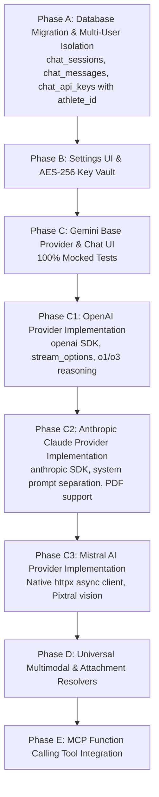

# AI Chat

> **Document Status**: Analysis and implementation plan — not yet implemented.
> **Depends on**: Kinetiqo MCP Server (Phases 1–4, fully implemented); Settings page infrastructure (existing); `chats` database table (new, this chapter).

---

### 14.1 Vision and Context

The Kinetiqo MCP server is fully implemented, tested, and verified working in both OpenClaw and Antigravity IDE. The next natural step is to bring that AI-powered athlete intelligence directly into the Kinetiqo web UI — without requiring the user to run a separate AI client. The goal is an integrated, private, self-hosted AI chat page that:

- **Talks to the athlete's own data** through the MCP tool layer already built (no separate Strava or third-party queries from the UI).
- **Stays inside Kinetiqo's privacy perimeter** — API keys are stored locally in the database, never sent to a third-party gateway.
- **Supports multiple AI providers** starting with Google Gemini AI, with the architecture ready to add OpenAI, Anthropic, Mistral, and others.
- **Offers a polished, modern chat experience** inspired by Gemini AI, Kimi, and Claude — with keyboard shortcuts, streamed responses, downloadable attachments, and persistent history across sessions.

The MCP tools provide the data; the chat page provides the conversational interface. This is a meaningful product extension: the athlete can ask "How was my training last month?" and receive an evidence-linked, data-backed answer — all from inside Kinetiqo, without pasting export files into an external AI tool.

---

### 14.2 Provider Architecture: Multi-Model from Day One

Although the first provider is Google Gemini AI, the internal architecture must be provider-agnostic from the start to avoid a costly refactor when a second provider is added.

#### 14.2.1 Provider Abstraction Layer

Define a thin Python abstraction in `src/kinetiqo/chat/providers/base.py`:

```python
from abc import ABC, abstractmethod
from dataclasses import dataclass
from typing import AsyncIterator

@dataclass
class ChatMessage:
    role: str        # "user" | "model" | "system"
    content: str     # plain-text content (after attachment resolution)
    attachments: list[dict] | None = None  # list of attachment descriptors

@dataclass
class ChatProviderModel:
    id: str          # e.g. "gemini-2.5-flash"
    display_name: str
    input_token_limit: int
    output_token_limit: int
    supports_vision: bool
    supports_document: bool

class ChatProvider(ABC):
    """Provider-agnostic LLM chat backend."""

    @abstractmethod
    async def list_models(self) -> list[ChatProviderModel]:
        """Return models available under the configured API key."""
        ...

    @abstractmethod
    async def send_message_stream(
        self,
        model_id: str,
        history: list[ChatMessage],
        new_message: ChatMessage,
    ) -> AsyncIterator[str]:
        """Stream response tokens for a new turn. Yields text chunks."""
        ...
```

Each provider (`src/kinetiqo/chat/providers/gemini.py`, future `openai.py`, etc.) implements this interface independently.

#### 14.2.2 Provider Registry

A simple registry in `src/kinetiqo/chat/providers/__init__.py` maps `provider_key` strings (stored in the API key table) to provider classes:

```python
PROVIDER_REGISTRY: dict[str, type[ChatProvider]] = {
    "gemini":    GeminiChatProvider,     # Chapter 14 — implemented first
    "openai":    OpenAIChatProvider,     # Chapter 15.1 — analyzed, ready to implement
    "anthropic": AnthropicChatProvider,  # Chapter 15.2 — analyzed, ready to implement
    "mistral":   MistralChatProvider,   # Chapter 15.3 — analyzed, ready to implement
}
```

The chat backend instantiates the appropriate provider at request time using the athlete's stored API key for that provider.

---

### 14.3 Google Gemini AI — API Details

#### 14.3.1 Authentication

Gemini AI uses a simple API key (no OAuth required for standard use):

- **Key source**: Google AI Studio → "Get API Key" → one key per Google account project.
- **Transport**: Pass via `x-goog-api-key` HTTP header (preferred over query parameter to avoid leaking in access logs).
- **SDK**: `google-genai` Python package (pip install `google-genai`). Instantiate with `genai.Client(api_key=stored_key)`.
- **Key validation**: On save, call `GET https://generativelanguage.googleapis.com/v1beta/models?pageSize=1` with the provided key. A `200 OK` confirms the key is valid; a `400` or `403` is reported immediately as a validation error.

#### 14.3.2 Listing Available Models

```http
GET https://generativelanguage.googleapis.com/v1beta/models
x-goog-api-key: {GEMINI_API_KEY}
```

Returns a paginated list of `models[]` objects. Filter to those with `generateContent` in `supportedGenerationMethods`. Relevant fields:

| Field | Purpose |
| :--- | :--- |
| `name` | Full resource name, e.g. `models/gemini-2.5-flash` |
| `displayName` | Human-readable label for the dropdown |
| `inputTokenLimit` | Max input context size |
| `outputTokenLimit` | Max output length |
| `supportedGenerationMethods` | Must include `generateContent` |
| `description` | Short description for tooltip |

**Caching strategy**: Cache the model list in `localStorage` (browser) with a 24-hour TTL, keyed by provider + first 8 chars of API key hash. Refresh on Settings save. Never re-fetch the model list on every page load.

#### 14.3.3 Chat API (Multi-Turn)

Use the `google-genai` SDK's chat session interface for server-side history management:

```python
from google import genai
from google.genai import types

client = genai.Client(api_key=stored_key)

# Reconstruct history from DB-persisted turns
history = [
    types.Content(role=turn["role"], parts=[types.Part.from_text(turn["content"])])
    for turn in db_history
]

chat = client.chats.create(model=selected_model_id, history=history)

# Stream the response
async for chunk in await chat.send_message_stream(new_user_message):
    yield chunk.text
```

For the Flask async route, use `httpx.AsyncClient` directly against the REST endpoint if the `google-genai` SDK's async support is not fully compatible with Gunicorn's worker class. The REST equivalent:

```http
POST https://generativelanguage.googleapis.com/v1beta/models/{model}:streamGenerateContent
x-goog-api-key: {GEMINI_API_KEY}
Content-Type: application/json

{
  "contents": [
    {"role": "user", "parts": [{"text": "..."}]},
    {"role": "model", "parts": [{"text": "..."}]},
    ...
  ]
}
```

**Streaming**: Use `streamGenerateContent` and forward SSE chunks to the browser via Flask's `Response(stream_with_context(...), mimetype="text/event-stream")`, consistent with Kinetiqo's existing SSE sync-progress pattern (HTMX + `htmx-ext-sse`).

#### 14.3.4 Multimodal Attachments

Gemini supports inline base64 image data and file URIs from Google File API. For Kinetiqo's first phase:
- Images: Encode as base64 inline `inlineData` parts (JPEG/PNG/WebP, max 20 MB per request).
- Documents (PDF): Use Gemini File API upload (upload once, get a `fileUri`, reference in subsequent turns). File URIs expire after 48 hours — store the URI alongside the attachment in the DB with `expires_at`.
- Future (Phase 2): MCP-generated poster/infographic artifacts can be attached by referencing their artifact ID; the chat backend resolves it to inline base64 before sending.

---

### 14.4 Database Schema: `chats` Table

The `chats` table persists all chat sessions and their message turns. Design priorities: efficient retrieval of a full session history, attachment support with minimal storage overhead for small attachments, external reference for large ones.

#### 14.4.1 Table Definitions

Add to `SCHEMA_DEFINITION` in `src/kinetiqo/db/schema.py` across all three dialects:

**`chat_sessions` table** — one row per named conversation thread:

```python
"chat_sessions": {
    "columns": [
        {"name": "session_id",   "type_mysql": "VARCHAR(36) PRIMARY KEY",
                                  "type_pg":    "VARCHAR(36) PRIMARY KEY",
                                  "type_firebird": "VARCHAR(36) PRIMARY KEY"},
        {"name": "athlete_id",   "type_mysql": "BIGINT NOT NULL",
                                  "type_pg":    "BIGINT NOT NULL",
                                  "type_firebird": "BIGINT NOT NULL"},
        {"name": "title",        "type_mysql": "TEXT",
                                  "type_pg":    "TEXT",
                                  "type_firebird": "VARCHAR(500)"},
        {"name": "provider",     "type_mysql": "VARCHAR(64) NOT NULL",
                                  "type_pg":    "VARCHAR(64) NOT NULL",
                                  "type_firebird": "VARCHAR(64) NOT NULL"},
        {"name": "model_id",     "type_mysql": "VARCHAR(128) NOT NULL",
                                  "type_pg":    "VARCHAR(128) NOT NULL",
                                  "type_firebird": "VARCHAR(128) NOT NULL"},
        {"name": "created_at",   "type_mysql": "TIMESTAMP NOT NULL",
                                  "type_pg":    "TIMESTAMP WITH TIME ZONE NOT NULL",
                                  "type_firebird": "TIMESTAMP NOT NULL"},
        {"name": "updated_at",   "type_mysql": "TIMESTAMP NOT NULL",
                                  "type_pg":    "TIMESTAMP WITH TIME ZONE NOT NULL",
                                  "type_firebird": "TIMESTAMP NOT NULL"},
    ],
    "indexes": [
        {"name": "idx_chat_sessions_athlete_updated",
         "def_mysql":    "CREATE INDEX idx_chat_sessions_athlete_updated ON chat_sessions (athlete_id, updated_at DESC)",
         "def_pg":       "CREATE INDEX idx_chat_sessions_athlete_updated ON chat_sessions (athlete_id, updated_at DESC)",
         "def_firebird": 'CREATE DESCENDING INDEX idx_chat_sessions_athlete_updated ON "chat_sessions" ("athlete_id", "updated_at")'}
    ]
}
```

**`chat_messages` table** — one row per message turn:

```python
"chat_messages": {
    "columns": [
        {"name": "message_id",      "type_mysql": "BIGINT AUTO_INCREMENT PRIMARY KEY",
                                     "type_pg":    "BIGINT GENERATED ALWAYS AS IDENTITY PRIMARY KEY",
                                     "type_firebird": "INTEGER GENERATED BY DEFAULT AS IDENTITY PRIMARY KEY"},
        {"name": "session_id",      "type_mysql": "VARCHAR(36) NOT NULL",
                                     "type_pg":    "VARCHAR(36) NOT NULL",
                                     "type_firebird": "VARCHAR(36) NOT NULL"},
        {"name": "athlete_id",      "type_mysql": "BIGINT NOT NULL",
                                     "type_pg":    "BIGINT NOT NULL",
                                     "type_firebird": "BIGINT NOT NULL"},
        {"name": "role",            "type_mysql": "VARCHAR(16) NOT NULL",
                                     "type_pg":    "VARCHAR(16) NOT NULL",
                                     "type_firebird": "VARCHAR(16) NOT NULL"},
        # Plaintext message body. For model turns this is the rendered text.
        {"name": "content",         "type_mysql": "LONGTEXT",
                                     "type_pg":    "TEXT",
                                     "type_firebird": "BLOB SUB_TYPE TEXT"},
        # JSON array of attachment descriptors (see §14.4.2). NULL when no attachments.
        {"name": "attachments",     "type_mysql": "TEXT",
                                     "type_pg":    "TEXT",
                                     "type_firebird": "VARCHAR(4000)"},
        {"name": "model_id",        "type_mysql": "VARCHAR(128)",
                                     "type_pg":    "VARCHAR(128)",
                                     "type_firebird": "VARCHAR(128)"},
        {"name": "provider",        "type_mysql": "VARCHAR(64)",
                                     "type_pg":    "VARCHAR(64)",
                                     "type_firebird": "VARCHAR(64)"},
        # Input/output token counts for cost awareness. NULL if provider does not report.
        {"name": "input_tokens",    "type_mysql": "INTEGER",
                                     "type_pg":    "INTEGER",
                                     "type_firebird": "INTEGER"},
        {"name": "output_tokens",   "type_mysql": "INTEGER",
                                     "type_pg":    "INTEGER",
                                     "type_firebird": "INTEGER"},
        {"name": "created_at",      "type_mysql": "TIMESTAMP NOT NULL",
                                     "type_pg":    "TIMESTAMP WITH TIME ZONE NOT NULL",
                                     "type_firebird": "TIMESTAMP NOT NULL"},
        # Error text when the model turn resulted in an error (rate limit, etc.)
        {"name": "error",           "type_mysql": "TEXT",
                                     "type_pg":    "TEXT",
                                     "type_firebird": "VARCHAR(1000)"},
    ],
    "indexes": [
        {"name": "idx_chat_messages_session",
         "def_mysql":    "CREATE INDEX idx_chat_messages_session ON chat_messages (session_id, message_id ASC)",
         "def_pg":       "CREATE INDEX idx_chat_messages_session ON chat_messages (session_id, message_id ASC)",
         "def_firebird": 'CREATE INDEX idx_chat_messages_session ON "chat_messages" ("session_id", "message_id")'},
        {"name": "idx_chat_messages_athlete",
         "def_mysql":    "CREATE INDEX idx_chat_messages_athlete ON chat_messages (athlete_id, created_at DESC)",
         "def_pg":       "CREATE INDEX idx_chat_messages_athlete ON chat_messages (athlete_id, created_at DESC)",
         "def_firebird": 'CREATE DESCENDING INDEX idx_chat_messages_athlete ON "chat_messages" ("athlete_id", "created_at")'}
    ]
}
```

#### 14.4.2 Attachment Descriptor Format

The `attachments` column stores a JSON array. Each element is a descriptor object:

```json
[
  {
    "attachment_id": "uuid-v4",
    "type": "image",
    "filename": "route_photo.webp",
    "mime_type": "image/webp",
    "size_bytes": 148320,
    "storage": "inline_b64",
    "data": "<base64-encoded-bytes>",
    "expires_at": null
  },
  {
    "attachment_id": "uuid-v4",
    "type": "document",
    "filename": "training_plan.pdf",
    "mime_type": "application/pdf",
    "size_bytes": 2048000,
    "storage": "gemini_file_api",
    "file_uri": "https://generativelanguage.googleapis.com/v1beta/files/abc123",
    "expires_at": "2026-11-01T12:00:00Z"
  },
  {
    "attachment_id": "uuid-v4",
    "type": "mcp_artifact",
    "filename": "poster_activity_1234.webp",
    "mime_type": "image/webp",
    "size_bytes": 512000,
    "storage": "mcp_artifact",
    "artifact_id": "kinetiqo-artifact-id",
    "expires_at": "2026-10-25T12:00:00Z"
  }
]
```

**Storage strategy by size and type**:

| Type | Size | Strategy |
| :--- | :--- | :--- |
| Image (JPEG/PNG/WebP) | ≤ 1 MB | Inline base64 in `data` field |
| Image | 1–20 MB | Gemini File API upload; store `file_uri` + `expires_at` |
| PDF document | Any | Gemini File API upload; store `file_uri` + `expires_at` |
| MCP artifact (poster, etc.) | Any | Reference by `artifact_id`; resolved at send time |
| Other binary | ≤ 500 KB | Inline base64 |
| Other binary | > 500 KB | Reject with user-friendly error until Phase 2 |

> **Firebird constraint**: Firebird's `VARCHAR(4000)` limit for `attachments` means large inline base64 blobs must use `BLOB SUB_TYPE TEXT` for the full `attachments` JSON on Firebird. The schema above uses `VARCHAR(4000)` as a starting point; if inline base64 data is stored, the field must be widened to `BLOB SUB_TYPE TEXT` on Firebird in the migration. Prefer `storage: "gemini_file_api"` on Firebird to keep attachment descriptors short.

**`chat_api_keys` table** — stores one API key per provider per athlete:

```python
"chat_api_keys": {
    "columns": [
        {"name": "key_id",       "type_mysql": "INTEGER AUTO_INCREMENT PRIMARY KEY",
                                  "type_pg":    "INTEGER GENERATED ALWAYS AS IDENTITY PRIMARY KEY",
                                  "type_firebird": "INTEGER GENERATED BY DEFAULT AS IDENTITY PRIMARY KEY"},
        {"name": "athlete_id",   "type_mysql": "BIGINT NOT NULL",
                                  "type_pg":    "BIGINT NOT NULL",
                                  "type_firebird": "BIGINT NOT NULL"},
        {"name": "provider",     "type_mysql": "VARCHAR(64) NOT NULL",
                                  "type_pg":    "VARCHAR(64) NOT NULL",
                                  "type_firebird": "VARCHAR(64) NOT NULL"},
        # Encrypted with AES-256 using Flask SECRET_KEY. Never stored in plaintext.
        {"name": "api_key_enc",  "type_mysql": "TEXT NOT NULL",
                                  "type_pg":    "TEXT NOT NULL",
                                  "type_firebird": "VARCHAR(512) NOT NULL"},
        {"name": "is_valid",     "type_mysql": "BOOLEAN NOT NULL DEFAULT 1",
                                  "type_pg":    "BOOLEAN NOT NULL DEFAULT TRUE",
                                  "type_firebird": "SMALLINT NOT NULL DEFAULT 1"},
        {"name": "validated_at", "type_mysql": "TIMESTAMP",
                                  "type_pg":    "TIMESTAMP WITH TIME ZONE",
                                  "type_firebird": "TIMESTAMP"},
        {"name": "created_at",   "type_mysql": "TIMESTAMP NOT NULL",
                                  "type_pg":    "TIMESTAMP WITH TIME ZONE NOT NULL",
                                  "type_firebird": "TIMESTAMP NOT NULL"},
        {"name": "updated_at",   "type_mysql": "TIMESTAMP NOT NULL",
                                  "type_pg":    "TIMESTAMP WITH TIME ZONE NOT NULL",
                                  "type_firebird": "TIMESTAMP NOT NULL"},
    ],
    "indexes": [
        {"name": "uq_chat_api_keys_athlete_provider",
         "def_mysql":    "CREATE UNIQUE INDEX uq_chat_api_keys_athlete_provider ON chat_api_keys (athlete_id, provider)",
         "def_pg":       "CREATE UNIQUE INDEX uq_chat_api_keys_athlete_provider ON chat_api_keys (athlete_id, provider)",
         "def_firebird": 'CREATE UNIQUE INDEX uq_chat_api_keys_athlete_provider ON "chat_api_keys" ("athlete_id", "provider")'}
    ]
}
```

---

### 14.5 API Key Security

API keys for AI providers are sensitive credentials. They must never be stored in plaintext and must follow the same security standards applied to other credentials in Kinetiqo.

#### 14.5.1 Encryption at Rest

- Encrypt API keys with **AES-256-GCM** before writing to `chat_api_keys.api_key_enc`.
- Derive the encryption key from `SECRET_KEY` using `HKDF-SHA256` with a fixed info label (`b"kinetiqo-chat-api-key-encryption"`).
- Use Python's `cryptography` library (`pip install cryptography`, already likely present for Flask-WTF/TLS).
- Store format: `base64(nonce || ciphertext || tag)` — allows nonce to be random per write.
- **Never** log or include the decrypted key in error messages, audit logs, or API responses.

#### 14.5.2 Settings Page — AI Features Section

Add an **"AI Features"** collapsible section to the existing Settings page (`src/kinetiqo/web/templates/settings.html`), following the same Tailwind CSS component pattern used by other settings panels.

UI elements per provider row:

| Element | Details |
| :--- | :--- |
| Provider badge | Small icon + name (e.g. Google Gemini AI gem icon) |
| API key input | `<input type="password">` with show/hide toggle; placeholder shows masked existing key if set |
| Status badge | `✓ Valid` (green), `⚠ Invalid` (red), `Not configured` (grey) — updates after save |
| Save button | Validates key against provider's model list endpoint; saves encrypted value; updates `is_valid` and `validated_at` |
| Remove button | Clears the key; removes from DB; marks provider unavailable in model dropdown |
| Link | "How to get a Gemini API key →" opens Google AI Studio in a new tab |

Validation flow (client → server):
1. User enters key and clicks **Save**.
2. POST `/settings/ai-keys` with CSRF token and `{ "provider": "gemini", "api_key": "..." }`.
3. Server calls `GeminiChatProvider.list_models()` with the new key.
4. On success: encrypt and upsert into `chat_api_keys`; return `{ "status": "valid", "model_count": N }`.
5. On failure: return HTTP 422 `{ "error": "Invalid API key", "detail": "403 Forbidden from provider" }`.
6. Client shows inline success (`Saved ✓`) or error (`Invalid key — check your Google AI Studio account`), adjacent to the input field (same pattern as existing FTP validation per §4.9 of AGENTS.md).

**Environment variable fallback**: If `GEMINI_API_KEY` (or a future `OPENAI_API_KEY`) is set in the environment, it takes precedence over the DB-stored value, analogous to how `ATHLETE_WEIGHT` overrides the DB profile. Document this override clearly in Settings UI with a banner: `"⚙ Key overridden by environment variable GEMINI_API_KEY"`.

---

### 14.6 New Page: AI Chat (`/chat`)

#### 14.6.1 Left Navigation Menu

Add **"AI Chat"** as a new left menu item, positioned after (or near) the MCP-related entries, using the same Tailwind sidebar pattern as existing items:

- **Icon**: A chat bubble SVG (Heroicons `chat-bubble-left-ellipsis`), consistent with the existing sidebar icon style.
- **Label**: "AI Chat"
- **Badge** (optional): A small coloured dot indicating the configured provider(s) — green if at least one valid key is present, grey otherwise.
- **Route**: `/chat` (for the default/new session) and `/chat/<session_id>` (for a specific session).
- **Access**: Requires login (`@login_required`). Shows even if no API key is configured, but displays an onboarding prompt to configure one in Settings.

#### 14.6.2 Page Layout

Inspired by Gemini AI, Kimi, and Claude — clean, dark-mode-first, three-column-collapsible layout:

```
┌─────────────────────────────────────────────────────────────────────┐
│  [Kinetiqo sidebar]  │  [Session list panel]  │  [Chat area]        │
│                      │  (collapsible)          │                     │
│  (existing nav)      │  ─────────────────────  │  ┌───────────────┐ │
│                      │  + New Chat             │  │ [message 1]   │ │
│                      │  ─────────────────────  │  │ (user bubble) │ │
│                      │  Today                  │  ├───────────────┤ │
│                      │  · How was my week?     │  │ [message 2]   │ │
│                      │  · Poster for Dolomites │  │ (model bubble)│ │
│                      │  Yesterday              │  │               │ │
│                      │  · Recovery after fondo │  │ [streaming…]  │ │
│                      │  ─────────────────────  │  └───────────────┘ │
│                      │                         │                     │
│                      │                         │  [Model selector]   │
│                      │                         │  [Input box]        │
│                      │                         │  [Send] [Attach]    │
└─────────────────────────────────────────────────────────────────────┘
```

**Session list panel** (left secondary column, 240px wide, collapsible):
- Shows chat sessions grouped by date ("Today", "Yesterday", "Last 7 days", "Older").
- Session title is auto-generated from the first user message (first 60 chars), or user-editable via double-click.
- "**+ New Chat**" button at top starts a fresh session.
- Clicking a session loads its history from `chat_messages`.
- On mobile (< 768px): session list is hidden, accessible via a hamburger/drawer.

**Chat area** (right, fills remaining width):
- Scrollable message list, oldest at top, newest at bottom.
- Auto-scrolls to latest message during streaming.
- User messages: right-aligned bubble with user avatar initial; semi-transparent background.
- Model messages: left-aligned, full-width prose display with markdown rendering (use `marked.js`, already a candidate for vendor assets — or a minimal inline renderer).
- Streaming indicator: animated typing dots (`⋯`) while SSE chunks arrive.
- Each model message has copy-to-clipboard icon (top-right corner, appears on hover).

**Input area** (fixed at bottom of chat area):
- Multi-line `<textarea>` with auto-grow (max 8 lines before scroll).
- Placeholder: `"Ask about your training, generate a poster, or analyse a ride…"`.
- **↑ / ↓ arrow keys** in an empty input box scroll through previous prompts in this session (browser-history-style, stored in `sessionStorage` as a local prompt array — not DB).
- **Enter** sends the message; **Shift+Enter** inserts a newline.
- **Send button** (paper-plane icon) — disabled while a response is streaming; shows `kinetiqo-loading-32x32.webp` (per §4.13 of AGENTS.md) while waiting.
- **Attach button** (paperclip icon) — opens native file picker; accepts images (JPEG/PNG/WebP/GIF, ≤ 20 MB) and PDFs (≤ 50 MB); validates client-side before upload.
- Attached files appear as thumbnail chips above the input box; each has an × remove button.

**Model selector** (above input area, right-aligned):
- A `<select>` dropdown populated from the cached model list.
- Grouped by provider (e.g. `optgroup` "Google Gemini AI" containing "Gemini 2.5 Flash", "Gemini 2.5 Pro", etc.).
- **Only providers with a valid configured API key are shown** — providers without a key are either hidden or shown greyed-out with a "Configure in Settings →" link.
- Persists selected model to `localStorage` key `chatSelectedModel`.
- Shows a small info icon next to the dropdown; hovering reveals the model's token limits and capabilities tooltip.

---

### 14.7 Chat Session Flow (Technical)

#### 14.7.1 Starting a New Chat

1. User clicks "+ New Chat" or navigates to `/chat`.
2. Frontend generates a UUID v4 `session_id` in JavaScript (or server generates it on first message POST).
3. URL updates to `/chat/<session_id>` (browser history pushState, no full reload).
4. Session row is created in `chat_sessions` on the **first message** (not on page load), avoiding empty session orphans.

#### 14.7.2 Sending a Message

POST `/api/chat/<session_id>/message`:
```json
{
  "provider": "gemini",
  "model_id": "gemini-2.5-flash",
  "content": "How was my training this week?",
  "attachments": []
}
```

Server flow:
1. Validate CSRF, login, session ownership.
2. Load existing `chat_messages` for the session (ordered by `message_id ASC`).
3. Upsert the `chat_sessions` row (create if new, update `updated_at`, `model_id`, `provider`).
4. Insert the new user `chat_messages` row.
5. Retrieve the decrypted API key for the specified provider; return HTTP 422 if not configured.
6. Instantiate the provider; reconstruct history from DB rows.
7. Call `provider.send_message_stream(...)` and return an SSE stream.
8. For each SSE chunk: emit `data: {"delta": "..."}`.
9. On stream completion: emit `data: {"done": true, "input_tokens": N, "output_tokens": M}`.
10. After stream ends: insert model's `chat_messages` row with full `content` and token counts.

> **Error handling**: If the provider returns a rate-limit (429) or quota error, emit `data: {"error": "Rate limit reached. Try again in a few seconds."}` and insert an error `chat_messages` row with `role="model"`, `content=null`, `error="Rate limit: ..."`. Display the error inline in the chat bubble with a retry button.

#### 14.7.3 SSE Integration Pattern

Reuse Kinetiqo's existing SSE pattern (already used for sync progress with HTMX):

```python
# Flask async route
@app.route("/api/chat/<session_id>/message", methods=["POST"])
@login_required
async def chat_send_message(session_id):
    # ... validation ...

    def generate():
        full_response = []
        for chunk in provider_stream:
            text = chunk.text or ""
            full_response.append(text)
            yield f"data: {json.dumps({'delta': text})}\n\n"
        # Persist to DB after stream ends
        _persist_model_message(session_id, "".join(full_response), ...)
        yield f"data: {json.dumps({'done': True})}\n\n"

    return Response(stream_with_context(generate()), mimetype="text/event-stream")
```

The browser-side JavaScript connects via `EventSource` or `fetch` with `ReadableStream`, updates the DOM incrementally, and on `done: true` saves the final message to the session state.

---

### 14.8 Attachment Handling

#### 14.8.1 Upload Flow

1. User selects a file via the attach button.
2. Client validates file type (whitelist: `image/jpeg`, `image/png`, `image/webp`, `image/gif`, `application/pdf`) and size (≤ 20 MB for images, ≤ 50 MB for PDF).
3. File is uploaded to POST `/api/chat/attachments/upload` (multipart form, CSRF protected).
4. Server determines storage strategy based on size and type:
   - Small image (≤ 1 MB): base64-encode immediately; return `{ "storage": "inline_b64", "data": "..." }`.
   - Large image or PDF: upload to Gemini File API; poll until `state == ACTIVE`; return `{ "storage": "gemini_file_api", "file_uri": "...", "expires_at": "..." }`.
5. Client stores the attachment descriptor in memory; shows thumbnail chip.
6. On message send, attachment descriptors are included in the POST body.
7. Server assembles the provider-specific `parts` list (inline data or file URI reference) and sends.

#### 14.8.2 Displaying Model Responses with Attachments

The model (Gemini) may return **inline images** (e.g. generated charts or diagrams) in its response parts. Handle `inlineData` parts in the response:

1. Detect `response.candidates[0].content.parts` with `mime_type` and `data` (base64).
2. Save the image to the MCP artifact store (same directory as poster/fondo artifacts), generate an `artifact_id`.
3. Insert the artifact descriptor into the `attachments` JSON of the model's `chat_messages` row.
4. Render in the chat bubble as a `` thumbnail with a **Download** button and a fullscreen preview modal (per existing WebP modal standard from `AGENTS.md`).
5. The download button triggers GET `/api/chat/attachments/<attachment_id>/download` returning the file with appropriate `Content-Disposition: attachment`.

#### 14.8.3 Download Icons and UX

For any attachment (user-uploaded or model-returned):
- Images: thumbnail preview (max 320×240px in bubble) with a cloud-download SVG icon button.
- PDFs: PDF icon (`static/img/pdf-icon.svg`) with filename, file size, and download button.
- MCP artifacts referenced by the model: show the kinetiqo-branded poster thumbnail.
- All download buttons: `<a href="/api/chat/attachments/<id>/download" download>` — no JavaScript required; browser handles the download natively.

---

### 14.9 MCP Tool Integration in Chat

The chat backend can optionally augment the AI's context with Kinetiqo athlete data by pre-loading MCP tool results as a **system context message** prepended to the conversation:

**System context injection (Phase 2)**:
- When the user starts a new chat, the backend calls a small set of read-only MCP tools automatically: `kinetiqo_get_activity_totals` (last 7 days), `kinetiqo_get_fitness_and_freshness` (current CTL/ATL/TSB), and `kinetiqo_get_training_goals`.
- Results are serialized as a structured system message injected before the first user turn.
- This gives the model immediate context ("You are an AI assistant with access to the following athlete data: CTL=72, ATL=85, TSB=-13, this week: 3 rides, 187 km...") without the user having to ask for it.
- The system context message is **not displayed in the chat UI** but is visible if the user explicitly asks "What data do you have about me?".

**On-demand tool calls (Phase 3 — requires careful design)**:
- For a richer experience, the model could request Kinetiqo MCP tools on demand (function calling). Gemini supports `function_declarations` in the request.
- Implementation: expose a whitelist of MCP tools as Gemini `Tool` definitions; handle `functionCall` response parts by executing the tool against the local DB and injecting the result as a `functionResponse` turn.
- This is architecturally straightforward given the MCP tool layer already exists but requires careful handling of tool execution time budgets (max 10 seconds per tool call), error display, and preventing the model from calling mutating tools (gated by `KINETIQO_MCP_ALLOW_*` flags — only read-only tools are exposed to the chat function-calling interface).
- Phase 3 is explicitly out of scope for the initial implementation.

---

### 14.10 Session Management UX

#### 14.10.1 Session Naming

- Auto-title: Generated from the first user message (first 60 characters, stripped of leading whitespace). Persisted to `chat_sessions.title` after the first message.
- Manual rename: Double-click the session name in the left panel; inline edit; save on blur or Enter; PATCH `/api/chat/<session_id>/title`.
- Auto-title from model (Phase 2): After the first model response, POST a separate `generateContent` call with prompt `"In 5 words or fewer, summarize this conversation: [first exchange]"` and update the title. Debounce to avoid extra API calls.

#### 14.10.2 Session Deletion

- Trash icon on session hover in the left panel.
- Confirmation dialog: `"Delete this chat? This cannot be undone."`.
- DELETE `/api/chat/<session_id>` → removes `chat_sessions` and all `chat_messages` rows (cascade in SQL or two queries).
- Also removes any associated Gemini File API uploads (call `DELETE https://generativelanguage.googleapis.com/v1beta/files/{file_id}` for each attachment with `storage: "gemini_file_api"`).

#### 14.10.3 Session Context Window Management

Long conversations eventually exceed the model's context window. Strategy:

- Track cumulative `input_tokens` across messages in the session.
- When approaching 80% of the model's `inputTokenLimit`, display a subtle banner: `"This conversation is getting long. Consider starting a new chat for best results."`.
- Do **not** silently truncate history — always show the user the full history in the UI and explain if older turns are dropped from the model context.
- Truncation policy (if the operator decides to implement it): drop oldest user/model pairs until total tokens are within 70% of limit, always keeping the system context message and the last 2 turns.

---

### 14.11 Settings Page Changes

The Settings page (`/settings`) gains a new **"AI Features"** section, inserted after the existing "Strava Description Templates" section:

```
╔══════════════════════════════════════════════════════╗
║  AI Features                                         ║
╠══════════════════════════════════════════════════════╣
║                                                      ║
║  Configure AI provider API keys to enable the        ║
║  AI Chat feature. Keys are stored encrypted in       ║
║  your local database and never sent to third parties ║
║  other than the AI provider you configure.           ║
║                                                      ║
║  ┌────────────────────────────────────────────────┐  ║
║  │  🌟 Google Gemini AI                           │  ║
║  │  API Key: [●●●●●●●●●●●●●●●●●●] [👁] [Remove]  │  ║
║  │  Status: ✓ Valid · 12 models available          │  ║
║  │  [Save Key]                                     │  ║
║  │  → How to get a Gemini API key                  │  ║
║  └────────────────────────────────────────────────┘  ║
║                                                      ║
║  (future providers appear here as grey cards)        ║
╚══════════════════════════════════════════════════════╝
```

**New Flask route**: POST `/settings/ai-keys` — CSRF protected, login required, validates and saves/updates the key.

**New Flask route**: DELETE `/settings/ai-keys/<provider>` — removes the key for a provider.

**Config additions** in `src/kinetiqo/config.py` (environment-variable overrides, analogous to map API keys):

```python
# AI Chat provider API keys (override DB-stored encrypted values if set)
gemini_api_key: str | None = os.getenv("GEMINI_API_KEY", "")
# openai_api_key: str | None = os.getenv("OPENAI_API_KEY", "")  # future
```

---

### 14.12 Routing and Template Structure

New files and routes:

| Path | Type | Purpose |
| :--- | :--- | :--- |
| `src/kinetiqo/web/templates/chat.html` | Jinja2 template | AI Chat page (extends `base.html`) |
| `src/kinetiqo/chat/__init__.py` | Python package | Chat feature root |
| `src/kinetiqo/chat/providers/base.py` | Python | Abstract provider interface |
| `src/kinetiqo/chat/providers/gemini.py` | Python | Gemini AI provider implementation |
| `src/kinetiqo/chat/providers/__init__.py` | Python | Provider registry |
| `src/kinetiqo/chat/service.py` | Python | Chat service (session CRUD, message persistence, provider dispatch) |
| `src/kinetiqo/chat/encryption.py` | Python | AES-256-GCM encrypt/decrypt for API keys |
| `src/kinetiqo/db/repository.py` | Python | New abstract methods: `create_chat_session`, `get_chat_sessions`, `get_chat_messages`, `insert_chat_message`, `update_chat_session_title`, `delete_chat_session`, `upsert_chat_api_key`, `get_chat_api_key`, `delete_chat_api_key` |
| `static/js/chat.js` | JavaScript | Chat UI logic (SSE, DOM updates, attachment handling, prompt history) |
| `static/css/chat.css` | CSS | Chat-specific styles (message bubbles, typing indicator, attachment chips) |

New Flask routes (all `@login_required`, CSRF on POST/PUT/DELETE):

| Method | Route | Purpose |
| :--- | :--- | :--- |
| GET | `/chat` | Render chat page (no session, show welcome) |
| GET | `/chat/<session_id>` | Render chat page with session loaded |
| GET | `/api/chat/sessions` | List sessions (JSON, for left panel) |
| POST | `/api/chat/sessions` | Create new session (returns `session_id`) |
| PATCH | `/api/chat/<session_id>/title` | Rename session |
| DELETE | `/api/chat/<session_id>` | Delete session and messages |
| GET | `/api/chat/<session_id>/messages` | Load full message history |
| POST | `/api/chat/<session_id>/message` | Send message → SSE stream |
| POST | `/api/chat/attachments/upload` | Upload attachment |
| GET | `/api/chat/attachments/<id>/download` | Download attachment |
| GET | `/api/chat/models` | List available models for configured providers |
| POST | `/settings/ai-keys` | Save/update provider API key |
| DELETE | `/settings/ai-keys/<provider>` | Remove provider API key |

---

### 14.13 Security Considerations

| Concern | Mitigation |
| :--- | :--- |
| API key storage | AES-256-GCM encryption at rest using `HKDF(SECRET_KEY)`. Never logged or returned in API responses. |
| CSRF | All POST/PATCH/DELETE routes require `X-CSRFToken` header (flask-wtf). |
| Session isolation | All DB queries filter by `athlete_id = current_user.id`. A user cannot access another user's sessions or attachments. |
| Path traversal in attachment download | Attachment storage uses opaque UUIDs, never user-supplied paths. Server resolves UUID → stored bytes, not filesystem paths. |
| Attachment content validation | Server re-validates MIME type using `python-magic` on the uploaded bytes (not just the filename extension) before storing or forwarding to provider. |
| Prompt injection via attachments | Warn user that uploaded documents may contain instructions to the model. Do not silently follow model-generated tool calls that were not user-initiated (Phase 3 safeguard). |
| Rate limits and costs | Display token counts per response. No automated retry loops. Let user control retry. |
| Data transmitted to AI provider | Document clearly that message content and attachments are sent to the selected AI provider. Warn that GPS coordinates, activity IDs, and personally identifiable athlete data sent in prompts or attachments leave Kinetiqo's privacy boundary. Show this warning once per provider configuration. |
| Gemini File API expiry | Track `expires_at` for file URIs; display an expired-attachment indicator in old chat messages rather than silently failing. |

---

### 14.14 Implementation Roadmap

#### Phase A: Foundation (no UI yet)

1. Add `chat_sessions`, `chat_messages`, and `chat_api_keys` tables to `SCHEMA_DEFINITION` in `schema.py` for all three backends (PostgreSQL, MySQL, Firebird).
2. Add abstract repository methods for chat in `src/kinetiqo/db/repository.py`; implement in all three concrete backends.
3. Implement `src/kinetiqo/chat/encryption.py` with AES-256-GCM using `cryptography` library.
4. Implement `src/kinetiqo/chat/providers/base.py` (abstract interface).
5. Implement `src/kinetiqo/chat/providers/gemini.py`: `list_models()` and `send_message_stream()` using `google-genai` SDK or `httpx` for streaming.
6. Add `GEMINI_API_KEY` to `Config` (env override, no default).
7. Add `google-genai` to `requirements.txt` with pinned version.
8. Write mocked unit tests for: encryption round-trip, Gemini provider model listing, Gemini streaming (mock `httpx`), DB methods for all three backends.
9. **Exit gate**: All mocked tests pass. No web UI changes yet.

#### Phase B: Settings Integration

1. Add "AI Features" section to `settings.html`.
2. Implement POST `/settings/ai-keys` and DELETE `/settings/ai-keys/<provider>` routes.
3. Implement `chat_service.py` with session CRUD and key management.
4. Test Settings UI: save valid key → success badge; save invalid key → error; remove key → provider disappears from chat.
5. **Exit gate**: Can save, validate, and remove a Gemini API key via Settings UI. Key is encrypted in DB.

#### Phase C: Chat Page — Basic Text Chat

1. Add `/chat` route and `chat.html` template with session list panel and chat area.
2. Add `static/js/chat.js` and `static/css/chat.css`.
3. Implement GET `/api/chat/sessions`, POST `/api/chat/sessions`, GET `/api/chat/<session_id>/messages`.
4. Implement POST `/api/chat/<session_id>/message` with SSE streaming response.
5. Implement model selector dropdown (GET `/api/chat/models`).
6. Implement ↑/↓ prompt history (sessionStorage).
7. Implement markdown rendering of model responses (use `marked.js`, add to `development/vendor-libraries.yaml`).
8. Implement session rename and delete.
9. **Exit gate**: Can start a new chat, send a text prompt to Gemini, see the streamed response, and view session history. Models only show if a valid key is configured.

#### Phase D: Attachments

1. Implement POST `/api/chat/attachments/upload` with file type/size validation, inline base64 for small images, and Gemini File API upload for large images and PDFs.
2. Implement attachment thumbnail chips in the input area.
3. Implement model response attachment parsing (inline image parts from Gemini).
4. Implement GET `/api/chat/attachments/<id>/download`.
5. Implement fullscreen image preview modal (consistent with existing WebP modal standard).
6. **Exit gate**: Can attach an image or PDF, send it with a text prompt, and receive a model response that references the image. Model-returned images are downloadable.

#### Phase E: MCP Context Injection (System Context)

1. On new chat creation, call `kinetiqo_get_activity_totals`, `kinetiqo_get_fitness_and_freshness`, and `kinetiqo_get_training_goals` via the existing MCP tool service layer.
2. Serialize results as a structured system context message (not displayed in UI by default).
3. Inject into the provider history before the first user turn.
4. Add a "Show system context" toggle (debug/power-user feature, collapsible).
5. **Exit gate**: New chat automatically includes current athlete fitness context. Model answers "How am I doing?" with accurate CTL/ATL/TSB data without the user having to ask.

---

### 14.15 Testing Requirements

All tests must be mocked — no live Gemini API calls in CI.

| Area | Required cases |
| :--- | :--- |
| Encryption | Round-trip encrypt/decrypt; different nonces per call; wrong key fails decryption; empty key rejected. |
| Gemini provider | `list_models()` with mocked HTTP response; filter non-generative models; `send_message_stream()` with mocked SSE chunks; 429 rate limit handling; API key validation (200 vs 403). |
| Chat DB methods | Session create/read/update/delete for all three backends; message insertion and retrieval ordered by `message_id`; `athlete_id` isolation (one user cannot read another's sessions); Firebird `BLOB SUB_TYPE TEXT` for large attachment JSON. |
| Settings routes | POST valid key → DB upsert + `is_valid=True`; POST invalid key → HTTP 422 + `is_valid=False`; DELETE → key removed; environment override banner displayed when env var set. |
| Chat routes | New session creation on first message; SSE stream termination; error message DB row on provider failure; session ownership check (403 for wrong athlete); attachment size/type rejection. |
| Model selector | Only providers with `is_valid=True` API keys appear; environment-var-overridden key always appears. |
| Token limit warning | Warning displayed when cumulative tokens approach 80% of model limit. |
| Attachment security | MIME type re-validation; UUID-only download paths; expired Gemini File API URI shows indicator; cross-user download returns 403. |

---

### 14.16 Dependencies to Add

| Package | Version | Purpose |
| :--- | :--- | :--- |
| `google-genai` | ≥ 1.0.0 (pin to tested version) | Google Gemini AI SDK |
| `cryptography` | ≥ 42.0.0 (pin; verify not already present) | AES-256-GCM key encryption |
| `marked.js` | 15.x (vendor via `development/vendor-libraries.yaml`) | Markdown rendering in chat bubbles |

Verify `pip check` passes with all existing pinned dependencies after adding `google-genai` and `cryptography`. Add both to `requirements.txt` with pinned versions.

---

### 14.17 Out of Scope (Initial Implementation)

The following are **not** part of the initial Gemini-first AI Chat implementation and require a separate product decision:

- **OpenAI / Anthropic / Mistral providers**: Full architectural and technical analysis is provided in **Chapter 15** below. They are scheduled for implementation immediately following Phase C (Gemini stabilization).
- **Microsoft Azure**: Azure OpenAI Service and Azure AI Foundry are intentionally excluded — they act as proxy wrappers for the exact same model families (OpenAI GPT, Mistral) already supported directly, requiring complex Azure-specific resource group and deployment-name configuration without adding athlete-facing capabilities.
- **MCP function calling** (Phase E, on-demand tool calls): Architecture is planned but requires tool schema serialization, execution timeout management, and UI for showing tool calls in the chat thread.
- **Image generation** (DALL-E, Imagen): Out of scope; Kinetiqo has Playwright-based poster generation instead.
- **Sharing chat transcripts**: No public export or share link feature in Phase A–E.
- **Cross-athlete collaborative chat**: Kinetiqo supports multiple athletes on the same instance, but each athlete's chat history, API keys, and sessions are strictly private and isolated by `athlete_id`.
- **Chat-initiated sync or Strava writes**: The chat backend only calls read-only MCP tools (Phase E); mutating operations are never triggered from a chat message, even if the user asks.
- **Voice input/output**: Not planned.
- **RAG over activity data**: Full-text search over activity names and descriptions via `chat_messages` is out of scope; the MCP tool layer provides structured query access instead.

---

## 15. Additional AI Provider Analysis (OpenAI, Anthropic, Mistral AI)

> **Document Status**: Deep analysis and implementation blueprint — ready for implementation.
> **Depends on**: Chapter 14 base implementation (Gemini provider working, provider abstraction stable, multi-user DB schema created).
> **Scope**: Detailed REST and SDK specifications for OpenAI, Anthropic Claude, and Mistral AI, including authentication, dynamic model listing, token accounting, streaming protocols, multi-turn role translation, rate limits, multi-user `athlete_id` isolation, and 100% mocked unit tests.

---

### 15.0 Provider Comparison Matrix

| Dimension | Google Gemini | OpenAI | Anthropic Claude | Mistral AI |
| :--- | :--- | :--- | :--- | :--- |
| **API Endpoint** | `generativelanguage.googleapis.com/v1beta` | `api.openai.com/v1` | `api.anthropic.com/v1` | `api.mistral.ai/v1` |
| **Auth Headers** | `x-goog-api-key: {KEY}` | `Authorization: Bearer {KEY}` | `x-api-key: {KEY}`<br>`anthropic-version: 2023-06-01` | `Authorization: Bearer {KEY}` |
| **Model Catalog** | `GET /models` | `GET /models` | `GET /models` | `GET /models` (rich metadata) |
| **Chat Endpoint** | `POST /models/{id}:streamGenerateContent` | `POST /chat/completions` | `POST /messages` | `POST /chat/completions` |
| **Streaming Protocol** | SSE (`data: {candidates: ...}`) | SSE (`data: {choices: ...}`, `[DONE]`) | SSE typed events (`content_block_delta`) | SSE (`data: {choices: ...}`, `[DONE]`) |
| **System Prompt** | `systemInstruction` object | `role: "system"` or `"developer"` | Separate top-level `system` field | `role: "system"` in messages |
| **Role Translation** | `user` / `model` | `user` / `assistant` | `user` / `assistant` | `user` / `assistant` |
| **Max Context (Best)** | 1,000,000 tokens (Gemini 2.5 Pro) | 128,000–1,048,576 tokens (GPT-4.1) | 1,000,000 tokens (Claude Sonnet/Opus) | 131,072–262,144 tokens (Mistral Large/Small) |
| **Max Output Tokens** | 8,192 tokens | 16,384–100,000 tokens (o3) | 8,192–64,000 tokens | 16,384–32,768 tokens |
| **Token Usage in Stream** | Sent in final `usageMetadata` chunk | Sent via `stream_options.include_usage: true` | Sent in `message_start` & `message_delta` | Sent via `stream_options.include_usage: true` |
| **Vision Attachments** | Inline base64 or File API | Inline base64 (`image_url`) | Inline base64 (`image` block) | Inline base64 (`image_url`, Pixtral models only) |
| **PDF Attachments** | Native File API & inline | Not natively supported inline | Native `type: "document"` base64 | Not supported |
| **Python Client** | `google-genai` SDK | `openai` SDK (`AsyncOpenAI`) | `anthropic` SDK (`AsyncAnthropic`) | Native `httpx.AsyncClient` (no extra SDK needed) |
| **Rate Limit Model** | Per-project RPM/TPM quota | Tier-based (Build, Launch, Grow) | Usage-based tiers (Tiers 1–4) | Per-key tier (Free, Experiment, Deployed) |

---

### 15.1 OpenAI

#### 15.1.1 Authentication & Credentials
- **Key Source**: [platform.openai.com/api-keys](https://platform.openai.com/api-keys). Secret keys begin with `sk-` or project keys with `sk-proj-`.
- **HTTP Header**: `Authorization: Bearer sk-...`
- **Optional Organization/Project**: `OpenAI-Organization: org-...` or `OpenAI-Project: proj-...` (useful for enterprise accounts with multiple sub-projects).
- **Key Validation Endpoint**: `GET https://api.openai.com/v1/models`.
  - HTTP `200 OK`: Key is valid and authorized.
  - HTTP `401 Unauthorized`: Bad key, revoked, or invalid format.
  - HTTP `429 Too Many Requests`: Account quota exhausted or temporary RPM exceeded.

#### 15.1.2 Dynamic Model Discovery & Filtering
OpenAI returns hundreds of models from `GET /v1/models`, including legacy engines, text embeddings (`text-embedding-3-small`), audio models (`tts-1`, `whisper-1`), and fine-tunes.

**Kinetiqo Filtering Logic**:
Filter the raw list to chat-capable conversational models using a known prefix check:
```python
CHAT_PREFIXES = ("gpt-4", "gpt-3.5", "o1", "o3", "o4")

def is_openai_chat_model(model_id: str) -> bool:
    return any(model_id.startswith(prefix) for prefix in CHAT_PREFIXES)
```

Because OpenAI's `/v1/models` does not return context window or max output tokens in its payload, Kinetiqo supplements the live model list with a cached metadata mapping:
```python
OPENAI_MODEL_METADATA: dict[str, dict] = {
    "gpt-4o":                {"input": 128_000,   "output": 16_384,  "vision": True,  "docs": False},
    "gpt-4o-mini":           {"input": 128_000,   "output": 16_384,  "vision": True,  "docs": False},
    "gpt-4.1":               {"input": 1_048_576, "output": 32_768,  "vision": True,  "docs": False},
    "gpt-4.1-mini":          {"input": 1_048_576, "output": 32_768,  "vision": True,  "docs": False},
    "o1":                    {"input": 200_000,   "output": 100_000, "vision": True,  "docs": False},
    "o1-mini":               {"input": 128_000,   "output": 65_536,  "vision": False, "docs": False},
    "o3":                    {"input": 200_000,   "output": 100_000, "vision": True,  "docs": False},
    "o3-mini":               {"input": 200_000,   "output": 100_000, "vision": False, "docs": False},
    "_default":              {"input": 128_000,   "output": 16_384,  "vision": False, "docs": False},
}
```

> **Reasoning Model Nuance (`o1`, `o3`)**:
> - Reasoning models generate internal chain-of-thought tokens that are billed as completion tokens.
> - They use `max_completion_tokens` instead of `max_tokens`.
> - They do not support custom `temperature` (fixed at 1.0) or `top_p`.
> - They require system prompts to be passed as `developer` role or injected into the initial `user` message.

#### 15.1.3 Streaming Chat Completions & Token Accounting
**Endpoint**: `POST https://api.openai.com/v1/chat/completions`

**Request Payload**:
```json
{
  "model": "gpt-4o",
  "messages": [
    {"role": "system", "content": "You are Kinetiqo AI, an athlete data assistant."},
    {"role": "user", "content": "Analyze my cycling volume this month."}
  ],
  "stream": true,
  "stream_options": {"include_usage": true},
  "max_completion_tokens": 4096,
  "temperature": 0.7
}
```

**Token Usage Delivery**:
With `stream_options: {"include_usage": true}`, OpenAI sends a final SSE chunk immediately before the `data: [DONE]` marker containing the exact token tally:
```json
data: {"id": "chatcmpl-123", "choices": [], "usage": {"prompt_tokens": 154, "completion_tokens": 320, "total_tokens": 474}}
data: [DONE]
```
The provider extracts `prompt_tokens` and `completion_tokens` and emits them as a sentinel event `__usage__:{prompt_tokens}:{completion_tokens}` so Kinetiqo stores exact numbers in `chat_messages.input_tokens` and `chat_messages.output_tokens`.

#### 15.1.4 Rate Limits & Quota Tiers (2025/2026)
OpenAI uses a 3-tier paid structure based on cumulative historical credit purchases:
1. **Free / Trial**: 3 RPM, 200 RPD, 40,000 TPM.
2. **Build Tier**: ≥ $5 funded. 500 RPM, 1,000,000 TPM.
3. **Launch Tier**: ≥ $100 funded. 5,000 RPM, 4,000,000 TPM.
4. **Grow Tier**: ≥ $500 funded. 10,000 RPM, 40,000,000 TPM.

#### 15.1.5 Multimodal Vision Payload
OpenAI accepts images inline as base64 data URLs:
```json
{
  "role": "user",
  "content": [
    {"type": "text", "text": "What do you notice about this power curve?"},
    {
      "type": "image_url",
      "image_url": {
        "url": "data:image/webp;base64,...",
        "detail": "high"
      }
    }
  ]
}
```
Supported formats: JPEG, PNG, WebP, non-animated GIF. Max payload size: 20 MB.

#### 15.1.6 Python Async Provider Blueprint
```python
from typing import AsyncIterator
from openai import AsyncOpenAI, RateLimitError, AuthenticationError, APIError
from kinetiqo.chat.providers.base import (
    ChatProvider, ChatProviderModel, ChatMessage,
    ChatAuthError, ChatRateLimitError, ChatProviderError
)

class OpenAIChatProvider(ChatProvider):
    def __init__(self, api_key: str) -> None:
        self._client = AsyncOpenAI(api_key=api_key)

    async def list_models(self) -> list[ChatProviderModel]:
        try:
            res = await self._client.models.list()
        except AuthenticationError:
            raise ChatAuthError("OpenAI API key is invalid or revoked.")
        except APIError as e:
            raise ChatProviderError(f"OpenAI error listing models: {e}")

        models: list[ChatProviderModel] = []
        for m in res.data:
            if not is_openai_chat_model(m.id):
                continue
            meta = OPENAI_MODEL_METADATA.get(m.id, OPENAI_MODEL_METADATA["_default"])
            models.append(ChatProviderModel(
                id=m.id,
                display_name=m.id,
                input_token_limit=meta["input"],
                output_token_limit=meta["output"],
                supports_vision=meta["vision"],
                supports_document=meta["docs"]
            ))
        return sorted(models, key=lambda x: x.id)

    async def send_message_stream(
        self,
        model_id: str,
        history: list[ChatMessage],
        new_message: ChatMessage
    ) -> AsyncIterator[str]:
        messages = self._format_messages(history, new_message, model_id)
        is_reasoning = model_id.startswith(("o1", "o3", "o4"))
        kwargs = {
            "model": model_id,
            "messages": messages,
            "stream": True,
            "stream_options": {"include_usage": True},
            "max_completion_tokens": 16384 if is_reasoning else 4096,
        }
        if not is_reasoning:
            kwargs["temperature"] = 0.7

        try:
            stream = await self._client.chat.completions.create(**kwargs)
            async for chunk in stream:
                if chunk.choices and chunk.choices[0].delta.content:
                    yield chunk.choices[0].delta.content
                if chunk.usage:
                    yield f"__usage__:{chunk.usage.prompt_tokens}:{chunk.usage.completion_tokens}"
        except RateLimitError:
            raise ChatRateLimitError("OpenAI rate limit or credit ceiling reached.")
        except AuthenticationError:
            raise ChatAuthError("OpenAI authentication failed.")
        except APIError as e:
            raise ChatProviderError(f"OpenAI streaming error: {e}")

    def _format_messages(self, history: list[ChatMessage], new_message: ChatMessage, model_id: str) -> list[dict]:
        out = []
        is_reasoning = model_id.startswith(("o1", "o3", "o4"))
        for m in history:
            role = "assistant" if m.role == "model" else m.role
            if is_reasoning and role == "system":
                role = "developer"
            out.append({"role": role, "content": m.content})
        out.append({"role": "user", "content": new_message.content})
        return out
```

---

### 15.2 Anthropic Claude

#### 15.2.1 Authentication & Mandatory Headers
- **Key Source**: [console.anthropic.com/settings/keys](https://console.anthropic.com/settings/keys). Keys start with `sk-ant-api03-...`.
- **Mandatory Headers**:
  - `x-api-key: sk-ant-...`
  - `anthropic-version: 2023-06-01` (**mandatory**; API returns 400 if omitted)
  - `content-type: application/json`
- **Key Validation**: `GET https://api.anthropic.com/v1/models`.
  - HTTP `200 OK`: Valid key.
  - HTTP `401 Unauthorized`: Invalid key.

#### 15.2.2 Dynamic Model Discovery
Endpoint: `GET https://api.anthropic.com/v1/models`
Anthropic's models API exclusively returns conversational models. Example item:
```json
{
  "id": "claude-3-5-sonnet-20241022",
  "display_name": "Claude 3.5 Sonnet",
  "created_at": "2024-10-22T00:00:00Z",
  "type": "model"
}
```

Token metadata mapping:
```python
ANTHROPIC_MODEL_METADATA: dict[str, dict] = {
    "claude-opus-4-5":            {"input": 1_000_000, "output": 32_000, "vision": True, "docs": True},
    "claude-sonnet-4-5":          {"input": 1_000_000, "output": 64_000, "vision": True, "docs": True},
    "claude-3-5-sonnet-20241022": {"input": 200_000,   "output": 8_192,  "vision": True, "docs": True},
    "claude-3-5-haiku-20241022":  {"input": 200_000,   "output": 8_192,  "vision": True, "docs": True},
    "_default":                   {"input": 200_000,   "output": 8_192,  "vision": True, "docs": True},
}
```

#### 15.2.3 Messages API & Streaming Event Types
**Endpoint**: `POST https://api.anthropic.com/v1/messages`

Anthropic requires:
1. `max_tokens` is **mandatory** on all requests.
2. System instruction must be passed as the top-level string field `"system"`, **never** inside the `"messages"` list.
3. Message roles alternate between `"user"` and `"assistant"`.

**Streaming Protocol**: Anthropic uses structured typed SSE events:
```
event: message_start
data: {"type": "message_start", "message": {"id": "msg_01", "role": "assistant", "usage": {"input_tokens": 128, "output_tokens": 1}}}

event: content_block_delta
data: {"type": "content_block_delta", "index": 0, "delta": {"type": "text_delta", "text": "Your total "}}

event: message_delta
data: {"type": "message_delta", "delta": {"stop_reason": "end_turn"}, "usage": {"output_tokens": 284}}

event: message_stop
data: {"type": "message_stop"}
```

Kinetiqo extracts `input_tokens` from `message_start` and final `output_tokens` from `message_delta`.

#### 15.2.4 Native PDF & Image Attachment Support
Anthropic natively supports PDF documents and images in base64:
```json
{
  "role": "user",
  "content": [
    {
      "type": "document",
      "source": {
        "type": "base64",
        "media_type": "application/pdf",
        "data": "..."
      }
    },
    {
      "type": "image",
      "source": {
        "type": "base64",
        "media_type": "image/webp",
        "data": "..."
      }
    },
    {"type": "text", "text": "Compare the training plan in the PDF to my actual workout poster."}
  ]
}
```

#### 15.2.5 Python Async Provider Blueprint
```python
from typing import AsyncIterator
from anthropic import AsyncAnthropic, RateLimitError, AuthenticationError, APIError
from kinetiqo.chat.providers.base import (
    ChatProvider, ChatProviderModel, ChatMessage,
    ChatAuthError, ChatRateLimitError, ChatProviderError
)

class AnthropicChatProvider(ChatProvider):
    def __init__(self, api_key: str) -> None:
        self._client = AsyncAnthropic(api_key=api_key)

    async def list_models(self) -> list[ChatProviderModel]:
        try:
            res = await self._client.models.list()
        except AuthenticationError:
            raise ChatAuthError("Anthropic API key is invalid.")
        except APIError as e:
            raise ChatProviderError(f"Anthropic error listing models: {e}")

        models: list[ChatProviderModel] = []
        for m in res.data:
            meta = ANTHROPIC_MODEL_METADATA.get(m.id, ANTHROPIC_MODEL_METADATA["_default"])
            models.append(ChatProviderModel(
                id=m.id,
                display_name=m.display_name or m.id,
                input_token_limit=meta["input"],
                output_token_limit=meta["output"],
                supports_vision=meta["vision"],
                supports_document=meta["docs"]
            ))
        return sorted(models, key=lambda x: x.id, reverse=True)

    async def send_message_stream(
        self,
        model_id: str,
        history: list[ChatMessage],
        new_message: ChatMessage
    ) -> AsyncIterator[str]:
        system_text, messages = self._format_messages(history, new_message)
        meta = ANTHROPIC_MODEL_METADATA.get(model_id, ANTHROPIC_MODEL_METADATA["_default"])
        input_tokens = output_tokens = 0

        try:
            async with self._client.messages.stream(
                model=model_id,
                system=system_text or "You are Kinetiqo AI, an athlete data assistant.",
                messages=messages,
                max_tokens=meta["output"]
            ) as stream:
                async for event in stream:
                    if event.type == "content_block_delta" and event.delta.type == "text_delta":
                        yield event.delta.text
                    elif event.type == "message_start" and event.message.usage:
                        input_tokens = event.message.usage.input_tokens
                    elif event.type == "message_delta" and event.usage:
                        output_tokens = event.usage.output_tokens
            yield f"__usage__:{input_tokens}:{output_tokens}"
        except RateLimitError:
            raise ChatRateLimitError("Anthropic rate limit exceeded.")
        except AuthenticationError:
            raise ChatAuthError("Anthropic API key invalid.")
        except APIError as e:
            raise ChatProviderError(f"Anthropic streaming error: {e}")

    def _format_messages(self, history: list[ChatMessage], new_message: ChatMessage) -> tuple[str, list[dict]]:
        sys_parts = []
        messages = []
        for m in history:
            if m.role == "system":
                sys_parts.append(m.content)
            else:
                messages.append({
                    "role": "assistant" if m.role == "model" else m.role,
                    "content": m.content
                })
        messages.append({"role": "user", "content": new_message.content})
        return "\n".join(sys_parts), messages
```

---

### 15.3 Mistral AI (La Plateforme Direct)

#### 15.3.1 Authentication & Endpoint
- **Key Source**: [console.mistral.ai/api-keys](https://console.mistral.ai/api-keys).
- **Endpoint**: `https://api.mistral.ai/v1`
- **HTTP Header**: `Authorization: Bearer {MISTRAL_API_KEY}`
- **OpenAI Compatibility**: Mistral's Chat Completions endpoint follows the OpenAI REST specification directly (`POST /v1/chat/completions`), allowing the same payload format while operating against Mistral's independent infrastructure in Europe.

#### 15.3.2 Rich Dynamic Model Metadata
Mistral's `GET /v1/models` endpoint is uniquely informative among LLM providers, providing explicit capability flags in the response:
```json
{
  "id": "mistral-large-latest",
  "object": "model",
  "created": 1732963200,
  "owned_by": "mistralai",
  "capabilities": {
    "completion_chat": true,
    "completion_fim": false,
    "function_calling": true,
    "fine_tuning": false,
    "vision": false
  },
  "max_context_length": 131072,
  "default_model_temperature": 0.7
}
```
**Kinetiqo Filtering & Parsing**:
- Include only models where `capabilities.completion_chat == true` (eliminates embedding and code-fill models).
- Extract `input_token_limit` directly from `m["max_context_length"]`.
- Set `supports_vision` directly from `capabilities.vision` (e.g. `pixtral-large-latest`).
- Set `output_token_limit` from curated maximums (default: `min(16384, max_context_length // 4)`).

#### 15.3.3 Pure Async Client Architecture (No Extra SDK)
Kinetiqo already pins and depends on `httpx` (0.28.1). Since Mistral uses the standard OpenAI-compatible REST API, implementing the Mistral provider directly via `httpx.AsyncClient` avoids introducing another bulky SDK package dependency (`mistralai`), reducing container footprint and dependency conflicts.

```python
import json
import httpx
from typing import AsyncIterator
from kinetiqo.chat.providers.base import (
    ChatProvider, ChatProviderModel, ChatMessage,
    ChatAuthError, ChatRateLimitError, ChatProviderError
)

MISTRAL_BASE_URL = "https://api.mistral.ai/v1"

class MistralChatProvider(ChatProvider):
    def __init__(self, api_key: str) -> None:
        self._headers = {
            "Authorization": f"Bearer {api_key}",
            "Content-Type": "application/json"
        }

    async def list_models(self) -> list[ChatProviderModel]:
        async with httpx.AsyncClient(timeout=15.0) as client:
            resp = await client.get(f"{MISTRAL_BASE_URL}/models", headers=self._headers)
            if resp.status_code == 401:
                raise ChatAuthError("Mistral API key is invalid.")
            resp.raise_for_status()
            data = resp.json().get("data", [])

        models: list[ChatProviderModel] = []
        for m in data:
            caps = m.get("capabilities", {})
            if not caps.get("completion_chat", False):
                continue
            models.append(ChatProviderModel(
                id=m["id"],
                display_name=m["id"],
                input_token_limit=m.get("max_context_length", 131072),
                output_token_limit=16384 if "large" in m["id"] or "pixtral" in m["id"] else 4096,
                supports_vision=caps.get("vision", False),
                supports_document=False
            ))
        return sorted(models, key=lambda x: x.id)

    async def send_message_stream(
        self,
        model_id: str,
        history: list[ChatMessage],
        new_message: ChatMessage
    ) -> AsyncIterator[str]:
        messages = [
            {"role": "assistant" if m.role == "model" else m.role, "content": m.content}
            for m in history
        ]
        messages.append({"role": "user", "content": new_message.content})

        payload = {
            "model": model_id,
            "messages": messages,
            "stream": True,
            "stream_options": {"include_usage": True},
            "temperature": 0.7,
            "max_tokens": 4096
        }

        input_tokens = output_tokens = 0
        try:
            async with httpx.AsyncClient(timeout=90.0) as client:
                async with client.stream(
                    "POST", f"{MISTRAL_BASE_URL}/chat/completions",
                    headers=self._headers, json=payload
                ) as resp:
                    if resp.status_code == 401:
                        raise ChatAuthError("Mistral API key is invalid.")
                    if resp.status_code == 429:
                        raise ChatRateLimitError("Mistral rate limit reached.")
                    resp.raise_for_status()

                    async for line in resp.aiter_lines():
                        if not line.startswith("data: "):
                            continue
                        body = line[6:].strip()
                        if body == "[DONE]":
                            break
                        chunk = json.loads(body)
                        choices = chunk.get("choices", [])
                        if choices and choices[0].get("delta", {}).get("content"):
                            yield choices[0]["delta"]["content"]
                        if chunk.get("usage"):
                            input_tokens = chunk["usage"].get("prompt_tokens", 0)
                            output_tokens = chunk["usage"].get("completion_tokens", 0)

            yield f"__usage__:{input_tokens}:{output_tokens}"
        except httpx.HTTPStatusError as e:
            raise ChatProviderError(f"Mistral HTTP {e.response.status_code}")
        except httpx.TimeoutException:
            raise ChatProviderError("Mistral request timed out.")
```

---

### 15.4 Multi-User Athlete Isolation in All AI Chat Operations

Because Kinetiqo supports multiple athletes on a single server, **multi-user isolation is enforced at every layer**:

1. **Database Schema Enforcement**:
   - `chat_sessions`: `athlete_id BIGINT NOT NULL` with compound index `(athlete_id, updated_at DESC)`.
   - `chat_messages`: `athlete_id BIGINT NOT NULL` with index `(session_id, message_id)`.
   - `chat_api_keys`: `athlete_id BIGINT NOT NULL` with unique constraint `UNIQUE (athlete_id, provider)`.

2. **Session Ownership Verification**:
   Every web route (`/chat/<session_id>`, `/api/chat/<session_id>/message`, `/api/chat/<session_id>/delete`) immediately queries:
   ```python
   session = repository.get_chat_session(session_id)
   if not session or session["athlete_id"] != current_user.id:
       abort(404)  # Return 404 rather than 403 to prevent session ID enumeration
   ```

3. **Per-Athlete Credential Isolation**:
   - Athlete A's OpenAI or Anthropic key is never visible to or usable by Athlete B.
   - When an athlete configures their API key in Settings, it is encrypted with a secret derived using `HKDF(SECRET_KEY, salt=athlete_id)`.
   - Even if two athletes configure keys for the same provider, each query decrypts only the key belonging to `current_user.id`.

4. **Attachment Isolation**:
   - Uploaded route images, posters, or PDFs are keyed by `(athlete_id, attachment_id)`.
   - Download endpoints verify that `attachment.athlete_id == current_user.id`.

---

### 15.5 Shared Error Exception Hierarchy

All provider implementations translate third-party exceptions into Kinetiqo's standard domain exception hierarchy defined in `src/kinetiqo/chat/providers/base.py`:

```python
class ChatProviderError(Exception):
    """Base exception for all AI chat provider failures."""

class ChatAuthError(ChatProviderError):
    """API key is invalid, missing, revoked, or unauthorized (HTTP 401)."""

class ChatRateLimitError(ChatProviderError):
    """Provider rate limit or quota exhausted (HTTP 429)."""

class ChatContextLimitError(ChatProviderError):
    """Input tokens exceed model context limit (HTTP 400)."""

class ChatOverloadedError(ChatProviderError):
    """Upstream AI servers overloaded (e.g. Anthropic 529, OpenAI 503)."""
```

The Flask SSE streaming route translates these exceptions into structured JSON error chunks rendered cleanly in the chat UI:
```python
try:
    async for chunk in provider.send_message_stream(...):
        if chunk.startswith("__usage__:"):
            _, inp, out = chunk.split(":")
            save_tokens(int(inp), int(out))
        else:
            yield f"data: {json.dumps({'text': chunk})}\n\n"
except ChatAuthError as e:
    yield f"data: {json.dumps({'error': 'Authentication failed. Please verify your API key in Settings.', 'code': 'auth_error'})}\n\n"
except ChatRateLimitError as e:
    yield f"data: {json.dumps({'error': 'Rate limit or monthly quota reached with AI provider.', 'code': 'rate_limit'})}\n\n"
except ChatProviderError as e:
    yield f"data: {json.dumps({'error': str(e), 'code': 'provider_error'})}\n\n"
```

---

### 15.6 Updated Dependencies Strategy

| Package | Pinned Version | Purpose | Action Required |
| :--- | :--- | :--- | :--- |
| `google-genai` | `>=1.0.0` | Google Gemini AI official SDK | Add to `requirements.txt` (Phase C) |
| `openai` | `>=1.60.0` | OpenAI official SDK (async client, typed streaming) | Add to `requirements.txt` (Phase C+) |
| `anthropic` | `>=0.45.0` | Anthropic Claude official SDK (async stream) | Add to `requirements.txt` (Phase C+) |
| `cryptography` | `>=42.0.0` | AES-256-GCM encryption for API keys | Add to `requirements.txt` (Phase B) |
| `httpx` | `0.28.1` | Direct REST streaming for Mistral AI | Already pinned in `requirements.txt` |
| `mistralai` | — | Mistral SDK | **Do not add** — use native `httpx` |

---

### 15.7 100% Mocked Unit Tests Specification

In accordance with Kinetiqo's core testing philosophy (§2 of `AGENTS.md`), **zero live network calls are allowed in tests**. All tests use `unittest.mock` to simulate SDKs and HTTP responses.

#### 15.7.1 OpenAI Provider Unit Tests (`tests/test_chat_openai.py`)
```python
import pytest
from unittest.mock import AsyncMock, MagicMock, patch
from kinetiqo.chat.providers.openai import OpenAIChatProvider
from kinetiqo.chat.providers.base import ChatMessage, ChatAuthError, ChatRateLimitError

@pytest.mark.asyncio
async def test_openai_list_models_filtering():
    """Verify non-chat models (embeddings, tts, whisper) are filtered out."""
    with patch("kinetiqo.chat.providers.openai.AsyncOpenAI") as mock_client_cls:
        client = AsyncMock()
        mock_client_cls.return_value = client
        client.models.list.return_value = MagicMock(data=[
            MagicMock(id="gpt-4o"),
            MagicMock(id="text-embedding-3-large"),
            MagicMock(id="tts-1"),
            MagicMock(id="o3-mini")
        ])

        provider = OpenAIChatProvider(api_key="sk-test")
        models = await provider.list_models()
        ids = [m.id for m in models]
        assert "gpt-4o" in ids
        assert "o3-mini" in ids
        assert "text-embedding-3-large" not in ids
        assert "tts-1" not in ids

@pytest.mark.asyncio
async def test_openai_streaming_and_usage_token_parsing():
    """Verify SSE streaming yields content deltas and final __usage__ sentinel."""
    with patch("kinetiqo.chat.providers.openai.AsyncOpenAI") as mock_client_cls:
        client = AsyncMock()
        mock_client_cls.return_value = client

        chunk1 = MagicMock(choices=[MagicMock(delta=MagicMock(content="Hello "))], usage=None)
        chunk2 = MagicMock(choices=[MagicMock(delta=MagicMock(content="athlete!"))], usage=None)
        chunk3 = MagicMock(choices=[], usage=MagicMock(prompt_tokens=42, completion_tokens=15))

        async def fake_stream():
            for c in [chunk1, chunk2, chunk3]:
                yield c

        client.chat.completions.create.return_value = fake_stream()

        provider = OpenAIChatProvider(api_key="sk-test")
        chunks = []
        async for piece in provider.send_message_stream("gpt-4o", [], ChatMessage(role="user", content="Hi")):
            chunks.append(piece)

        assert chunks == ["Hello ", "athlete!", "__usage__:42:15"]

@pytest.mark.asyncio
async def test_openai_auth_error_mapping():
    """Verify 401 raises ChatAuthError."""
    from openai import AuthenticationError
    with patch("kinetiqo.chat.providers.openai.AsyncOpenAI") as mock_client_cls:
        client = AsyncMock()
        mock_client_cls.return_value = client
        client.models.list.side_effect = AuthenticationError(
            message="Invalid key", response=MagicMock(status_code=401), body={}
        )

        provider = OpenAIChatProvider(api_key="sk-bad")
        with pytest.raises(ChatAuthError):
            await provider.list_models()
```

#### 15.7.2 Anthropic Provider Unit Tests (`tests/test_chat_anthropic.py`)
```python
import pytest
from unittest.mock import AsyncMock, MagicMock, patch
from kinetiqo.chat.providers.anthropic import AnthropicChatProvider
from kinetiqo.chat.providers.base import ChatMessage, ChatAuthError

@pytest.mark.asyncio
async def test_anthropic_system_message_separation():
    """Verify system messages are extracted to the top-level system parameter."""
    with patch("kinetiqo.chat.providers.anthropic.AsyncAnthropic") as mock_client_cls:
        client = AsyncMock()
        mock_client_cls.return_value = client

        provider = AnthropicChatProvider(api_key="sk-ant-test")
        history = [
            ChatMessage(role="system", content="System instruction 1"),
            ChatMessage(role="user", content="Hello"),
            ChatMessage(role="model", content="Hi there"),
        ]
        new_msg = ChatMessage(role="user", content="Tell me more")
        sys_text, messages = provider._format_messages(history, new_msg)

        assert sys_text == "System instruction 1"
        assert messages == [
            {"role": "user", "content": "Hello"},
            {"role": "assistant", "content": "Hi there"},
            {"role": "user", "content": "Tell me more"},
        ]

@pytest.mark.asyncio
async def test_anthropic_streaming_event_handling():
    """Verify content_block_delta text and message_delta usage are yielded."""
    with patch("kinetiqo.chat.providers.anthropic.AsyncAnthropic") as mock_client_cls:
        client = AsyncMock()
        mock_client_cls.return_value = client

        events = [
            MagicMock(type="message_start", message=MagicMock(usage=MagicMock(input_tokens=100))),
            MagicMock(type="content_block_delta", delta=MagicMock(type="text_delta", text="Strong ")),
            MagicMock(type="content_block_delta", delta=MagicMock(type="text_delta", text="effort!")),
            MagicMock(type="message_delta", usage=MagicMock(output_tokens=30)),
        ]

        class FakeStreamContext:
            async def __aenter__(self):
                async def gen():
                    for e in events:
                        yield e
                return gen()
            async def __aexit__(self, *args):
                pass

        client.messages.stream.return_value = FakeStreamContext()

        provider = AnthropicChatProvider(api_key="sk-ant-test")
        chunks = []
        async for c in provider.send_message_stream("claude-3-5-sonnet-20241022", [], ChatMessage(role="user", content="Hi")):
            chunks.append(c)

        assert chunks == ["Strong ", "effort!", "__usage__:100:30"]
```

#### 15.7.3 Mistral Provider Unit Tests (`tests/test_chat_mistral.py`)
```python
import pytest
from unittest.mock import AsyncMock, MagicMock, patch
from kinetiqo.chat.providers.mistral import MistralChatProvider
from kinetiqo.chat.providers.base import ChatMessage, ChatAuthError

@pytest.mark.asyncio
async def test_mistral_list_models_capabilities():
    """Verify Mistral model capability filtering and context length parsing."""
    with patch("kinetiqo.chat.providers.mistral.httpx.AsyncClient") as mock_client_cls:
        client = AsyncMock()
        mock_client_cls.return_value.__aenter__.return_value = client

        client.get.return_value = MagicMock(
            status_code=200,
            json=lambda: {
                "data": [
                    {
                        "id": "mistral-large-latest",
                        "max_context_length": 131072,
                        "capabilities": {"completion_chat": True, "vision": False}
                    },
                    {
                        "id": "pixtral-large-latest",
                        "max_context_length": 131072,
                        "capabilities": {"completion_chat": True, "vision": True}
                    },
                    {
                        "id": "mistral-embed",
                        "max_context_length": 8192,
                        "capabilities": {"completion_chat": False, "vision": False}
                    }
                ]
            }
        )

        provider = MistralChatProvider(api_key="test-key")
        models = await provider.list_models()
        ids = [m.id for m in models]

        assert "mistral-large-latest" in ids
        assert "pixtral-large-latest" in ids
        assert "mistral-embed" not in ids

        pixtral = next(m for m in models if m.id == "pixtral-large-latest")
        assert pixtral.supports_vision is True
        assert pixtral.input_token_limit == 131072

@pytest.mark.asyncio
async def test_mistral_streaming_sse_parsing():
    """Verify raw SSE lines from httpx stream are decoded into tokens."""
    with patch("kinetiqo.chat.providers.mistral.httpx.AsyncClient") as mock_client_cls:
        client = AsyncMock()
        mock_client_cls.return_value.__aenter__.return_value = client

        fake_resp = MagicMock(status_code=200)
        async def fake_lines():
            yield 'data: {"choices": [{"delta": {"content": "Cadence "}}]}'
            yield 'data: {"choices": [{"delta": {"content": "is 92 rpm"}}]}'
            yield 'data: {"choices": [], "usage": {"prompt_tokens": 50, "completion_tokens": 12}}'
            yield 'data: [DONE]'

        fake_resp.aiter_lines = fake_lines
        client.stream.return_value.__aenter__.return_value = fake_resp

        provider = MistralChatProvider(api_key="test-key")
        chunks = []
        async for c in provider.send_message_stream("mistral-large-latest", [], ChatMessage(role="user", content="How was cadence?")):
            chunks.append(c)

        assert chunks == ["Cadence ", "is 92 rpm", "__usage__:50:12"]
```

---

### 15.8 Implementation Sequence & Verification Gates



**Quality Gates Before Release**:
1. All unit tests pass under `pytest -o pythonpath=src` with zero live network calls.
2. Cross-athlete data isolation verified (`athlete_id` strictly enforced on session, message, and key queries).
3. Encryption at rest validated for all four provider keys using `cryptography` AES-256-GCM.
4. Token counts (`input_tokens`, `output_tokens`) accurately recorded per turn for all active providers.

