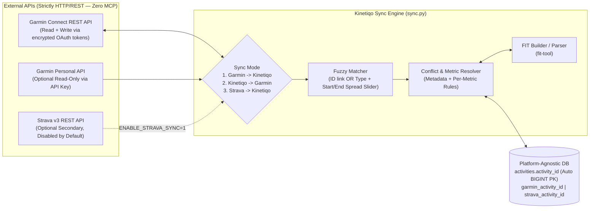

# Garmin-Primary Bidirectional Sync & Platform-Agnostic Warehouse Concept

> **Status:** Concept Specification (Grill-Me Spec Gate Passed — Aggregate `0.15 <= 0.20`).  
> **Date:** 2026-11-28  
> **Target Subsystems:** `src/kinetiqo/db/schema.py`, `src/kinetiqo/db/*`, `src/kinetiqo/garmin.py` *(new)*, `src/kinetiqo/sync.py`, `src/kinetiqo/config.py`, `src/kinetiqo/cli.py`, `src/kinetiqo/web/app.py`, `src/kinetiqo/web/templates/sync.html`, `build/entrypoint.sh`.  
> **Primary Goal:** Pivot Kinetiqo from a Strava-anchored data warehouse to a **Garmin-primary, platform-agnostic fitness data warehouse**—preserving full historical fidelity, enabling bidirectional reconciliation (`Kinetiqo -> Garmin`, `Garmin -> Kinetiqo`, and optional legacy `Strava -> Kinetiqo`) strictly via APIs (**no MCP**), rebuilding the primary key architecture around an auto-increment `activity_id`, and keeping Strava sync dormant/optional in code without artificial runtime restrictions.

---

## 1. Motivation & Strategic Architecture

Following Strava's June 2026 Terms of Use restrictions prohibiting the use of Strava API data with LLMs, Kinetiqo's role as a self-hosted Strava data warehouse conflicts with AI-assisted coaching, chat, and analytics workflows.

Instead of stripping AI features or introducing complex per-row blocking rules, this concept pivots Kinetiqo's source of truth to **Garmin Connect**:

1. **Migration First (`Kinetiqo -> Garmin`):** Reconcile the existing local Kinetiqo database (historically populated from Strava) against Garmin Connect—matching activities that already exist on Garmin, resolving metric/metadata drifts according to explicit per-field rules, and uploading missing activities as `.fit` files so Garmin Connect holds a complete copy of the athlete's history.
2. **Garmin Primary Going Forward (`Garmin -> Kinetiqo`):** Operate `Garmin -> Kinetiqo` as the primary synchronization pipeline for new workouts, telemetry streams, and summary updates.
3. **Platform-Agnostic Core Schema:** Rebuild `activities.activity_id` as an internal auto-increment `BIGINT PRIMARY KEY` decoupled from any external provider, storing `garmin_activity_id` and `strava_activity_id` as dedicated indexed link columns with full backward compatibility for existing databases.
4. **Dormant Optional Strava (`Strava -> Kinetiqo`):** Keep existing Strava sync code intact in `src/kinetiqo/strava.py` and `SyncService`, but disable it by default (`ENABLE_STRAVA_SYNC=0`) and remove all mandatory `STRAVA_*` startup checks so Kinetiqo runs standalone on Garmin.
5. **Strictly API, Zero MCP:** All Garmin reads and writes are executed directly over HTTP/REST APIs from Python (`garmin.py`), with zero MCP dependencies.

### 1.1 Garmin API Access Strategy (No MCP)

Garmin exposes two distinct programmatic interfaces relevant to self-hosted users:

| Interface | Auth Mechanism | Capabilities | Role in Kinetiqo |
|---|---|---|---|
| **Garmin Connect Authenticated REST API** (`connectapi.garmin.com` via `garth` / `python-garminconnect` OAuth1+OAuth2 session tokens) | Interactive Web UI / CLI login (+ MFA prompt); encrypted OAuth tokens persisted in DB (password never stored) | **Full Read & Write:** activity search (full history), detailed summary/laps/splits, `.fit`/`.tcx`/`.gpx` download, `.fit` upload, `PUT` metadata/summary updates, `DELETE`, gear & profile | **Primary engine** for both `Garmin -> Kinetiqo` and `Kinetiqo -> Garmin` |
| **Official Garmin Personal API** (`personal.connectapi.garmin.com`) | `GARMIN_PERSONAL_API_KEY` (exchanged for short-lived bearer token) | **Strictly Read-Only (`GET` only):** activity list, activity detail, `.fit` file download, daily wellness; **cannot** upload, edit, or delete activities | **Optional read-only mode** (`GARMIN_AUTH_MODE=personal_api`) for users who only run `Garmin -> Kinetiqo` |

> **Why Unified Connect REST (`connect_api`) is Default:** Because `Kinetiqo -> Garmin` requires `.fit` uploads, `PUT /activity-service/activity/{id}`, and optional deletions—none of which exist in the read-only Garmin Personal API—Kinetiqo uses a unified `GarminClient` (`src/kinetiqo/garmin.py`) backed by encrypted `garth` OAuth tokens as the default transport, while supporting `GARMIN_PERSONAL_API_KEY` as an optional read-only transport for `Garmin -> Kinetiqo`.



---

## 2. Sync Modes & Advanced Sync Settings Modal

### 2.1 Three Sync Directions

The Sync UI (`/fastsync`, `/fullsync`) and CLI (`kinetiqo.py sync`) expose an explicit **Sync Direction** selector:

1. **`Garmin -> Kinetiqo`** *(Default / Primary)*: Fetches activities and `.fit`/telemetry streams from Garmin Connect into the local Kinetiqo database.
2. **`Kinetiqo -> Garmin`** *(Migration & Push)*: Reconciles local Kinetiqo activities against Garmin Connect, updates metadata/summaries according to conflict rules, and uploads missing activities as synthesized `.fit` files.
3. **`Strava -> Kinetiqo`** *(Optional / Legacy)*: Preserves the existing Strava ETL pipeline. Hidden or disabled in the UI unless `ENABLE_STRAVA_SYNC=1` and Strava credentials are configured.

### 2.2 Advanced Sync Settings Cogwheel Modal

Modeled directly after the **AI Coach Cogwheel Settings Modal** (`docs/concepts/ai-coach.md` §10.2), a **⚙ Sync Settings** button sits next to **Start Sync** on `/fastsync` and `/fullsync` (with a shortcut link on `/settings`).

All settings are persisted server-side in a JSON document (`sync_settings_json`) inside the database (`sync_settings` / `profile`), validated with HTTP `422 { "error": "...", "field": "..." }` on invalid values, and rendered using Kinetiqo's standard Tailwind modal styling, left-aligned **`Saved ✓`** confirmation, and `static/img/kinetiqo-loading-32x32.webp` loading indicators.

The modal contains **4 tabs**:
1. **`Garmin -> Kinetiqo`** (Detailed rules for pulling from Garmin)
2. **`Kinetiqo -> Garmin`** (Detailed rules for pushing/migrating to Garmin)
3. **`Strava -> Kinetiqo`** (Detailed rules for legacy/optional Strava pulls — shown when `ENABLE_STRAVA_SYNC=1`)
4. **`Global & Connections`** (Garmin OAuth / Personal API key connection, rate-limit throttling, dry-run defaults, Strava enable toggle, weather & description hooks)

#### Per-Direction Configuration Structure

Each of the three direction tabs (`Garmin -> Kinetiqo`, `Kinetiqo -> Garmin`, `Strava -> Kinetiqo`) shares a uniform, strongly typed schema (`SyncDirectionPolicyV1`):

##### A. Activity Matching ("How to consider same activities")
1. **External ID Fast-Path (Checkbox, default `ON`):** If `garmin_activity_id` (or `strava_activity_id`) already matches in `activities`, treat as the same activity immediately without fuzzy matching.
2. **Sport / Activity Type Match (Select, default `canonical_group`):**
   - `exact_mapped_sport`: Exact normalized Kinetiqo sport (e.g., `GravelRide` == `gravel_cycling`).
   - `canonical_group` *(recommended default)*: Same broad sport family (`cycling`, `running`, `walking`, `skiing`, `swimming`) — prevents duplicates when Strava labeled a ride `Ride` and Garmin recorded `road_biking` or `gravel_cycling`!
3. **Start & End Time Spread Sliders (`0 s` – `300 s` / `5 min`):**
   - **Start Time Tolerance Slider:** `0` to `300` seconds (step `5 s`, default `60 s`). Checks `|source.start_utc - target.start_utc| <= start_tolerance_s`.
   - **End Time Tolerance Slider:** `0` to `300` seconds (step `5 s`, default `120 s`). Checks `|source.end_utc - target.end_utc| <= end_tolerance_s` (where `end_utc = start_utc + elapsed_time`).
   - *Why separate Start & End sliders:* Devices and platforms frequently drift on pause/auto-pause tail trimming or GPS cold-start lock (`end_utc` often drifts more than `start_utc` due to `elapsed_time` vs `moving_time` rounding).

##### B. Duplicate Resolution ("When the same activities are found")
1. **Default Source of Truth:** `source` | `target` (used as fallback for any field set to `default`).
2. **Metadata Fields to Update on Duplicate (Independent Checkboxes + Direction Selector `skip | source | target`):**
   - `Activity Name` (`name` / `activityName`)
   - `Description` (`description`)
   - `Visibility / Privacy` (`visibility` / `privacyRule`)
   - `Sport / Activity Type` (`sport` / `activityType`)
   - `Gear` (`gear_id` / `gearDTO`)
   - `Trainer / Indoor Flag` (`trainer`)
   - `Commute Flag` (`commute`)
3. **Per-Metric Conflict Resolution (`source | target | higher | lower`):**
   Configured individually for every analytical metric:
   - `Distance` (`distance`)
   - `Elevation Gain` (`total_elevation_gain` / `elevationGain`)
   - `Elevation High / Low` (`elev_high`, `elev_low`)
   - `Moving Time` (`moving_time` / `movingDuration`)
   - `Elapsed Time` (`elapsed_time` / `elapsedDuration`)
   - `Average Speed` (`average_speed` / `averageSpeed`)
   - `Max Speed` (`max_speed` / `maxSpeed`)
   - `Average Heart Rate` (`average_heartrate` / `averageHR`)
   - `Max Heart Rate` (`max_heartrate` / `maxHR`)
   - `Average Power` (`average_watts` / `averagePower`)
   - `Max Power` (`max_watts` / `maxPower`)
   - `Normalized / Weighted Power` (`weighted_average_watts` / `normalizedPower`)
   - `Average Cadence` (`average_cadence` / `averageBikingCadence` / `averageRunCadence`)
   - `Calories` (`calories`)
   - `Kilojoules / Work` (`kilojoules`)
   - `Average Temperature` (`average_temp` / `avgTemp`)
4. **Two-Tier `Kinetiqo -> Garmin` Metric Write Mode** *(shown on `Kinetiqo -> Garmin` tab)*:
   - **Tier 1 — Metadata & Editable Summary Patch *(Default, Safe)*:** Updates `activityName`, `description`, `privacyRule`, `activityType`, and Garmin-editable summary scalars (`distance`, `elevationGain`, `calories`, `duration`) via `PUT /activity-service/activity/{id}`. Never deletes the Garmin activity or alters its `.fit` file, preserving Garmin-native Training Effect, Stamina, Respiration, and original `activityId`.
   - **Tier 2 — Full `.fit` Replacement *(Opt-In Toggle, Off by Default)*:** When enabled and stream-backed telemetry metrics (`watts`, `HR`, `cadence`, or elevation/distance curve) resolve in favor of Kinetiqo, Kinetiqo:
     1. Downloads and archives the original Garmin `.fit` locally (`data/backups/garmin/<id>.fit`) as a safety rollback snapshot.
     2. Synthesizes a new `.fit` from Kinetiqo's `activities` + `streams` (applying the winning metric scalars/streams).
     3. Deletes the target Garmin activity and uploads the synthesized `.fit`, then applies metadata (`activityName`, `description`, `privacyRule`) and updates `activities.garmin_activity_id` to the newly assigned Garmin `activityId`.

##### C. Missing-Activity Rules ("General Flags per Sync Option")
1. **"If activity exists strictly in Source and NOT in Target":**
   - `sync` *(Default)* — Create/upload the activity in Target (with streams/FIT).
   - `ignore` — Leave Target untouched (metadata-only sync for already-matched activities).
2. **"If activity exists strictly in Target and NOT in Source":**
   - `sync` *(Default)* — Reverse-sync the activity from Target back to Source (e.g., during `Kinetiqo -> Garmin`, pull Garmin-only workouts into Kinetiqo; during `Garmin -> Kinetiqo`, push Kinetiqo-only workouts to Garmin).
   - `ignore` — Leave Target untouched.
   - `delete in target` — Delete the Target-only activity.

> **Window-Scope & Safety Guardrails for `delete in target`:**
> - Whenever a sync runs with a bounded window (**Fast Sync** lookback or **Full Sync** with `limit_days > 0`), `delete in target` is **strictly scoped to timestamps inside the fetched window** (`[window_start, now]`). Activities older than `window_start` are never eligible for deletion.
> - Selecting `delete in target` on `Kinetiqo -> Garmin` displays an inline red warning banner and requires an explicit confirmation prompt before execution (and is blocked when `dry_run=true`).

##### D. Additional Operational & Edge-Case Controls (Recommended)
1. **Dry-Run / Reconciliation Preview Toggle:** Executes discovery, matching, and conflict evaluation without writing to Garmin or mutating Kinetiqo DB; streams a diff report (`N matched`, `M metadata diffs`, `K missing in target`, `J missing in source`) to the SSE log pane.
2. **Stream Sync Policy (`if_missing | always_overwrite | skip`):** Controls whether `streams` (1 Hz telemetry) are fetched/synthesized only for new activities (`if_missing`, default) or re-fetched for matched activities.
3. **Zero-GPS / Manual Activity Handling (`upload_manual_summary | skip_no_streams`):** For `Kinetiqo -> Garmin`, determines whether indoor/manual workouts without `streams` rows are pushed via Garmin's manual activity creation payload (`POST /activity-service/activity`) or skipped.
4. **3rd-Party Duplicate Guard (Zwift / MyWhoosh / TrainerRoad):** When an activity was recorded by a 3rd-party platform and pushed to both Strava and Garmin, timestamps can differ by several seconds and power/elevation smoothing may differ. Enabling *"Prefer hardware/power-meter stream on tie"* breaks ties toward whichever source has `device_watts=True` and higher stream sample density.
5. **Rate-Limit & Anti-Bot Pacing:** Configurable inter-request delay (`default: 1000 ms` for Garmin reads, `1500 ms` for `.fit` uploads) and automatic pause/abort on HTTP `429` / Cloudflare challenge, preserving progress via existing `sync_jobs` / `sync_execution_lock`.
6. **Post-Sync Enrichment Hooks:**
   - Weather enrichment (`VISUAL_CROSSING_API_KEY`) runs after `Garmin -> Kinetiqo` (or reverse-sync pulls) using Garmin's GPS stream.
   - Description auto-update (`UPDATE_GARMIN_*` / optional `UPDATE_STRAVA_*`) can optionally render Kinetiqo's one-line stats block into Garmin `description` when enabled.

### 2.3 Sync Modal JSON Contract (`sync_settings_json`)

```json
{
  "schema_version": 1,
  "active_direction": "garmin_to_kinetiqo",
  "global": {
    "garmin_auth_mode": "connect_api",
    "enable_strava_sync": false,
    "dry_run_default": false,
    "request_delay_ms": 1000,
    "prefer_device_watts_on_tie": true,
    "backup_garmin_fit_before_replace": true
  },
  "directions": {
    "garmin_to_kinetiqo": {
      "matching": {
        "use_external_id": true,
        "sport_match_mode": "canonical_group",
        "start_tolerance_sec": 60,
        "end_tolerance_sec": 120
      },
      "on_match": {
        "default_source_of_truth": "source",
        "metadata": {
          "name": "source",
          "description": "source",
          "visibility": "source",
          "sport": "source",
          "gear": "source",
          "trainer": "source",
          "commute": "source"
        },
        "metrics": {
          "distance": "source",
          "total_elevation_gain": "source",
          "elev_high": "source",
          "elev_low": "source",
          "moving_time": "source",
          "elapsed_time": "source",
          "average_speed": "source",
          "max_speed": "source",
          "average_heartrate": "source",
          "max_heartrate": "source",
          "average_watts": "source",
          "max_watts": "source",
          "weighted_average_watts": "source",
          "average_cadence": "source",
          "calories": "source",
          "kilojoules": "source",
          "average_temp": "source"
        },
        "streams_policy": "if_missing"
      },
      "missing": {
        "in_source_only": "sync",
        "in_target_only": "sync"
      }
    },
    "kinetiqo_to_garmin": {
      "matching": {
        "use_external_id": true,
        "sport_match_mode": "canonical_group",
        "start_tolerance_sec": 60,
        "end_tolerance_sec": 120
      },
      "on_match": {
        "default_source_of_truth": "source",
        "replace_garmin_fit_on_metric_diff": false,
        "metadata": {
          "name": "source",
          "description": "source",
          "visibility": "source",
          "sport": "source",
          "gear": "target",
          "trainer": "source",
          "commute": "source"
        },
        "metrics": {
          "distance": "higher",
          "total_elevation_gain": "higher",
          "elev_high": "source",
          "elev_low": "source",
          "moving_time": "source",
          "elapsed_time": "source",
          "average_speed": "source",
          "max_speed": "higher",
          "average_heartrate": "source",
          "max_heartrate": "higher",
          "average_watts": "source",
          "max_watts": "higher",
          "weighted_average_watts": "source",
          "average_cadence": "source",
          "calories": "source",
          "kilojoules": "source",
          "average_temp": "source"
        },
        "streams_policy": "if_missing"
      },
      "missing": {
        "in_source_only": "sync",
        "in_target_only": "sync"
      }
    },
    "strava_to_kinetiqo": {
      "matching": {
        "use_external_id": true,
        "sport_match_mode": "exact_mapped_sport",
        "start_tolerance_sec": 60,
        "end_tolerance_sec": 120
      },
      "on_match": {
        "default_source_of_truth": "source",
        "metadata": { "name": "source", "description": "source", "visibility": "source", "sport": "source", "gear": "source", "trainer": "source", "commute": "source" },
        "metrics": { "distance": "source", "total_elevation_gain": "source" },
        "streams_policy": "if_missing"
      },
      "missing": {
        "in_source_only": "sync",
        "in_target_only": "ignore"
      }
    }
  }
}
```

---

## 3. Revamped Platform-Agnostic Database Schema & Backward Compatibility

### 3.1 Why a Schema Rebuild is Required

Currently (`src/kinetiqo/db/schema.py`), Kinetiqo treats Strava's numeric ID as its own primary key (`activities.activity_id BIGINT PRIMARY KEY` and `profile.athlete_id BIGINT PRIMARY KEY`). That breaks in a Garmin-primary / multi-source warehouse:
- Garmin `activityId` (`BIGINT`) and Strava `id` (`BIGINT`) are independent namespaces and **cannot** share a primary key without collision risk or losing the cross-platform link.
- Several fields required for faithful `Kinetiqo <-> Garmin` synchronization (`description`, `visibility`, `elevation_loss`, `training_stress_score`, `device_name`, `commute`, `trainer`, `start_lat`, `start_lng`) are currently **not persisted** in `activities`.

### 3.2 Target Schema Changes (PostgreSQL, MySQL, Firebird)

All changes preserve Kinetiqo's zero-ORM, parameterized-SQL 3-backend architecture (`postgresql.py`, `mysql.py`, `firebird.py`).

#### Table 1: `activities` (Revamped)

| Column | PostgreSQL | MySQL | Firebird | Purpose |
|---|---|---|---|---|
| `activity_id` *(PK)* | `BIGINT GENERATED BY DEFAULT AS IDENTITY PRIMARY KEY` | `BIGINT AUTO_INCREMENT PRIMARY KEY` | `BIGINT PRIMARY KEY` *(backed by generator `GEN_ACTIVITIES_ID` + `BEFORE INSERT` trigger when `NULL`)* | **Platform-agnostic internal surrogate primary key** |
| `garmin_activity_id` | `BIGINT` | `BIGINT` | `BIGINT` | External Garmin Connect `activityId` (nullable) |
| `strava_activity_id` | `BIGINT` | `BIGINT` | `BIGINT` | External Strava `id` (nullable; legacy link) |
| `primary_source` | `VARCHAR(16) NOT NULL DEFAULT 'garmin'` | `VARCHAR(16) NOT NULL DEFAULT 'garmin'` | `VARCHAR(16) DEFAULT 'garmin' NOT NULL` | `'garmin'`, `'strava'`, `'manual'`, `'merged'` |
| `description` | `TEXT` | `TEXT` | `BLOB SUB_TYPE TEXT` | Activity notes/description (previously missing from DB) |
| `visibility` | `VARCHAR(32)` | `VARCHAR(32)` | `VARCHAR(32)` | Canonical visibility: `'public'`, `'followers'`, `'private'` |
| `device_name` | `VARCHAR(128)` | `VARCHAR(128)` | `VARCHAR(128)` | Recording device/app (`Edge 840`, `Zwift`, etc.) |
| `trainer` | `BOOLEAN` | `BOOLEAN` | `SMALLINT` | Indoor/trainer flag |
| `commute` | `BOOLEAN` | `BOOLEAN` | `SMALLINT` | Commute flag |
| `elevation_loss` | `DOUBLE PRECISION` | `DOUBLE PRECISION` | `DOUBLE PRECISION` | Cumulative descent (meters) |
| `training_stress_score` | `DOUBLE PRECISION` | `DOUBLE PRECISION` | `DOUBLE PRECISION` | Garmin/computed TSS (replaces Strava-only `suffer_score` dependency) |
| `garmin_synced_at` | `TIMESTAMP WITH TIME ZONE` | `TIMESTAMP NULL` | `TIMESTAMP` | Last reconciliation timestamp with Garmin |
| `strava_synced_at` | `TIMESTAMP WITH TIME ZONE` | `TIMESTAMP NULL` | `TIMESTAMP` | Last reconciliation timestamp with Strava |
| *(existing columns)* | *(retained)* | *(retained)* | *(retained)* | `start_date`, `name`, `sport`, `athlete_id`, `distance`, `moving_time`, `elapsed_time`, `total_elevation_gain`, `average_speed`, `max_speed`, `average_heartrate`, `max_heartrate`, `average_cadence`, `average_watts`, `max_watts`, `achievement_count`, `average_temp`, `calories`, `device_watts`, `elev_high`, `elev_low`, `gear_id`, `has_heartrate`, `kilojoules`, `pr_count`, `suffer_score`, `weighted_average_watts`, `workout_type`, `trophies`, `ai_responses`, `weather_*` |

**New Indexes on `activities`:**
- `uq_activities_garmin_id`: unique filtered/nullable index on `garmin_activity_id` (`WHERE garmin_activity_id IS NOT NULL` on PG; standard `UNIQUE` allows multiple `NULL`s in PostgreSQL, MySQL, and Firebird 3+).
- `uq_activities_strava_id`: unique index on `strava_activity_id`.
- `idx_activities_source_start`: `(primary_source, start_date DESC)` for source-filtered queries and migration audits.
- `idx_activities_sport_start_asc`: `(sport, start_date)` to accelerate fuzzy matching lookups (`WHERE start_date BETWEEN ? AND ?`).

#### Table 2: `profile` & Auth/Settings Storage

| Column Addition / Change | Types (PG / MySQL / Firebird) | Purpose |
|---|---|---|
| `athlete_id` *(kept as internal PK)* | `BIGINT GENERATED BY DEFAULT AS IDENTITY PRIMARY KEY` / `BIGINT AUTO_INCREMENT PRIMARY KEY` / `BIGINT PRIMARY KEY` | Platform-agnostic athlete PK (migrated row keeps existing value, sequence seeded above `MAX`) |
| `garmin_user_id` | `VARCHAR(128)` / `VARCHAR(128)` / `VARCHAR(128)` | Garmin Connect `displayName` / user profile ID |
| `strava_athlete_id` | `BIGINT` | Legacy/optional Strava numeric athlete ID |
| `garmin_tokens_enc` | `TEXT` / `TEXT` / `BLOB SUB_TYPE TEXT` | AES-GCM encrypted `garth` OAuth1/OAuth2 token bundle (encrypted via `chat/encryption.py` HKDF key; password **never** stored) |
| `garmin_api_key_enc` | `TEXT` / `TEXT` / `BLOB SUB_TYPE TEXT` | Encrypted optional `GARMIN_PERSONAL_API_KEY` |
| `sync_settings_json` | `TEXT` / `LONGTEXT` / `BLOB SUB_TYPE TEXT` | Persisted `SyncDirectionPolicyV1` settings from the Advanced Sync Modal |

#### Table 3: Foreign-Key & Cache Impact Audit

| Dependent Table / File | Reference Type | Migration / Compatibility Behavior |
|---|---|---|
| `streams` | `activity_id BIGINT` (`fk_activity` `ON DELETE CASCADE`) | References internal `activities.activity_id`. Unchanged when existing IDs are preserved! |
| `weather` | `activity_id BIGINT PK` (no cascade FK) | References internal `activities.activity_id`. Existing cached weather remains 100% intact. |
| `verified_segment_efforts` | `activity_id BIGINT` (`fk_vse_activity` `ON DELETE CASCADE`) | References internal `activities.activity_id`. Unchanged. |
| `activity_goals` | `athlete_id BIGINT` | References internal `profile.athlete_id`. Unchanged. |
| `sync_jobs` | `sync_type`, `options_json` | Extend `sync_type` to store direction + scope (e.g., `garmin:fast`, `garmin:full`, `kinetiqo_to_garmin:full`, `strava:fast`); store resolved modal snapshot in `options_json`. |
| `verified_trophies.json` / `verified_koms.json` | Keyed by `strava_activity_id` string | On migration, resolve lookup by `activity_id` **or** `strava_activity_id` so existing Strava-fetched KOMs/trophies never vanish. |
| Web Routes (`/activity/<id>`, `/api/activity/<id>`) | Path parameter `<id>` | Look up `WHERE activity_id = %s`; if not found, optionally fall back to `WHERE strava_activity_id = %s OR garmin_activity_id = %s` (redirecting or serving seamlessly) for external deep-link compatibility. |

### 3.3 Backward-Compatible Zero-Downtime Migration Algorithm

Because `SchemaManager` (`src/kinetiqo/db/schema.py`) currently performs automated startup migrations, upgrading an existing Strava-seeded database runs idempotently inside a transaction (with a schema migration marker/check):

1. **Add new columns** (`garmin_activity_id`, `strava_activity_id`, `primary_source`, `description`, `visibility`, `device_name`, `trainer`, `commute`, `elevation_loss`, `training_stress_score`, `garmin_synced_at`, `strava_synced_at`) to `activities` (and `garmin_user_id`, `strava_athlete_id`, `garmin_tokens_enc`, `garmin_api_key_enc`, `sync_settings_json` to `profile`).
2. **Backfill existing rows (where `strava_activity_id IS NULL AND garmin_activity_id IS NULL`):**
   - `UPDATE activities SET strava_activity_id = activity_id, primary_source = 'strava' WHERE strava_activity_id IS NULL AND garmin_activity_id IS NULL;`
   - `UPDATE profile SET strava_athlete_id = athlete_id WHERE strava_athlete_id IS NULL;`
3. **Convert `activity_id` to auto-increment & advance sequence:**
   - **PostgreSQL:** `ALTER TABLE activities ALTER COLUMN activity_id ADD GENERATED BY DEFAULT AS IDENTITY;` then `SELECT setval(pg_get_serial_sequence('activities', 'activity_id'), COALESCE((SELECT MAX(activity_id) FROM activities), 0) + 1, false);`
   - **MySQL:** Temporarily drop FKs on `streams`/`verified_segment_efforts` (or alter cleanly), `ALTER TABLE activities MODIFY COLUMN activity_id BIGINT NOT NULL AUTO_INCREMENT`, re-add FKs, and `ALTER TABLE activities AUTO_INCREMENT = <MAX(activity_id) + 1>;`
   - **Firebird:** Create `GENERATOR GEN_ACTIVITIES_ID`, set `SET GENERATOR GEN_ACTIVITIES_ID TO <MAX(activity_id)>`, and add `BI_ACTIVITIES_ID` trigger (`IF (NEW.activity_id IS NULL) THEN NEW.activity_id = GEN_ID(GEN_ACTIVITIES_ID, 1);`).
4. **Result:**
   - Every historical Strava row keeps its exact `activity_id`, `streams`, `weather`, `verified_segment_efforts`, and `/activity/<id>` URL intact, while now carrying `strava_activity_id` and waiting for `garmin_activity_id` to be populated during `Kinetiqo -> Garmin` reconciliation!
   - Every **new** activity synced from Garmin gets a clean, platform-agnostic sequential `activity_id` (above `MAX`), with `garmin_activity_id` set to Garmin's `activityId` and `primary_source = 'garmin'`.
   - New installations start cleanly from `activity_id = 1`.

---

## 4. Comprehensive Field Mapping & Compatibility Matrix

This section maps every activity summary, metadata, sport taxonomy, telemetry stream, and profile field across **Garmin** (Connect REST API / Personal API / `.fit`), **Strava** (v3 REST API), and **Kinetiqo** (Target Platform-Agnostic DB), specifying exact drift resolution rules.

### 4.1 Core Identity, Timestamps & Metadata

| Garmin (`activitylist` / `summaryDTO` / `metadataDTO` / `.fit`) | Strava (`SummaryActivity` / `DetailedActivity`) | Kinetiqo (`activities` / `profile`) | Drift Resolution / Mapping Strategy |
|---|---|---|---|
| `activityId` (`int64`, e.g. `17482910342`) | `id` (`int64`, e.g. `1284910234`) | `activity_id` (`BIGINT` auto-inc PK) + `garmin_activity_id` + `strava_activity_id` | **ID Drift:** Separate external ID columns prevent collisions. Inserts omit `activity_id` to auto-generate a platform-agnostic PK, storing the external ID in `garmin_activity_id` or `strava_activity_id`. |
| `userProfileId` / `ownerDisplayName` | `athlete.id` (`int64`) | `activities.athlete_id` (`BIGINT` internal FK) + `profile.garmin_user_id` + `profile.strava_athlete_id` | **Owner Drift:** Map external user identifiers to Kinetiqo's internal `profile.athlete_id` on ingest. |
| `startTimeGMT` (`"YYYY-MM-DD HH:MM:SS"` or ISO) / `beginTimestamp` (epoch ms) | `start_date` (ISO-8601 UTC `"Z"`) | `start_date` (`TIMESTAMP WITH TIME ZONE` / `TIMESTAMP`) | **Format Drift:** Garmin `beginTimestamp` is milliseconds; `startTimeGMT` lacks `Z`. Normalize both to timezone-aware UTC `datetime` (`beginTimestamp / 1000` preferred when available for sub-second precision). |
| `startTimeLocal` (`"YYYY-MM-DD HH:MM:SS"`) + `timeZoneUnitDTO.timeZone` (e.g. `"Europe/Prague"`) | `start_date_local` + `timezone` (`"(GMT+01:00) Europe/Prague"`) + `utc_offset` | Computed via `Config.get_athlete_timezone()` *(optional `timezone` column)* | **TZ Drift:** Strip Strava's `(GMT+XX:XX) ` prefix to extract IANA zone matching Garmin's `timeZoneUnitDTO.timeZone`. Store UTC in `start_date`. |
| `activityName` (`str`, max ~200 chars) | `name` (`str`) | `name` (`TEXT` / `VARCHAR(500)`) | **Length Drift:** Truncate to 200 chars when pushing `Kinetiqo -> Garmin`; preserve full string in Kinetiqo. |
| `description` (`str`, nullable) | `description` (`str`, DetailedActivity only) | `description` (`TEXT` / `BLOB SUB_TYPE TEXT`) *(new column)* | **Missing Column Drift:** Add `description` to `activities` so Kinetiqo preserves user notes and `Kinetiqo -> Garmin` can push/reconcile descriptions without calling Strava. |
| `privacyRule.typeKey` (`"public"`, `"subscribers"` [Connections], `"groups"`, `"private"`) | `visibility` (`"everyone"`, `"followers_only"`, `"only_me"`) + `private` (`bool`) | `visibility` (`VARCHAR(32)`) *(new column: `'public'`, `'followers'`, `'private'`)* | **Enum Drift:** Normalize `everyone`/`public` → `'public'`; `followers_only`/`subscribers`/`groups` → `'followers'`; `only_me`/`private` → `'private'`. Map back on `Kinetiqo -> Garmin` (`typeId: 3/2/1`). |
| `deviceName` (`str`, e.g. `"Edge 840"`) / `.fit` `file_id.manufacturer` + `garmin_product` | `device_name` (`str`, DetailedActivity only) | `device_name` (`VARCHAR(128)`) *(new column)* | **Synthesized FIT Drift:** When uploading `Kinetiqo -> Garmin`, embed `.fit` `file_id` manufacturer/product (e.g. `development` or original device metadata if known) so Garmin accepts the file cleanly. |
| `gearDTO` (`uuid`, `gearPk`, `displayName`) via `/gear-service/gear/filterGear?activityId=...` | `gear_id` (`str`, e.g. `"b123456"`) | `gear_id` (`VARCHAR(255)`) | **Namespace Drift:** Strava `gear_id` is opaque `"b12345"`; Garmin uses `gearPk` / `uuid`. Maintain a `gear_mapping` lookup (name/brand/model match or user mapping in Settings) when translating `Kinetiqo <-> Garmin`. |
| `eventTypeDTO.typeKey` (`"uncategorized"`, `"race"`, `"training"`, `"transportation"`, etc.) | `workout_type` (`int`: `0`=default, `1`=race, `2`=long run, `3`=workout; ride: `10`=default, `11`=race, `12`=workout) + `commute` (`bool`) | `workout_type` (`INTEGER`) + `commute` (`BOOLEAN`) | **Taxonomy Drift:** Map Strava `workout_type` `1`/`11` ↔ Garmin `eventTypeDTO = "race"`; `3`/`12` ↔ `"training"`; `commute=True` ↔ `"transportation"`. |
| `locationName` + `activityType.typeKey` (`virtual_ride`, `indoor_cycling`, `treadmill_running`) | `trainer` (`bool`) | `trainer` (`BOOLEAN`) *(new column)* | **Boolean vs Sport Drift:** Garmin encodes indoor status in `activityType` (`indoor_cycling`, `virtual_ride`, `treadmill_running`) rather than a dedicated boolean. Infer `trainer=True` from indoor `typeKey`s on ingest; map `trainer=True` rides to `indoor_cycling` or `virtual_ride` on export. |
| `manualActivity` (`bool`) | `manual` (`bool`) | Inferable (`has streams == False`) | **No-Stream Drift:** Manual activities have no `.fit` streams. `Kinetiqo -> Garmin` uses `POST /activity-service/activity` (manual JSON endpoint) instead of `.fit` upload when `streams` are absent. |

### 4.2 Sport Taxonomy Compatibility (`sports.py`)

Kinetiqo's canonical `sport` values (`src/kinetiqo/sports.py`) remain the internal standard so all infographics, goals, and analytics keep working unchanged.

| Garmin `activityType.typeKey` | Strava `sport_type` | Kinetiqo Canonical `sport` | Drift Resolution / Mapping Strategy |
|---|---|---|---|
| `cycling`, `road_biking` | `Ride` | `Ride` | Direct 1:1 (`cycling` generic maps to `Ride`). When pushing `Ride -> Garmin`, map to `road_biking` (default) or `cycling`. |
| `gravel_cycling`, `cyclocross` | `GravelRide` | `GravelRide` | Direct 1:1 (`cyclocross` folds to `GravelRide` or preserves subtype via `canonical_group` matching). |
| `mountain_biking`, `trail_biking`, `downhill_biking` | `MountainBikeRide` | `MountainBikeRide` | Direct 1:1 (`mountain_biking` primary). |
| `e_bike_fitness` | `EBikeRide` | `EBikeRide` | Direct 1:1. |
| `e_bike_mountain` | `EMountainBikeRide` | `EMountainBikeRide` | Direct 1:1. |
| `virtual_ride` | `VirtualRide` | `VirtualRide` | Direct 1:1. |
| `indoor_cycling`, `spin` | `Ride` + `trainer=true` *(or `VirtualRide`)* | `IndoorRide` | **Indoor Drift:** Strava often tagged non-virtual trainer rides as `Ride` with `trainer=true`. Kinetiqo already defines `IndoorRide` in `CYCLING_INDOOR_TYPES` (`sports.py:17`) — map Garmin `indoor_cycling` → `IndoorRide`, and Strava `Ride` (`trainer=true`) → `IndoorRide` optionally. |
| `recumbent_cycling` / `handcycling` | `Velomobile` / `Handcycle` | `Velomobile` / `Handcycle` | Closest match; `canonical_group` treats both as `cycling_outdoor`. |
| `running`, `street_running`, `track_running` | `Run` | `Run` | Direct 1:1. |
| `trail_running` | `TrailRun` | `TrailRun` | Direct 1:1. |
| `treadmill_running`, `indoor_running`, `virtual_run` | `VirtualRun` | `VirtualRun` | Direct 1:1 (`treadmill_running` → `VirtualRun`). |
| `walking`, `casual_walking`, `speed_walking` | `Walk` | `Walk` | Direct 1:1. |
| `hiking`, `mountaineering` | `Hike` | `Hike` | Direct 1:1. |
| `resort_skiing_snowboarding_ws`, `alpine_skiing` | `AlpineSki` | `AlpineSki` | Direct 1:1. |
| `backcountry_skiing_snowboarding_ws`, `backcountry_skiing` | `BackcountrySki` | `BackcountrySki` | Direct 1:1. |
| `cross_country_skiing_ws`, `skate_skiing`, `classic_skiing` | `NordicSki` | `NordicSki` | Direct 1:1. |
| `snowboarding_ws` | `Snowboard` | `Snowboard` | Direct 1:1. |
| `lap_swimming`, `open_water_swimming`, `swimming` | `Swim` | `Swim` | **Pool vs Open Water Drift:** Garmin separates `lap_swimming` (pool length, no GPS) vs `open_water_swimming` (GPS). Both map to `Swim` in Kinetiqo; on `Kinetiqo -> Garmin`, choose `open_water_swimming` if GPS `streams` exist, else `lap_swimming`. |
| `strength_training`, `fitness_equipment`, `yoga`, `rowing`, `elliptical`, `other` | `WeightTraining`, `Workout`, `Yoga`, `Rowing`, `Elliptical`, etc. | Pass-through normalized CamelCase (e.g. `WeightTraining`, `Workout`) | **Fallback:** Maintain an explicit bidirectional `GARMIN_TO_KINETIQO_SPORT` / `KINETIQO_TO_GARMIN_SPORT` dictionary in `sports.py` with CamelCase/snake_case fallback. |

### 4.3 Summary Metrics & Physiological Fields

| Garmin (`summaryDTO` / `activitylist`) | Strava (`SummaryActivity`) | Kinetiqo (`activities`) | Drift Resolution / Mapping Strategy |
|---|---|---|---|
| `distance` (`float`, **meters**) | `distance` (`float`, **meters**) | `distance` (`DOUBLE PRECISION`, **meters**) | Unit-compatible (meters). Per-metric rule (`source \| target \| higher \| lower`). |
| `movingDuration` (`float`, **seconds**) | `moving_time` (`int`, **seconds**) | `moving_time` (`INTEGER`, **seconds**) | **Precision Drift:** Garmin returns `float` seconds; round `int(round(val))` for Kinetiqo. Note: Strava recalculates moving time aggressively; Garmin uses device auto-pause (`movingDuration` or `duration`). |
| `elapsedDuration` (`float`, **seconds**) / `duration` (timer) | `elapsed_time` (`int`, **seconds**) | `elapsed_time` (`INTEGER`, **seconds**) | **Timer vs Elapsed Drift:** Garmin distinguishes `duration` (timer active time) vs `elapsedDuration` (wall-clock start-to-finish). Map `elapsedDuration` → `elapsed_time` and `movingDuration` (fallback `duration`) → `moving_time`. |
| `elevationGain` (`float`, **meters**) | `total_elevation_gain` (`float`, **meters**) | `total_elevation_gain` (`DOUBLE PRECISION`, **meters**) | **DEM Smoothing Drift:** Strava and Garmin DEM/barometric corrections routinely differ by 5–20%. Resolved per user rule (`source \| target \| higher \| lower`). |
| `elevationLoss` (`float`, **meters**) | *(Not in SummaryActivity)* | `elevation_loss` (`DOUBLE PRECISION`) *(new column)* | Store from Garmin; compute from `streams.altitude` negative deltas if missing from Strava. |
| `maxElevation` / `minElevation` (`float`, **meters**) | `elev_high` / `elev_low` (`float`, **meters**) | `elev_high` / `elev_low` (`DOUBLE PRECISION`) | Unit-compatible (meters). Fallback to `min/max(streams.altitude)` if null. |
| `averageSpeed` / `maxSpeed` (`float`, **m/s**) | `average_speed` / `max_speed` (`float`, **m/s**) | `average_speed` / `max_speed` (`DOUBLE PRECISION`, **m/s**) | Unit-compatible (`m/s`). On `Kinetiqo -> Garmin` `.fit` export, encode in `m/s` (FIT SDK scales by `1000` mm/s). |
| `averageHR` / `maxHR` (`float`, **bpm**) | `average_heartrate` / `max_heartrate` (`float`, **bpm**) | `average_heartrate` / `max_heartrate` (`INTEGER`) | Round to `int` in Kinetiqo; set `has_heartrate = (average_heartrate is not None or max_heartrate is not None)`. |
| `averageBikingCadenceInRevPerMinute` (cycling **rpm**) **OR** `averageRunningCadenceInStepsPerMinute` (running **spm** — full steps/min!) | `average_cadence` (cycling **rpm**; running **strides/min = half of spm**!) | `average_cadence` (`DOUBLE PRECISION`) | **CRITICAL 2× CADENCE DRIFT:** Strava reports running cadence as **single-leg strides/min** (~85), whereas Garmin Connect reports **total steps/min** (~170) and FIT `.fit` files store **half-strides** (matching Strava/FIT spec!). **Resolution:** Standardize Kinetiqo internal running cadence convention (or convert cleanly at boundary: if `sport in RUNNING_TYPES` and ingesting Garmin JSON `averageRunningCadenceInStepsPerMinute`, divide by `2.0` if Kinetiqo keeps Strava/FIT single-foot convention—OR migrate Kinetiqo UI to display `spm` and document conversion explicitly!). Recommended: **normalize `streams.cadence` & `average_cadence` to FIT native (rpm for cycling, strides/min for running) at the API adapter boundary** so `.fit` exports and existing UI charts stay 100% consistent! |
| `avgPower` / `averagePower` (`float`, **W**) | `average_watts` (`float`, **W**) | `average_watts` (`DOUBLE PRECISION`, **W**) | **Estimated Power Drift:** Strava synthesizes `average_watts` when `device_watts=false`. Garmin only populates `averagePower` from real power meters (`device_watts=true`). On `Kinetiqo -> Garmin`, only export power to `.fit` if `device_watts=True` (unless user overrides). |
| `maxPower` (`float`, **W**) | `max_watts` (`float`, **W**) | `max_watts` (`DOUBLE PRECISION`, **W**) | Unit-compatible (watts). |
| `normPower` / `normalizedPower` (`float`, **W**) | `weighted_average_watts` (`float`, **W**) | `weighted_average_watts` (`DOUBLE PRECISION`, **W**) | **Equivalent Concept:** Garmin `normalizedPower` maps 1:1 to `weighted_average_watts`. If missing on either side, compute via `kinetiqo.analytics.power.calculate_normalized_power()`. |
| `calories` (`float`, **kcal** — includes BMR unless `bmrCalories` subtracted) | `calories` (`float`, **kcal**, DetailedActivity) & `kilojoules` (`float`, mechanical work **kJ**) | `calories` (`DOUBLE PRECISION`) + `kilojoules` (`DOUBLE PRECISION`) | **Energy Drift:** Garmin `calories` is metabolic kcal (`bmrCalories` + active); Garmin does not always expose mechanical `kilojoules` in summary JSON. Compute `kilojoules = average_watts * moving_time / 1000.0` when `device_watts=True` and `kilojoules` is missing. |
| `avgTemp` / `minTemp` / `maxTemp` (°C in `summaryDTO` / `.fit`) | `average_temp` (°C) | `average_temp` (`DOUBLE PRECISION`) | Unit-compatible (°C). Fallback to mean of `streams.temp` if summary omits it. |
| `trainingStressScore` (`TSS`) + `aerobicTrainingEffect` | `suffer_score` (Strava Relative Effort) | `suffer_score` (`INTEGER`) + `training_stress_score` (`DOUBLE PRECISION`) *(new column)* | **Fitness Chart Drift:** Strava's `suffer_score` does not exist in Garmin! `fitness.py` (`CTL/ATL/TSB`) currently queries `suffer_score > 0`. **Resolution:** Populate `training_stress_score` from Garmin (`trainingStressScore`, or compute Coggan TSS from `weighted_average_watts` + `FTP`, or hrTSS from HR + LTHR), and update `fitness.py` to use `COALESCE(training_stress_score, suffer_score)` so Fitness/Freshness works seamlessly for both Garmin and legacy Strava data! |
| `pr` (`bool` flag) / Personal Records API | `achievement_count`, `pr_count`, `trophies` (`segment_efforts`) | `achievement_count`, `pr_count`, `trophies`, `verified_segment_efforts` | **Social Segment Drift:** Garmin does not have Strava's public segment leaderboard KOMs/trophies. Keep existing `trophies` / `verified_segment_efforts` intact for historical Strava rows; Garmin activities leave `trophies = NULL` (no inflation). |

### 4.4 Telemetry Time-Series Streams (`streams` Table)

| Garmin `.fit` `record` Message / JSON `activityDetails` | Strava `/activities/{id}/streams` | Kinetiqo `streams` Column | Drift Resolution / Mapping Strategy |
|---|---|---|---|
| `timestamp` (`datetime` UTC) | `time` (integer seconds offset from `start_date`) | `ts` (`TIMESTAMP WITH TIME ZONE` / `TIMESTAMP`) | **Timestamp Drift:** Parse Garmin `.fit` `record.timestamp` directly to UTC `datetime`. On `Kinetiqo -> Garmin` `.fit` export, write `ts` directly as FIT `timestamp` (`uint32` seconds since FIT epoch `1989-12-31T00:00:00Z`). |
| `position_lat` / `position_long` (FIT **semicircles**) or `directLatitude`/`directLongitude` (JSON degrees) | `latlng` (`[lat, lng]` decimal degrees) | `lat`, `lng` (`DOUBLE PRECISION` degrees) | **Semicircle Drift:** FIT stores coordinates in `semicircles` (`deg = semicircles * (180 / 2^31)`). Convert at `.fit` parser/builder boundary; preserve `NULL` when indoor/no GPS fix. |
| `enhanced_altitude` / `altitude` (meters) | `altitude` (meters) | `altitude` (`DOUBLE PRECISION`) | Unit-compatible (meters). Prefer `enhanced_altitude` in `.fit` over legacy `altitude`. |
| `heart_rate` (bpm) | `heartrate` (bpm) | `heartrate` (`INTEGER`) | Direct 1:1. |
| `cadence` (+ `fractional_cadence` in FIT; **rpm** cycling, **strides/min** running in FIT!) | `cadence` (rpm cycling, strides/min running) | `cadence` (`INTEGER`) | FIT `.fit` `record.cadence` already matches Strava's convention (half-steps for running, rpm for cycling)! If reading Garmin JSON `activityDetails` (`directRunCadence` in spm), divide by `2`. |
| `enhanced_speed` / `speed` (m/s) | `velocity_smooth` (m/s) | `speed` (`DOUBLE PRECISION`) | Direct 1:1 (m/s). Prefer `enhanced_speed` in `.fit`. |
| `distance` (cumulative meters) | `distance` (cumulative meters) | `distance` (`DOUBLE PRECISION`) | Direct 1:1 (meters). Ensure monotonic non-decreasing cumulative distance when synthesizing `.fit`. |
| `power` (watts) | `watts` (watts) | `watts` (`DOUBLE PRECISION`) | Direct 1:1 (watts). |
| `temperature` (°C) | `temp` (°C) | `temp` (`DOUBLE PRECISION`) | Direct 1:1 (°C). |
| *(Computed from `altitude` & `distance`)* | `grade_smooth` (%) | `grade_smooth` (`DOUBLE PRECISION`) | Garmin `.fit` does not store `grade_smooth`. Compute smoothed slope `(Δalt / Δdist) * 100` in Python on Garmin ingest so Activity Detail charts & Climb cards work identically! |
| *(Inferred from `speed > threshold` or FIT `timer` events)* | `moving` (`bool`) | `moving` (`BOOLEAN` / `SMALLINT`) | Garmin `.fit` records `event` (`timer start/stop`) rather than a per-second `moving` array. Derive `moving` boolean from FIT timer stop/start events + speed threshold (`> 0.5 m/s` cycling, `> 0.3 m/s` running). |

---

## 5. Environment Variables & Docker Cron Redesign

### 5.1 Design Goals

1. **No Mandatory Strava Vars:** `cli.py:validate_config()` and `web/app.py` must boot cleanly with **zero** `STRAVA_*` variables set.
2. **Rename Strava Crons Explicitly:** Existing `FULL_SYNC` and `FAST_SYNC` are renamed to `STRAVA_FULL_SYNC` and `STRAVA_FAST_SYNC` (optional; disabled by default).
3. **Add Garmin Crons & Auth Vars:** Add optional `GARMIN_FULL_SYNC` and `GARMIN_FAST_SYNC` cron expressions plus `GARMIN_PERSONAL_API_KEY` and optional headless auth variables.
4. **Rethink `FULL_SYNC` for Garmin:** Unlike Strava (where nightly unlimited `FULL_SYNC` audited deletions), Garmin Connect enforces aggressive rate limits / Cloudflare protection. `GARMIN_FULL_SYNC` should be **disabled (`""`) or window-bounded** (e.g. `GARMIN_FULL_SYNC_LIMIT_DAYS=30`) by default, relying on `GARMIN_FAST_SYNC` for regular incremental updates.

### 5.2 Updated Environment Variables Reference

| Variable | Default | Required | Purpose |
|---|---|---|---|
| `GARMIN_AUTH_MODE` | `connect_api` | No | `connect_api` (OAuth1+OAuth2 via `garth` for full read+write) or `personal_api` (read-only Official Personal API) |
| `GARMIN_PERSONAL_API_KEY` | `""` | No | Official Garmin Personal API key (used when `GARMIN_AUTH_MODE=personal_api`) |
| `GARMIN_EMAIL` / `GARMIN_PASSWORD` | `""` | No | Optional bootstrap credentials for headless CLI/Docker token acquisition (password is never persisted to DB; encrypted OAuth tokens are saved to `profile.garmin_tokens_enc`) |
| `GARMIN_FAST_SYNC` | `""` *(e.g. `*/30 * * * *`)* | No | Optional cron schedule running `kinetiqo.py sync --source garmin --fast-sync` |
| `GARMIN_FULL_SYNC` | `""` *(e.g. `0 3 * * 0`)* | No | Optional cron schedule running `kinetiqo.py sync --source garmin --full-sync` (respects `GARMIN_FULL_SYNC_LIMIT_DAYS`) |
| `GARMIN_FULL_SYNC_LIMIT_DAYS` | `30` | No | Default lookback window (days) for scheduled `GARMIN_FULL_SYNC` (`0` = unlimited, recommended only for manual runs) |
| `ENABLE_STRAVA_SYNC` | `0` | No | Set to `1` to surface `"Strava -> Kinetiqo"` in the UI and allow Strava cron/CLI syncs |
| `STRAVA_CLIENT_ID` / `STRAVA_CLIENT_SECRET` / `STRAVA_REFRESH_TOKEN` / `STRAVA_ATHLETE_ID` | `""` | No *(only if `ENABLE_STRAVA_SYNC=1`)* | Optional legacy Strava credentials |
| `STRAVA_FAST_SYNC` | `""` | No | Optional cron schedule for `kinetiqo.py sync --source strava --fast-sync` (replaces `FAST_SYNC`; legacy `FAST_SYNC` treated as deprecated alias if `STRAVA_FAST_SYNC` unset) |
| `STRAVA_FULL_SYNC` | `""` | No | Optional cron schedule for `kinetiqo.py sync --source strava --full-sync` (replaces `FULL_SYNC`; legacy `FULL_SYNC` treated as deprecated alias if `STRAVA_FULL_SYNC` unset) |

### 5.3 Updated `build/entrypoint.sh` Cron Logic (Conceptual)

- `GARMIN_FAST_SYNC` → `$PYTHON_PATH /app/kinetiqo.py sync --source garmin --fast-sync`
- `GARMIN_FULL_SYNC` → `$PYTHON_PATH /app/kinetiqo.py sync --source garmin --full-sync --period "${GARMIN_FULL_SYNC_LIMIT_DAYS:-30}d"` *(omitting `--period` if `0`)*
- `STRAVA_FAST_SYNC` *(if `ENABLE_STRAVA_SYNC=1`)* → `$PYTHON_PATH /app/kinetiqo.py sync --source strava --fast-sync`
- `STRAVA_FULL_SYNC` *(if `ENABLE_STRAVA_SYNC=1`)* → `$PYTHON_PATH /app/kinetiqo.py sync --source strava --full-sync`
- Backward-compat fallback: If legacy `FAST_SYNC` or `FULL_SYNC` are set and `STRAVA_*` / `GARMIN_*` are unset, log a deprecation warning and map to `STRAVA_*` (only when `ENABLE_STRAVA_SYNC=1`).

---

## 6. CLI & Web Route Evolution

### 6.1 CLI (`src/kinetiqo/cli.py`)

```bash
# Default primary sync (Garmin -> Kinetiqo)
python src/kinetiqo.py sync --fast-sync
python src/kinetiqo.py sync --source garmin --full-sync --period 90d

# Migrate local Kinetiqo DB -> Garmin (with dry-run preview first!)
python src/kinetiqo.py sync --direction kinetiqo-to-garmin --full-sync --dry-run
python src/kinetiqo.py sync --direction kinetiqo-to-garmin --full-sync

# Optional legacy Strava sync (requires ENABLE_STRAVA_SYNC=1 or explicit --source strava)
python src/kinetiqo.py sync --source strava --fast-sync

# Headless Garmin OAuth token bootstrap (handles MFA prompt in terminal, saves encrypted tokens to DB)
python src/kinetiqo.py garmin-auth
```

### 6.2 Web Endpoints (`src/kinetiqo/web/app.py`)

| Endpoint | Method(s) | Purpose |
|---|---|---|
| `/fastsync`, `/fullsync` | `GET` | Render Sync page with **Direction Selector** (`Garmin -> Kinetiqo`, `Kinetiqo -> Garmin`, optional `Strava -> Kinetiqo`) and **⚙ Advanced Sync Settings** modal button |
| `/sync/start/<type>` | `POST` | Accept `direction`, `dry_run`, `limit_days`, `weather_data`, `resync_weather`, plus persisted modal settings snapshot; enqueue `SyncService` job |
| `/api/sync/settings` | `GET`, `PUT` | Read/validate (`SyncSettingsV1`) and persist `sync_settings_json` in DB (`422 {error, field}` on error) |
| `/api/sync/garmin/auth` | `POST`, `DELETE` | Initiate Garmin Connect login + MFA token exchange (storing encrypted `garth` OAuth tokens only, never password) or disconnect |
| `/api/sync/garmin/key` | `PUT`, `DELETE` | Save or clear optional `GARMIN_PERSONAL_API_KEY` |

---

## 7. End-to-End Migration Runbook (Strava DB → Garmin Warehouse)

For an existing Kinetiqo user moving all historical Strava-imported data into Garmin and switching to Garmin as the primary source:

1. **Upgrade & Automatic DB Migration:** Start Kinetiqo; `SchemaManager` adds `garmin_activity_id`, `strava_activity_id`, `primary_source`, `description`, `visibility`, `training_stress_score`, etc., backfills `strava_activity_id = activity_id` for existing rows, and configures `activity_id` auto-increment above `MAX(activity_id)`.
2. **Connect Garmin in ⚙ Sync Settings → Global & Connections:** Sign in via Garmin OAuth (+ MFA), verify `Connection Active ✓`.
3. **Configure `Kinetiqo -> Garmin` Tab:**
   - Start/End spread sliders: e.g. `60 s` / `120 s`, Sport match: `canonical_group`.
   - Metadata rules: choose whether Kinetiqo `name`, `description`, `visibility` overwrite Garmin or vice versa.
   - Metric rules: e.g. `higher` for `distance` / `total_elevation_gain`, `source` / `target` per preference; keep *"Replace Garmin `.fit` on metric diff"* **OFF** initially to preserve existing native Garmin device metrics.
   - Missing flags: `in_source_only = sync` (uploads missing historical activities as `.fit`), `in_target_only = sync` (pulls any Garmin-only activities into Kinetiqo and links `garmin_activity_id`).
4. **Dry Run First:** Run `/fullsync` with **Direction = `Kinetiqo -> Garmin`** and **Dry Run = ON**. Review matched pairs, timestamp spreads, and upload queue.
5. **Execute `Kinetiqo -> Garmin` Sync:** Uncheck Dry Run and run Full Sync. Kinetiqo links all matching `garmin_activity_id`s, reconciles metadata/summaries, synthesizes `.fit` files for Kinetiqo-only activities and uploads them to Garmin, and pulls Garmin-only activities into Kinetiqo.
6. **Switch to Ongoing `Garmin -> Kinetiqo`:**
   - Set `ENABLE_STRAVA_SYNC=0` (and remove `STRAVA_*` env vars or leave them dormant).
   - Enable `GARMIN_FAST_SYNC="*/30 * * * *"` (and optionally `GARMIN_FULL_SYNC="0 3 * * 0"` with `GARMIN_FULL_SYNC_LIMIT_DAYS=30`).
   - From this point forward, Garmin Connect is the single primary source of truth feeding Kinetiqo's database, analytics, infographics, and AI features.

---

## 8. Ambiguity Report (Grill-Me Exit Gate)

```text
Ambiguity Report:
  Goals:        0.0   ✓ clear
  Acceptance:   0.25  ✓ clear
  Boundaries:   0.0   ✓ clear
  Alternatives: 0.25  ✓ clear
  Assumptions:  0.25  ✓ clear
  ──────────────────────────────
  Aggregate:    0.15  ✓ below threshold (0.2 spec)

Notes:
- Assumptions (0.25): Exact JSON field variants for niche Garmin Connect sports
  (e.g. multi-sport triathlon parent/child activities, pool swim lengths, and
  manual-activity POST payload nuances) should be verified against live account
  payloads during Phase 0 of implementation.
```
